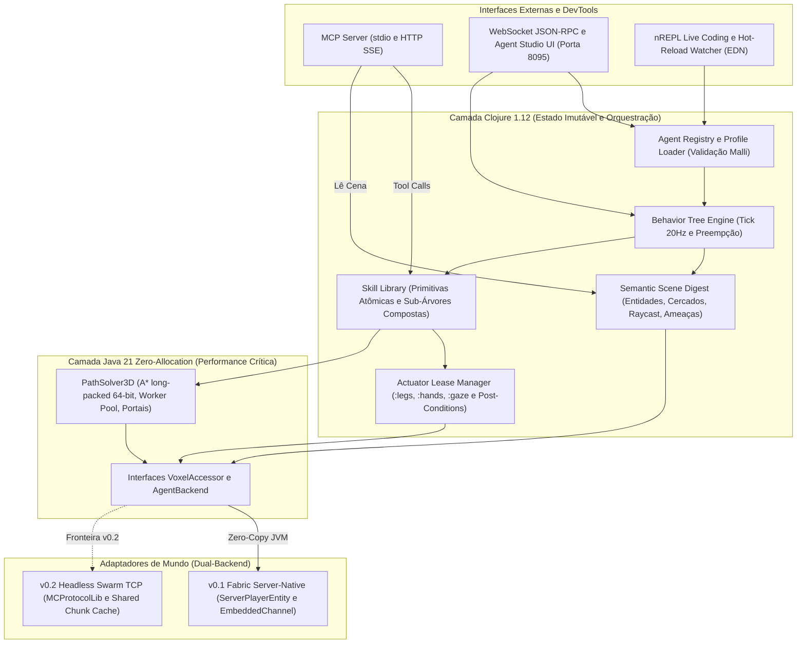
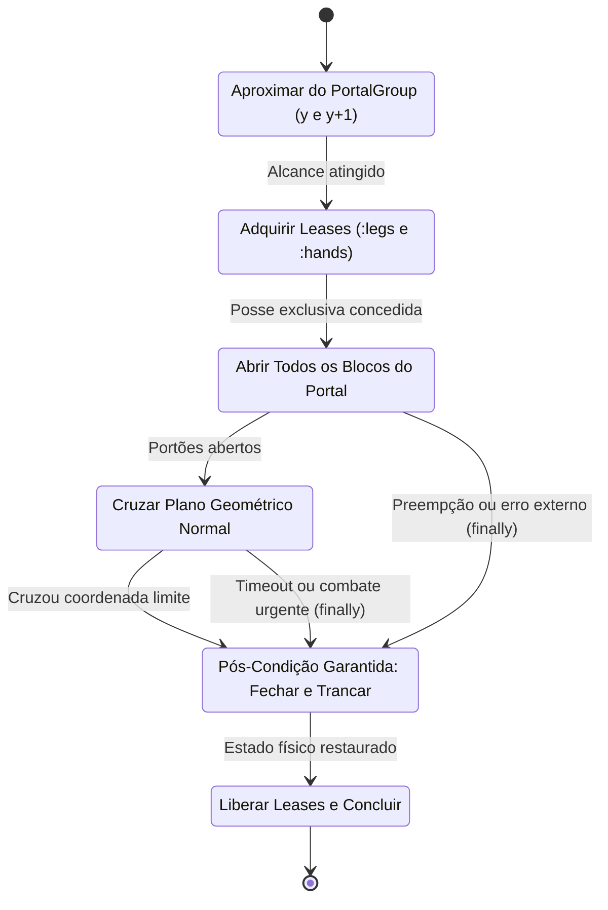
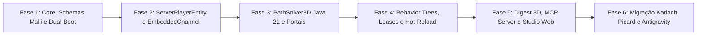

# Especificação de Arquitetura & Plano de Implementação: `craft-agents`

Documento consolidado com todas as decisões de design fechadas para o **`craft-agents`** (`/home/pace/dev/minecraft/craft-agents`, Licença **MIT**) — motor de agentes autônomos, NPCs vivos e IA incorporada projetado para substituir e superar o Mineflayer.

---

## 1. Resumo das Decisões Arquiteturais Consolidadas

| Eixo de Design | Decisão Fechada | Benefício Direto sobre o Mineflayer |
| :--- | :--- | :--- |
| **Identidade & Licença** | `/home/pace/dev/minecraft/craft-agents` (**MIT**) | Produto independente em sinergia com o [craft-repl](file:///home/pace/dev/minecraft/craft-repl/README.md). |
| **Arquitetura de Transporte** | **Dual-Backend (`AgentBackend` + `VoxelAccessor`)** | `v0.1` usa Backend Server-Native JVM; `v0.2` adiciona Backend Cliente Headless TCP (`MCProtocolLib` + Virtual Threads). |
| **Stack do Núcleo** | **Clojure 1.12 + Java 21/25** | Clojure para estado imutável, Behavior Trees, Malli e MCP; Java 21 primitivo zero-allocation para A\* 3D e ponte Netty/Fabric. |
| **Entidade no Servidor (`v0.1`)** | **`ServerPlayerEntity` + Netty `EmbeddedChannel`** | Jogador 100% real para todos os mods (*JEG*, *Naturalist*, *FabricTailor*), `<500 KB` RAM/bot e zero serialização/desync de rede. |
| **Modo de Inicialização** | **Suporte Duplo (Zero-Install Attach + JAR `/mods`)** | Hot-inject ao vivo via `KnotClassLoader` (sem reiniciar servidor) durante dev e boot automático em produção. |
| **Cérebro & Concorrência** | **Behavior Trees em Dados (EDN/JSON + Malli) + Leases** | Posse atômica de `:legs`, `:hands` e `:gaze` + pós-condições `finally` garantidas (fim de estados presos como `sneak` infinito). |
| **Navegação Espacial 3D** | **A\* 3D Java 21 (`long` 64-bit) Off-Thread + Portais** | Roda fora da `ServerThread` (zero impacto no TPS), lê `VoxelShape` reais de mods e executa `abrir -> cruzar -> fechar` em portões simples/duplos. |
| **Integração IA & Externa** | **MCP Nativo + WebSocket RPC + Skills Evolutivas** | Controle poliglota (Python/Clojure/TS/LLMs), *Semantic Scene Digest* compacto e criação segura de novas sub-árvores sem `eval()`. |
| **Persistência** | **Perfis EDN/JSON (Hot-Reload) + Store Local EDN/JSONL** | Identidades, regiões/cercados e árvores versionáveis em Git + memórias e skills aprendidas salvas em disco leve. |
| **Observabilidade** | **Agent Studio Web Embutido + Debug Partículas In-Game** | Grafo da Behavior Tree ao vivo, monitor de leases, radar 2D da rota A\* e visualização opcional da rota dentro do jogo. |

---

## 2. Diagrama de Componentes (`craft-agents` v0.1 + Fronteira v0.2)



### 2.1 Máquina de Estados de Travessia Transacional de Portais (`traverse-portal`)



---

## 3. Estrutura do Repositório (`/home/pace/dev/minecraft/craft-agents`)

```text
/home/pace/dev/minecraft/craft-agents/
├── deps.edn                                  # Clojure 1.12, core.async, malli, data.json, http-kit, nrepl
├── Makefile                                  # compile-java, uberjar, attach, test, studio
├── README.md                                 # Documentação técnica e guia MCP / Behavior Trees
├── LICENSE                                   # MIT
├── agents/                                   # Perfis declarativos Git-friendly (Hot-Reload)
│   ├── regions/
│   │   └── sanctuary.edn                     # Definição semântica dos cercados e portões duplos
│   ├── skills/                               # Biblioteca evolutiva de sub-árvores (Voyager-style seguro)
│   ├── karlach.edn                           # Perfil, skin, loadout e Behavior Tree da Karlach
│   ├── picard.edn                            # Perfil, skin e rotina do Capitão Picard
│   └── antigravity.edn                       # Perfil de escolta, armas JEG e combate tático
├── state/                                    # Snapshots leves em disco (memória episódica / JSONL)
├── src/
│   ├── java/com/craft/agents/
│   │   ├── attach/                           # CraftAgentsAgent.java & Injector.java (KnotClassLoader + Mod Entrypoint)
│   │   ├── api/                              # VoxelAccessor.java, PortalGroup.java, PathResult.java
│   │   ├── nav/                              # PackedPos.java, PrimitiveMinHeap.java, PathSolver3D.java
│   │   └── fabric/                           # FakeNettyChannel.java, SyntheticPlayerFactory.java, FabricWorldAdapter.java
│   └── clj/craft/agents/
│       ├── core.clj                          # Ciclo de vida do motor, ServerTick hook (20Hz) e bootstrap
│       ├── schemas.clj                       # Contratos Malli (Nodes BT, Skills, Perfis, Leases, MCP)
│       ├── backend/
│       │   ├── protocol.clj                  # Protocolos Clojure desacoplados do transporte
│       │   └── fabric.clj                    # Ponte thread-safe para ServerPlayerEntity & VoxelShape
│       ├── leases.clj                        # Arbitragem transacional (:legs, :hands, :gaze) + cleanup/post-conditions
│       ├── nav.clj                           # Orquestrador assíncrono do PathSolver3D + travessia atômica de portais
│       ├── perception.clj                    # Geração do Semantic Scene Digest p/ BTs e LLMs
│       ├── bt/
│       │   ├── engine.clj                    # Avaliador funcional puro (:selector, :sequence, :parallel, :guard, :action)
│       │   └── builtins.clj                  # Ações nativas (move-to, traverse-portal, feed-animals, escort, attack-ranged)
│       ├── store.clj                         # Watcher de hot-reload EDN + persistência atômica de memória/skills
│       ├── mcp/
│       │   └── server.clj                    # Servidor MCP (JSON-RPC 2.0 stdio/SSE) + validação de composição de Skills
│       └── studio/
│           └── server.clj                    # Servidor WebSocket + UI Web leve (BT Live Graph, A* Radar, Debug Particles)
├── resources/
│   ├── fabric.mod.json                       # Permite rodar também como JAR direto em /mods!
│   └── public/                               # Frontend enxuto (ES Modules + Canvas 2D) do Agent Studio
└── test/craft/agents/                        # Testes unitários e generativos (test.check) do A*, Leases e BT
```

---

## 4. Plano de Execução por Fases (MVP `v0.1`)



> [!IMPORTANT]
> **Meta de Aceite do MVP `v0.1`:** Aposentar `mc-karlach.service`, `mc-picard.service` e `mc-npc.service` (Node.js/Mineflayer), rodando **Karlach**, **Picard** e **Antigravity** dentro do `craft-agents` com consumo `< 2 MB` totais para os 3 bots, zero erros de pacote com armas *JEG*, e travessia perfeita (abrir -> entrar -> alimentar animais *Naturalist* -> sair -> trancar) nos cercados de portão duplo.

### Fase 1: Fundação do Projeto, Contratos Malli & Dual-Boot (Attach + Fabric Mod)
1. Inicializar `/home/pace/dev/minecraft/craft-agents` com `deps.edn`, `Makefile` e schemas Malli em `craft.agents.schemas`.
2. Implementar `CraftAgentsAgent.java` (suportando tanto `agentmain` Zero-Install no `KnotClassLoader` quanto `ModInitializer` via `fabric.mod.json`) e o hook de tick seguro no `ServerThread`.
3. Definir os protocolos de fronteira Dual-Backend (`IAgentBackend`, `IVoxelWorld`) garantindo zero vazamento de classes Minecraft para fora do pacote `fabric`.

### Fase 2: Jogador Sintético In-Memory (`EmbeddedChannel` + `ServerPlayerEntity`)
1. Implementar `FakeNettyChannel.java` e `SyntheticPlayerFactory.java` (resolvendo nomes Intermediary/Mojmap dinamicamente no Fabric 1.21.1 como feito em [core.clj](file:///home/pace/dev/minecraft/craft-repl/src/clj/craft/core.clj)).
2. Suportar spawn persistente, aplicação de skin (*FabricTailor* / propriedades `GameProfile`), controle físico real por tick (`forward`, `strafe`, `jump`, `sprint`, `sneak`, `yaw`/`pitch`), inventário completo, uso de itens/blocos (`interactionManager`) e disparo/ataque com itens de mods (*JEG*).

### Fase 3: Motor Numérico `PathSolver3D` (Java 21 Zero-Allocation) + Portais Semânticos
1. Implementar `PackedPos.java` (codificação bit-a-bit `x, y, z` em `long`), `PrimitiveMinHeap.java` e `PathSolver3D.java` executando em pool de threads separado lendo snapshots seguros de `VoxelShape`.
2. Implementar detecção automática de **Portais Semânticos** (`PortalGroup`): agrupa portas duplas e portões empilhados verticalmente (`y` e `y+1`, corrigindo na raiz o bug do Mineflayer).
3. Implementar o executor transacional `traverse-portal` em `craft.agents.nav` + `craft.agents.leases`: abre todos os blocos do portal, atravessa verificando cruzamento do plano geométrico normal à passagem, e **garante no bloco de pós-condição** o fechamento completo ao sair.

### Fase 4: Engine de Behavior Trees (EDN), Leases de Atuadores & Persistência Hot-Reload
1. Construir `craft.agents.leases` impedindo matematicamente conflito de controle entre subsistemas (`:legs`, `:hands`, `:gaze`).
2. Construir `craft.agents.bt.engine` e `craft.agents.bt.builtins` com nós compostos, decoradores de cooldown/timeout e primitivas ricas (`patrol`, `enter-enclosure-and-care`, `escort-player`, `combat-engage`, `look-natural`).
3. Implementar `craft.agents.store` com file-watcher para *hot-reload* instantâneo ao editar `agents/*.edn` e gravação de estado/skills em `state/`.

### Fase 5: Percepção Semântica, Servidor MCP Nativo & Agent Studio Web
1. Construir `craft.agents.perception` gerando o *Semantic Scene Digest* (entidades com nomes reais dos registros Fabric, inclusive *Naturalist*, cercados próximos, inventário e linha de visão).
2. Expor `craft.agents.mcp.server` (listagem de tools, invocação de skills tipadas, consulta de cena e registro validado por Malli de novas sub-árvores compostas por IA).
3. Subir o **Agent Studio Web** (`porta 8095`) com visualização ao vivo da Behavior Tree de cada bot, posse de leases, radar 2D da rota A\* e toggle de partículas de debug dentro do jogo.

### Fase 6: Migração Real (Karlach, Picard e Antigravity) & Desligamento do Mineflayer
1. Declarar `agents/sanctuary.edn`, `agents/karlach.edn`, `agents/picard.edn` e `agents/antigravity.edn`.
2. Injetar o `craft-agents` ao vivo no servidor Minecraft em execução, validar Karlach alimentando animais e trancando os portões duplos, Picard em patrulha/diálogo e Antigravity em escolta/combate com *JEG*.
3. Desativar os serviços Node.js legados (`mc-karlach`, `mc-picard`, `mc-npc`), medir a queda de ~600 MB de RAM e rodar a suíte de testes automatizados.
