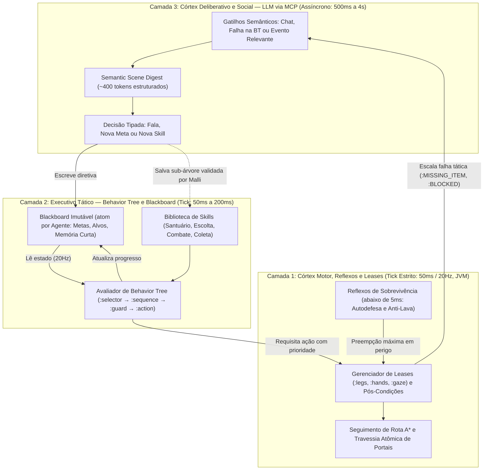
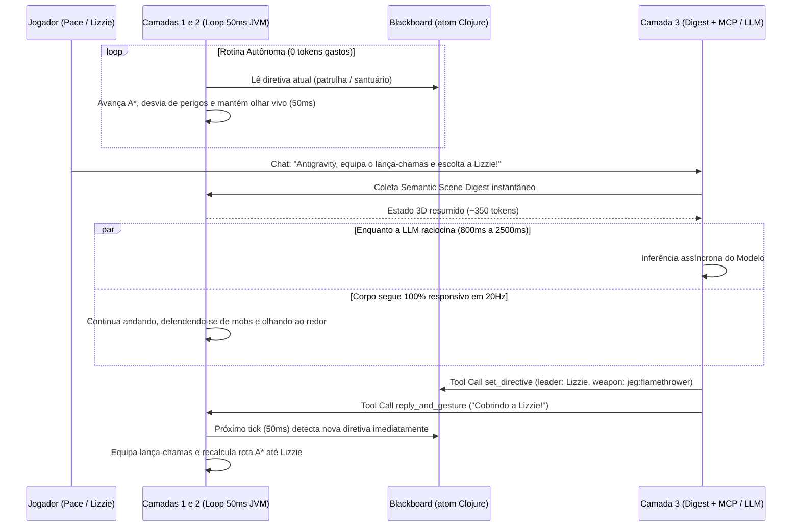
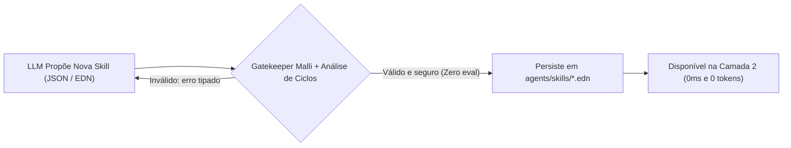

# Arquitetura Comportamental e o Papel da LLM no `craft-agents`

Este documento detalha como os agentes pensam, agem fisicamente e interagem com Modelos de Linguagem (LLMs) dentro do **`craft-agents`**, resolvendo os dois maiores defeitos dos frameworks atuais (*Voyager*, *Mindcraft* e scripts Mineflayer): **paralisia por latência de IA** e **execução insegura via `eval()`**.

---

## 1. O Problema Fundamental: Por que LLMs falham controlando bots diretamente?

O servidor do Minecraft roda a **20 Hz (`50ms` por tick)**. Uma chamada a uma LLM leva entre **400ms e 4.000ms** (de 8 a 80 ticks do jogo).

Quando projetos em cima do Mineflayer colocam a LLM diretamente no loop motor ou pedem para ela gerar JavaScript via `eval()`:
1. **Paralisia Tática:** Enquanto a LLM "pensa" por 2 segundos, o bot apanha de mobs sem reagir, cai em buracos ou passa reto de portas.
2. **Explosão de Custo e Tokens:** Se 10 NPCs consultarem uma LLM a cada 3 segundos só para decidir para onde andar, são **200 requisições por minuto** para tarefas triviais.
3. **Conflito de Estado Mutável:** Código gerado por LLM esquece de limpar flags (`sneak`, `sprint`, listeners de eventos), corrompendo o bot após poucos minutos.

---

## 2. A Solução: Arquitetura Cognitiva em 3 Camadas (System 0, System 1 e System 2)

Inspirada em robótica autônoma moderna (*Subsumption Architecture* + *Dual-Process Theory*), o `craft-agents` divide o cérebro de cada agente em **três escalas de tempo desacopladas**:



### 2.1 Linha do Tempo Real: Como o Bot Nunca Congela Enquanto a LLM Pensa



---

### Camada 1: Córtex Motor, Reflexos e Leases (`System 0` — `50ms`, Zero LLM)
Roda sincronizado aos 20 ticks por segundo do servidor em Clojure/Java:
- **Arbitragem Estrita por *Leases*:** Os recursos físicos do corpo são divididos em 3 canais independentes com posse exclusiva:
  - `:legs` (andar, correr, pular, agachar, seguir caminho A\*)
  - `:hands` (equipar item, abrir portão, alimentar animal, atirar com arma *JEG*, minerar)
  - `:gaze` (para onde a cabeça/olhos apontam)
  - *Por que separar os 3?* Porque permite que o bot **caminhe na patrulha (`:legs`) enquanto olha nos olhos de um jogador que passa ao lado (`:gaze`) e acena com a mão (`:hands`)**, sem um sistema sobrescrever o outro!
- **Garantias Transacionais (`Post-Conditions`):** Toda ação que altera o ambiente (ex: abrir os 2 blocos de um portão duplo ou agachar para colocar bloco) registra um *compensator* (`finally`). Se o bot for interrompido no meio por um ataque ou nova ordem, o motor **garante o reset de postura e o fechamento do portão**.
- **Autonomia Sem IA:** Se o provedor de LLM estiver desligado ou sem internet, o bot **continua 100% vivo, funcional, patrulhando e lutando**.

---

### Camada 2: Executivo Tático — Behavior Trees em Dados Puros + Blackboard (`System 1` — Zero Tokens)
É aqui que vivem a personalidade prática e a rotina de cada agente, descritas como estruturas de dados EDN imutáveis:

```clojure
;; Exemplo real simplificado de Behavior Tree em EDN (agents/karlach.edn)
{:agent/id :karlach
 :agent/role "Guardiã do Santuário"
 :bt/root
 [:selector
  ;; Prioridade 1: Autodefesa imediata se houver hostil perto do santuário
  [:sequence
   [:guard :hostile-nearby? {:radius 12}]
   [:action :engage-threat {:weapon "minecraft:netherite_axe" :priority 100}]]

  ;; Prioridade 2: Ordem ativa vinda de conversa/LLM no Blackboard
  [:sequence
   [:guard :has-active-directive?]
   [:action :run-blackboard-directive]]

  ;; Prioridade 3: Rotina autônoma de cuidado dos cercados (0 chamadas de LLM!)
  [:sequence
   [:cooldown {:seconds 45}
    [:action :care-for-enclosure
     {:enclosures [:pen-north-east :pen-south-east :pen-south-west :pen-north-west]
      :food-item  "minecraft:apple"
      :max-feed   2}]]]

  ;; Prioridade 4: Vida social passiva (olha para jogadores próximos, patrulha corredor)
  [:parallel
   [:action :patrol-waypoints {:route :sanctuary-corridor}]
   [:action :social-gaze {:radius 8}]]]}
```

**O que é o Blackboard?**
É um mapa imutável (`atom` Clojure) exclusivo de cada agente contendo seu estado mental de curto prazo:
```clojure
{:current-directive {:type :escort :leader "Pace" :stance :protective :expires-at 1793459200}
 :combat/threat-id  nil
 :social/last-speaker "Lizzie"
 :memory/recent-events [{:tick 12040 :event :fed-animal :entity "naturalist:capybara" :pen :pen-1}]}
```
Repare como as camadas conversam sem travar uma à outra: **a Behavior Tree lê o Blackboard a 20 Hz; a LLM escreve novas diretivas no Blackboard de forma assíncrona quando termina de pensar!**

---

### Camada 3: Córtex Deliberativo — O Papel Exato da LLM (`System 2` — *Event-Driven*)

No `craft-agents`, a LLM **não é o motorista mexendo no volante a cada 50ms; ela é o Comandante / Roteirista sentado no banco do navegador**.

#### A. Quando a LLM é chamada? (Apenas sob Gatilhos Semânticos)
1. **Diálogo e Comandos de Jogadores:** Alguém fala no chat ou por voz perto do bot (*"Antigravity, cobre a Lizzie enquanto eu busco munição lá em cima"*).
2. **Escalonamento de Falha Tática (*Exception Escalation*):** A Behavior Tree tentou cumprir uma diretiva e falhou por um motivo não trivial (ex: `{:error :NO_AMMO_FOR_WEAPON, :weapon "jeg:assault_rifle"}` ou `{:error :ENCLOSURE_EMPTY, :pen :pen-2}`). O motor acorda a LLM passando a falha exata para ela replanejar!
3. **Eventos Notáveis do Mundo:** Um jogador morreu perto do bot, um boss spawnou, amanheceu, ou um animal fugiu da área delimitada do santuário.

#### B. O que a LLM recebe? (*Semantic Scene Digest*)
Em vez de despejar milhares de coordenadas brutas, `craft.agents.perception` sintetiza uma fotografia semântica limpa (~300 a 500 tokens):

```edn
{:self {:name "Antigravity"
        :pos [-165.4 65.0 180.2]
        :health 20.0
        :equipped {:mainhand "jeg:assault_rifle" :armor :full-netherite}
        :active-task [:escort {:leader "Pace"}]}
 :environment {:region :sanctuary-corridor
               :time :night
               :nearby-portals [{:id :pen-north-east :type :double-fence-gate :open? false :dist 4.2}]}
 :entities {:players [{:name "Pace" :dist 3.1 :health 18.0 :looking-at :self}
                      {:name "Lizzie" :dist 9.4 :health 20.0}]
            :hostiles [{:type "minecraft:ravager" :dist 14.5 :line-of-sight? true}]
            :animals-summary {"naturalist:capybara" 4 "minecraft:wolf" 2}}
 :trigger {:type :player-chat
           :speaker "Pace"
           :message "Antigravity, protege a Lizzie e troca pro lança-chamas!"}}
```

#### C. O que a LLM pode fazer em resposta? (4 Ferramentas MCP Estruturadas)
A LLM **nunca retorna código JS/Clojure solto**. Ela chama ferramentas validadas por **Malli / JSON Schema**:

1. **`reply_and_gesture`**: Responde no chat com a personalidade do personagem e dispara gestos (`swing-arm`, `nod`, `look-at`) enquanto o corpo continua agindo normalmente.
2. **`set_directive`**: Atualiza a meta ativa no Blackboard (ex: `{:type :escort, :leader "Lizzie", :loadout "jeg:flamethrower"}`). No próximo tick de `50ms`, a Behavior Tree já troca a arma e corre até a Lizzie!
3. **`run_task_sequence`**: Dispara uma sequência pontual de skills parametrizadas (`[{:skill :move-to :target [-170 65 175]} {:skill :open-container} {:skill :take-item :id "minecraft:apple" :count 16}]`).
4. **`compose_and_save_skill` (Evolução Estilo *Voyager* Sem Risco):**
   Se o agente descobrir como resolver uma tarefa nova combinando nós primitivos de Behavior Tree, ele envia a árvore como JSON/EDN. O motor valida no Malli:
   - Todos os nós existem?
   - Todos os parâmetros têm tipos e limites válidos?
   - Existe risco de loop sem guarda/timeout?
   Se aprovado, salva em `agents/skills/<nome>.edn`. **O agente acabou de aprender uma habilidade permanente que nas próximas vezes rodará a 0ms e 0 tokens na Camada 2!**



---

## 3. Dois Modos de Uso do Mesmo Motor no Mercado

Essa separação em 3 camadas faz o `craft-agents` atender os dois maiores públicos do mercado sem mudar a arquitetura:

1. **Modo "NPC de Jogo / Servidor Modded" (95% Camadas 1 e 2 + 5% LLM sob demanda):**
   - Ideal para **Karlach**, **Picard** e **Antigravity** no seu servidor: consumo zero de API de IA enquanto patrulham, cuidam dos bichos e lutam; respostas inteligentes e obediência a comandos complexos quando você conversa com eles (podendo inclusive usar seu `small-router` para rotear entre modelos rápidos/locais e modelos fortes).
2. **Modo "Agente Autônomo de Pesquisa / Benchmark IA" (Controle Externo via MCP):**
   - Um pesquisador em Python/Claude/Gemini conecta um cliente MCP na porta do `craft-agents` e usa o Minecraft como ambiente 3D de raciocínio contínuo, recebendo *Semantic Scene Digests* prontos e invocando skills determinísticas sem nunca tocar em JavaScript ou `JSPyBridge`.
