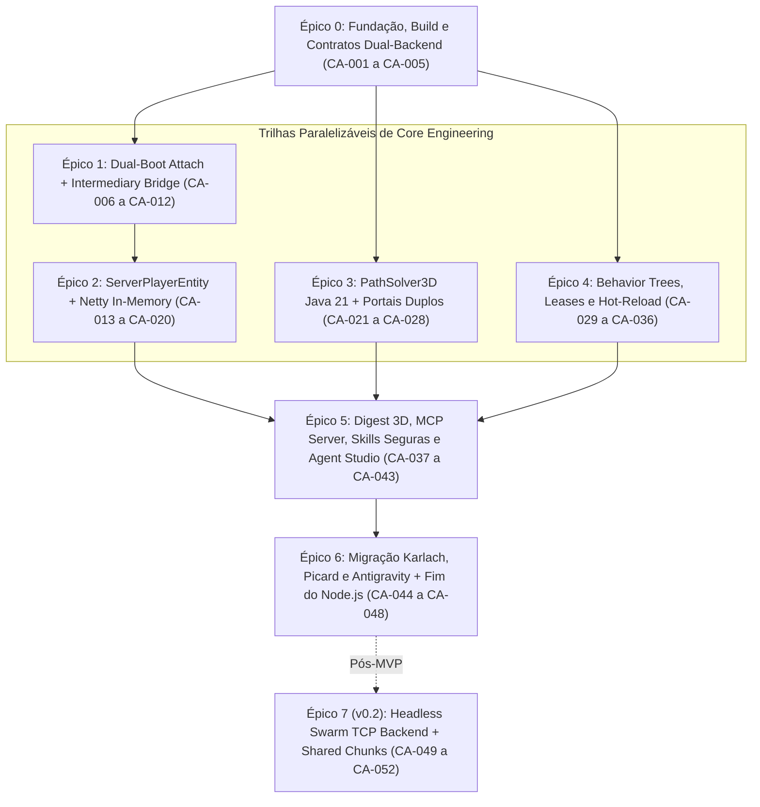

# Backlog Detalhado de Implementação — `craft-agents` (`v0.1` MVP & Horizonte `v0.2`)

Este documento transforma a arquitetura do **`craft-agents`** em um backlog de engenharia executável, rastreável por IDs (`CA-001` a `CA-052`), com dependências explícitas, trilhas paralelizáveis, mapeamentos técnicos do Fabric 1.21.1 e critérios objetivos de aceite (*Definition of Done - DoD*).

---

## 1. Grafo de Dependências e Trilhas Paralelas (DAG de Execução)

Após concluir o **Épico 0** (Contratos e Schemas), o projeto se abre em **três trilhas independentes** que podem ser desenvolvidas e testadas simultaneamente antes da convergência nos Épicos 5 e 6:

---

## 2. Convenções de Engenharia e Critérios Globais de Qualidade

- **Regra de Ouro de Thread-Safety:** Nenhuma mutação de `ServerWorld`, `ServerPlayerEntity` ou inventário pode ocorrer fora da `ServerThread`. Leituras pesadas (como `PathSolver3D`) operam exclusivamente sobre snapshots imutáveis de seções de chunk.
- **Zero Vazamento de Domínio:** Classes `net.minecraft.*` (ou `class_*` Intermediary) são estritamente proibidas fora de `com.craft.agents.fabric.*` e `craft.agents.backend.fabric`.
- **Orçamento de Performance (`v0.1`):**
  - Memória marginal por agente Server-Native: **`< 500 KB`**.
  - Impacto na `ServerThread` com 10 agentes ativos: **`< 1.0 ms` por tick** (mantendo `20.0 TPS` cravados).
  - Alocação de objetos no loop interno do `PathSolver3D`: **Zero objetos por nó expandido** (uso exclusivo de arrays primitivos `long[]`, `int[]`, `float[]`).

---

## 3. Backlog Detalhado por Épicos

### Épico 0 — Fundação do Repositório, Build Híbrido & Contratos (`CA-001` a `CA-005`)

- [ ] **`CA-001` — Estruturação do Repositório, `deps.edn`, `mise.toml` e `Makefile`**
  - **Arquivos:** `deps.edn`, `Makefile`, `mise.toml`, `.gitignore`, `LICENSE`, `README.md`
  - **Escopo:** Configurar Clojure 1.12, Java 21/25, aliases `:dev`, `:test` (`test.check`), `:build` (compilação `javac` com `--release 21` gerando classes em `target/classes`), empacotamento de Uberjar/Agent JAR e alvos `make compile-java`, `make test`, `make jar`, `make attach`.
  - **Bloqueado por:** Nenhum.
  - **DoD:** `make compile-java && make test` executa limpo em `< 10s` retornando código `0`.

- [ ] **`CA-002` — Interfaces Java de Fronteira Dual-Backend (`com.craft.agents.api`)**
  - **Arquivos:** `src/java/com/craft/agents/api/VoxelAccessor.java`, `CollisionType.java`, `PortalGroup.java`, `PathNodeStep.java`, `PathResult.java`
  - **Escopo:** Definir contratos Java puros sem dependências externas para consulta rápida de voxels: `int getCollisionMask(int x, int y, int z)`, `double getFloorHeight(int x, int y, int z)`, `PortalGroup getPortalAt(int x, int y, int z)` e `boolean isHazard(int x, int y, int z)` (lava, fogo, cacto, void).
  - **Bloqueado por:** `CA-001`.
  - **DoD:** Interfaces compilam isoladamente sem classpath do Minecraft.

- [ ] **`CA-003` — Protocolos Clojure de Backend (`craft.agents.backend.protocol`)**
  - **Arquivos:** `src/clj/craft/agents/backend/protocol.clj`
  - **Escopo:** Definir protocolos `IWorldBackend` (spawn/despawn de agente, snapshot de mundo para pathfinding, raycast semântico, consulta de entidades/blocos na vizinhança) e `IAgentBody` (aplicar controles motores por tick, olhar, usar item/bloco, atacar, equipar slot, falar no chat, ler inventário/saúde).
  - **Bloqueado por:** `CA-002`.
  - **DoD:** Implementação de `MockWorldBackend` em memória permite instanciar e mover um agente virtual em testes unitários sem servidor Minecraft.

- [ ] **`CA-004` — Catálogo Central de Schemas Malli (`craft.agents.schemas`)**
  - **Arquivos:** `src/clj/craft/agents/schemas.clj`, `test/craft/agents/schemas_test.clj`
  - **Escopo:** Modelar schemas estritos para: `Coord3D`, `PortalSpec`, `RegionProfile` (cercados/áreas), `LeaseChannel` (`:legs`, `:hands`, `:gaze`), `BTNode` recursivo (`:selector`, `:sequence`, `:parallel`, `:cooldown`, `:timeout`, `:guard`, `:action`), `AgentProfile`, `SceneDigest` e payloads MCP.
  - **Bloqueado por:** `CA-001`.
  - **DoD:** Testes generativos validam serialização/desserialização EDN ↔ JSON e geram JSON Schema válido automaticamente via `malli.json-schema`.

- [ ] **`CA-005` — Barramento Interno de Eventos e Ciclo de Tick (`craft.agents.events`)**
  - **Arquivos:** `src/clj/craft/agents/events.clj`
  - **Escopo:** Criar pub/sub leve e não-bloqueante sobre `core.async` (com `dropping-buffer` / `sliding-buffer` para evitar *backpressure* na `ServerThread`) para eventos `:tick`, `:chat`, `:entity-hurt`, `:agent-stuck`, `:task-failed` e `:profile-reloaded`.
  - **Bloqueado por:** `CA-001`.
  - **DoD:** Publicar 10.000 eventos em rajada não bloqueia a thread produtora (`< 2ms` total).

---

### Épico 1 — Dual-Boot (Zero-Install Attach + Mod Fabric) & Ponte Intermediary (`CA-006` a `CA-012`)

- [ ] **`CA-006` — Tabela e Resolvedor `MethodHandle` para Fabric 1.21.1 (`IntermediaryResolver.java`)**
  - **Arquivos:** `src/java/com/craft/agents/fabric/IntermediaryResolver.java`
  - **Escopo:** Resolver uma única vez no boot (cacheando `MethodHandle` de custo quase zero no JIT) tanto nomes Mojmap/Yarn (ambiente dev) quanto nomes **Intermediary** (produção `fabric-server-launcher.jar`), cobrindo `MinecraftServer` (`class_1132`), `PlayerManager` (`class_3324`), `ServerWorld` (`class_3218`), `ServerPlayerEntity` (`class_3222`), `ClientConnection` (`class_2535`), `ConnectedClientData` (`class_8588`), `BlockPos` (`class_2338`), `BlockState` (`class_2680`) e `Registries` (`class_7923`).
  - **Bloqueado por:** `CA-001`.
  - **DoD:** Utilitário de diagnóstico lista `100%` dos handles resolvidos sem reflexão repetida em runtime.

- [ ] **`CA-007` — Agente JVM Zero-Install (`CraftAgentsBootstrap.java` & `AttachCli.java`)**
  - **Arquivos:** `src/java/com/craft/agents/attach/CraftAgentsBootstrap.java`, `AttachCli.java`
  - **Escopo:** Implementar `agentmain` capaz de localizar o `KnotClassLoader` ativo, injetar dependências Clojure/Java de forma idempotente (convivendo pacificamente caso o `craft-repl` já esteja anexado no mesmo PID!) e iniciar o runtime `craft.agents.core/start!`.
  - **Bloqueado por:** `CA-001`, `CA-006`.
  - **DoD:** `make attach` injeta o motor no servidor ativo sem restart e suporta re-attach limpo (`reload!`) sem duplicar ticks.

- [ ] **`CA-008` — Entrypoint Nativo de Mod Fabric (`fabric.mod.json` + `FabricModInit.java`)**
  - **Arquivos:** `resources/fabric.mod.json`, `src/java/com/craft/agents/fabric/FabricModInit.java`
  - **Escopo:** Permitir que o mesmo JAR, se colocado em `/home/pace/minecraft-server/mods/`, inicialize automaticamente no evento `SERVER_STARTED` e desligue limpamente em `SERVER_STOPPING`.
  - **Bloqueado por:** `CA-007`.
  - **DoD:** Manifesto válido reconhecido pelo `FabricLoader` sem conflitar com o modo Attach.

- [ ] **`CA-009` — Executor `ServerThread` Determinístico e Hook de 20 Hz (`craft.agents.core`)**
  - **Arquivos:** `src/clj/craft/agents/core.clj`
  - **Escopo:** Registrar listener no `ServerTickEvents.END_SERVER_TICK` (ou fila de tick com `AtomicBoolean` de desligamento p/ hot-reload) medindo tempo gasto por tick em microssegundos (`telemetry/tick-duration-us`) e expondo macro `in-server-thread` com retorno via `CompletableFuture`.
  - **Bloqueado por:** `CA-007`.
  - **DoD:** Hook roda exatamente a 20 Hz, pode ser pausado/substituído via REPL sem vazar listeners e registra métricas de duração.

- [ ] **`CA-010` — Leitor de Registros Reais de Mods (`FabricRegistryInspector.java`)**
  - **Arquivos:** `src/java/com/craft/agents/fabric/FabricRegistryInspector.java`
  - **Escopo:** Consultar diretamente `Registries.ENTITY_TYPE`, `Registries.ITEM` e `Registries.BLOCK` do servidor para traduzir qualquer instância modded (`naturalist:capybara`, `jeg:assault_rifle`, `another_furniture:*`) em identificadores namespaceados exatos, eliminando para sempre o `name: 'unknown'` do Mineflayer.
  - **Bloqueado por:** `CA-006`.
  - **DoD:** Consulta em runtime retorna IDs exatos para entidades do *Naturalist* e armas do *JEG*.

- [ ] **`CA-011` — Captura Nativa de Eventos de Chat e Dano no Servidor**
  - **Arquivos:** `src/java/com/craft/agents/fabric/FabricEventHooks.java`
  - **Escopo:** Escutar `ServerMessageEvents.CHAT_MESSAGE` (e comandos direcionados) além de `ServerLivingEntityEvents.AFTER_DAMAGE` da Fabric API, publicando eventos limpos no barramento `craft.agents.events`.
  - **Bloqueado por:** `CA-005`, `CA-009`.
  - **DoD:** Mensagem enviada por jogador no jogo chega ao barramento Clojure em `< 5ms` com autor, texto e coordenadas do falante.

- [ ] **`CA-012` — Gerenciamento Seguro de Lifecycle / Hot-Unload**
  - **Arquivos:** `src/clj/craft/agents/core.clj`
  - **Escopo:** Garantir que `(craft.agents.core/stop!)` remova todos os bots sintéticos do mundo, salve os snapshots de estado em disco, feche portas HTTP/MCP e desligue pools de threads sem deixar resíduos na JVM do Minecraft.
  - **Bloqueado por:** `CA-009`.
  - **DoD:** Ciclo `start! -> spawn 3 bots -> stop! -> start!` executa 5 vezes seguidas sem aumento residual de threads ou jogadores fantasmas.

---

### Épico 2 — `ServerPlayerEntity` Sintético In-Memory (`CA-013` a `CA-020`)

- [ ] **`CA-013` — Canal Netty Descartável em Memória (`SilentEmbeddedChannel.java`)**
  - **Arquivos:** `src/java/com/craft/agents/fabric/SilentEmbeddedChannel.java`
  - **Escopo:** Estender canal Netty in-memory acoplado a uma subclasse leve de `ClientConnection` (`NetworkSide.SERVERBOUND`) e `ServerPlayNetworkHandler` que consome/libera (`ReferenceCountUtil.release`) imediatamente qualquer pacote de saída sem comprimir nem serializar bytes, respondendo automaticamente a `KeepAlive` e `TeleportConfirm`.
  - **Bloqueado por:** `CA-006`.
  - **DoD:** Zero `ByteBuf` vazado (`LEAK: ByteBuf.release()`) com o detector de leaks do Netty em nível `PARANOID`.

- [ ] **`CA-014` — Fábrica de Jogadores Sintéticos (`SyntheticPlayerFactory.java`)**
  - **Arquivos:** `src/java/com/craft/agents/fabric/SyntheticPlayerFactory.java`
  - **Escopo:** Criar `GameProfile` com UUID determinístico offline (`UUID.nameUUIDFromBytes`), instanciar `ServerPlayerEntity`, registrar no `PlayerManager.onPlayerConnect` na coordenada/dimensão configurada e remover limpamente via `PlayerManager.remove`.
  - **Bloqueado por:** `CA-013`.
  - **DoD:** Bot aparece fisicamente no mundo para os jogadores reais (`Pace`, `Lizzie`), carrega hitbox normal e custa `< 500 KB` de heap.

- [ ] **`CA-015` — Integração de Skins Persistentes (*FabricTailor* / Signed Textures)**
  - **Arquivos:** `src/clj/craft/agents/backend/fabric_skins.clj`
  - **Escopo:** Aplicar texturas/assinaturas `textures` direto nas `PropertyMap` do `GameProfile` antes do `onPlayerConnect` (ou acionar API do `fabrictailor` instalado no servidor) a partir da configuração declarativa em `agents/*.edn`.
  - **Bloqueado por:** `CA-014`.
  - **DoD:** Karlach, Picard e Antigravity nascem imediatamente com suas skins customizadas visíveis para todos os clientes conectados.

- [ ] **`CA-016` — Motor Físico Server-Side por Tick (`SyntheticMotorController.java`)**
  - **Arquivos:** `src/java/com/craft/agents/fabric/SyntheticMotorController.java`
  - **Escopo:** No tick do servidor, alimentar `forwardSpeed`, `sidewaysSpeed`, `jumping`, `setSprinting`, `setSneaking`, `setYaw`, `setPitch`, `headYaw` e invocar `.playerTick()` / `.tickMovement()` oficial do `ServerPlayerEntity` para que gravidade, colisão, escadas, água e knockback usem 100% a física autoritativa da Mojang.
  - **Bloqueado por:** `CA-014`.
  - **DoD:** Bot caminha, corre, pula degraus de 1 bloco, nada na água e sofre gravidade real sem qualquer teleporte artificial.

- [ ] **`CA-017` — Manipulação de Blocos e Portas/Portões (`interactBlock` & `dig`)**
  - **Arquivos:** `src/java/com/craft/agents/fabric/SyntheticInteraction.java`
  - **Escopo:** Encapsular `serverPlayer.interactionManager.interactBlock(...)` (com `BlockHitResult` legítimo, mão correta e animação `swingHand` visível aos jogadores!) para abrir/fechar portas, portões e baús, além de mineração progressiva respeitando dureza/ferramenta.
  - **Bloqueado por:** `CA-014`.
  - **DoD:** Bot abre e fecha um portão duplo de carvalho com som, mudança real de `BlockState[open]` e animação do braço visível.

- [ ] **`CA-018` — Interação com Entidades e Alimentação de Animais (*Naturalist* & Vanilla)**
  - **Arquivos:** `src/java/com/craft/agents/fabric/SyntheticInteraction.java`
  - **Escopo:** Implementar `interactEntity` real (`player.interact(animal, Hand.MAIN_HAND)`) segurando o alimento apropriado (ou aplicando fallback de `InLove` + partículas quando o animal estiver em cooldown), fazendo animais seguirem a comida na mão e entrarem em modo reprodução.
  - **Bloqueado por:** `CA-010`, `CA-017`.
  - **DoD:** Animais Vanilla e *Naturalist* reagem à interação real do bot sem gambiarras HTTP externas.

- [ ] **`CA-019` — Combate Corpo-a-Corpo e Disparo Nativo de Armas de Mods (*JEG*)**
  - **Arquivos:** `src/java/com/craft/agents/fabric/SyntheticCombat.java`
  - **Escopo:** Suportar `player.attack(target)` com cooldown de ataque 1.9+ (`getAttackCooldownProgress`) **e** uso contínuo/gatilho de itens modded (`interactionManager.interactItem` / pacotes internos de disparo ou projéteis do *Just Enough Guns*), garantindo munição/recarga funcional.
  - **Bloqueado por:** `CA-014`, `CA-010`.
  - **DoD:** Antigravity segura `jeg:assault_rifle` ou `jeg:flamethrower`, engaja um `Ravager` de teste sem causar erros de rede nos clientes próximos e elimina o alvo.

- [ ] **`CA-020` — Gestão Completa de Inventário, Equipamento e Containers**
  - **Arquivos:** `src/clj/craft/agents/backend/fabric.clj`
  - **Escopo:** Implementar leitura imutável em EDN dos 36 slots + armadura + offhand, troca rápida de item na mão (`selectedSlot` / swap de inventário), coleta automática de itens no chão (`pickup`) e transferência atômica com baús (`LootableContainerBlockEntity`).
  - **Bloqueado por:** `CA-014`.
  - **DoD:** Bot retira maçãs de um baú real, equipa na mão principal e guarda sobras de volta com consistência de itens `100%` preservada.

---

### Épico 3 — `PathSolver3D` (Java 21 Zero-Allocation) + Portais Semânticos (`CA-021` a `CA-028`)

- [ ] **`CA-021` — Estruturas Primitivas Sem Alocação (`PackedPos.java`, `Long2IntOpenHashMap.java`, `PrimitiveMinHeap.java`)**
  - **Arquivos:** `src/java/com/craft/agents/nav/PackedPos.java`, `PrimitiveMinHeap.java`, `LongHashSet.java`
  - **Escopo:** Codificar `(x: 26b, z: 26b, y: 12b)` em um único `long` de 64 bits (mesmo layout interno do `BlockPos.asLong`), implementar fila de prioridade binária (`fCost = g + h`) e tabela hash aberta sobre arrays `long[]`/`float[]` reutilizáveis por thread (`ThreadLocal<SolverBuffers>`).
  - **Bloqueado por:** `CA-002`.
  - **DoD:** Benchmark unitário expande `100.000` nós em `< 25ms` com `0 bytes` alocados no heap após warm-up.

- [ ] **`CA-022` — Snapshot Imutável de Seções de Chunk (`ChunkSnapshotVoxelAccessor.java`)**
  - **Arquivos:** `src/java/com/craft/agents/fabric/ChunkSnapshotVoxelAccessor.java`
  - **Escopo:** Na `ServerThread`, capturar em `< 0.2ms` referências seguras às `ChunkSection` (`PalettedContainer<BlockState>`) num raio de chunks ao redor do bot, permitindo que Worker Threads consultem `VoxelShape`, altura real de degraus/tapetes/cercas (`maxY` da caixa AABB) e perigos (lava/fogo/cacto) **100% fora da `ServerThread`**.
  - **Bloqueado por:** `CA-002`, `CA-006`.
  - **DoD:** 8 threads paralelas calculando rotas simultâneas nunca lançam `ConcurrentModificationException` nem tocam no `ServerWorld` mutável.

- [ ] **`CA-023` — Detector de Portais Semânticos (`PortalDetector.java`)**
  - **Arquivos:** `src/java/com/craft/agents/nav/PortalDetector.java`
  - **Escopo:** Identificar portas de madeira, alçapões passáveis, portões simples e **portões duplos/triplos empilhados verticalmente (`y`, `y+1`)** ou emparelhados lateralmente, diferenciando portas destrancáveis pelo bot de portas de ferro sem botão/alavanca (`locked`).
  - **Bloqueado por:** `CA-002`.
  - **DoD:** Testes unitários detectam corretamente o cercado de portão duplo (`y=65` + `y=66`) como `PortalGroup` transitável (corrigindo na raiz a falha do `mineflayer-pathfinder`).

- [ ] **`CA-024` — Operadores Geométricos 3D e Solver A\* Completo (`PathSolver3D.java`)**
  - **Arquivos:** `src/java/com/craft/agents/nav/PathSolver3D.java`, `MovementCosts.java`
  - **Escopo:** Implementar movimentos cardinais, diagonais sem quina bloqueada (*corner-cutting check*), subida de degrau/pulo (`<= 1.25` de delta real de `VoxelShape`), descida segura até `maxFallDistance` (padrão `3`), natação, escadas, parkour opcional de 1–2 blocos e travessia de `PortalGroup`, com objetivos flexíveis (`ExactBlock`, `NearRadius`, `AdjacentInteract`, `LineOfSight`, `FleeRadius`).
  - **Bloqueado por:** `CA-021`, `CA-023`.
  - **DoD:** Suíte de labirintos 3D (escadas em espiral, cercas com portão duplo, meios-blocos, fosso de lava) atinge `100%` de acerto nos testes automatizados.

- [ ] **`CA-025` — Suavização de Caminho (*String-Pulling*) e Pool Assíncrono (`craft.agents.nav`)**
  - **Arquivos:** `src/clj/craft/agents/nav.clj`
  - **Escopo:** Executar `PathSolver3D` num `ExecutorService` dedicado, aplicar *line-of-sight string pulling* em trechos planos livres de obstáculos/portais para movimentos naturais fluidos (sem andar igual robô em zigue-zague ortogonal) e entregar `CompletableFuture<PathResult>`.
  - **Bloqueado por:** `CA-024`.
  - **DoD:** Rota diagonal em campo aberto gera linha suave direta sem colidir em quinas.

- [ ] **`CA-026` — Seguidor Físico de Rota e Detecção Inteligente de *Stuck***
  - **Arquivos:** `src/clj/craft/agents/nav_follower.clj`
  - **Escopo:** Guiar o agente nó a nó usando vetores contínuos de velocidade/olhar (sem o "cheat" de teleporte de `0.2` blocos do Mineflayer), ajustando sprint/caminhada conforme proximidade de curvas/portais e disparando replanejamento imediato se um bloco mudar na frente da rota ou se o progresso real travar por `> 1.5s`.
  - **Bloqueado por:** `CA-016`, `CA-025`.
  - **DoD:** Bot percorre percurso de 80 blocos com obstáculos dinâmicos colocados na frente dele em tempo real, desviando suavemente.

- [ ] **`CA-027` — Executor Transacional `traverse-portal` (Abrir → Cruzar Plano → Fechar)**
  - **Arquivos:** `src/clj/craft/agents/nav_portals.clj`, `test/craft/agents/nav_portals_test.clj`
  - **Escopo:** Implementar a máquina de estados formal da Seção 2.1: aproximar, adquirir leases `:legs` + `:hands`, abrir **todos** os blocos do `PortalGroup` (`y=65` e `y=66`), caminhar até o produto escalar `(pos - portalCenter) · portalNormal > +0.85` confirmar que o corpo inteiro cruzou a passagem, e **executar como pós-condição garantida (`finally`)** o fechamento de todos os blocos do grupo.
  - **Bloqueado por:** `CA-017`, `CA-026`, `CA-029`.
  - **DoD:** Mesmo cancelando a tarefa ou simulando ataque hostil no meio da travessia, o portão duplo termina **sempre fechado** e o bot nunca fica preso na geometria do portão.

- [ ] **`CA-028` — Regiões Semânticas e Restrições de Área (`Exclusion / Sanctuary Zones`)**
  - **Arquivos:** `src/clj/craft/agents/regions.clj`
  - **Escopo:** Carregar polígonos/AABBs nomeados (`agents/regions/sanctuary.edn`) permitindo consultar instantaneamente *"em qual cercado esta entidade está?"* e aplicar custos extras ou proibições de rota por perfil de agente.
  - **Bloqueado por:** `CA-004`, `CA-024`.
  - **DoD:** Consulta espacial identifica corretamente os 4 cercados do santuário e seus respectivos `PortalGroup`s.

---

### Épico 4 — Behavior Trees, Leases de Atuadores & Persistência Hot-Reload (`CA-029` a `CA-036`)

- [ ] **`CA-029` — Gerenciador Transacional de Leases (`craft.agents.leases`)**
  - **Arquivos:** `src/clj/craft/agents/leases.clj`, `test/craft/agents/leases_test.clj`
  - **Escopo:** Arbitrar posse exclusiva por canal (`:legs`, `:hands`, `:gaze`) com níveis numéricos de prioridade. Quando um nó de prioridade superior (ex: `combate = 100`) toma o lease de um nó inferior (ex: `cuidar-cercado = 40`), invocar imediatamente o *compensator* (`on-preempt` / `finally`) do dono anterior (limpando `sneak`, `sprint` ou fechando portão) antes de entregar o controle.
  - **Bloqueado por:** `CA-004`.
  - **DoD:** Testes de propriedade (`test.check`) gerando sequências aleatórias de aquisições/preempções provam que **nunca** há dois donos simultâneos nem vazamento de estado motor.

- [ ] **`CA-030` — Blackboard Imutável por Agente (`craft.agents.blackboard`)**
  - **Arquivos:** `src/clj/craft/agents/blackboard.clj`
  - **Escopo:** Estruturar o estado cognitivo de cada agente em um `atom` com histórico circular leve das últimas `N` transições (para *time-travel inspection*), TTL automático para diretivas temporárias e notificações reativas.
  - **Bloqueado por:** `CA-004`.
  - **DoD:** Escritas concorrentes vindas do MCP/LLM e leituras de 20 Hz da BT ocorrem sem *locks* bloqueantes.

- [ ] **`CA-031` — Engine Funcional de Behavior Trees (`craft.agents.bt.engine`)**
  - **Arquivos:** `src/clj/craft/agents/bt/engine.clj`, `test/craft/agents/bt/engine_test.clj`
  - **Escopo:** Implementar avaliador puro retornando `{:status (:success | :failure | :running), :node-trace ...}` para nós `:selector`, `:sequence`, `:parallel`, `:invert`, `:cooldown`, `:timeout`, `:guard` e `:action`, rastreando exatamente qual caminho da árvore está ativo a cada tick para exibição ao vivo no Studio.
  - **Bloqueado por:** `CA-029`, `CA-030`.
  - **DoD:** Avaliação completa de uma árvore de 50 nós leva `< 0.05 ms` por agente.

- [ ] **`CA-032` — Camada 1 de Reflexos Autônomos (`craft.agents.reflexes`)**
  - **Arquivos:** `src/clj/craft/agents/reflexes.clj`
  - **Escopo:** Implementar reflexos de sobrevivência pré-BT (respirar se afogando, sair de lava/fogo imediato, auto-respawn limpo em caso de morte, retaliação/escudo de emergência se atacado de perto), desacoplados de qualquer LLM.
  - **Bloqueado por:** `CA-029`, `CA-016`.
  - **DoD:** Bot empurrado em fogo ou atacado por zumbi reage em `< 100ms` (1–2 ticks) mesmo com o módulo MCP desligado.

- [ ] **`CA-033` — Biblioteca de Skills Primitivas Built-in (`craft.agents.bt.builtins`)**
  - **Arquivos:** `src/clj/craft/agents/bt/builtins.clj`
  - **Escopo:** Implementar as skills fundamentais reutilizáveis:
    - `:move-to` / `:patrol-waypoints`
    - `:traverse-portal` / `:care-for-enclosure` (entrar no cercado, aproximar dos bichos sem agachar, alimentar com item e trancar na saída)
    - `:escort-player` (seguir líder com distância elástica, olhando natural e igualando furtividade apenas se configurado)
    - `:engage-hostiles` (combate melee ou ranged *JEG* com linha de visão)
    - `:withdraw-or-deposit-chest`, `:equip-item`, `:give-item-to-player`, `:social-gaze`, `:speak-and-gesture`.
  - **Bloqueado por:** `CA-027`, `CA-031`, `CA-018`, `CA-019`, `CA-020`.
  - **DoD:** Cada skill possui schema Malli de entrada/saída e retorna códigos de erro semânticos claros (`:NO_PATH`, `:MISSING_ITEM`, `:TARGET_LOST`).

- [ ] **`CA-034` — Carregador de Perfis e Watcher de Hot-Reload (`craft.agents.store`)**
  - **Arquivos:** `src/clj/craft/agents/store.clj`
  - **Escopo:** Monitorar `agents/**/*.edn` via `java.nio.file.WatchService`. Ao salvar um arquivo `.edn`, validar contra o Malli: se válido, atualizar a Behavior Tree/configuração do agente em tempo real sem desconectá-lo do mundo; se inválido, rejeitar mantendo a árvore anterior viva e registrar erro claro no log/Studio.
  - **Bloqueado por:** `CA-004`, `CA-031`.
  - **DoD:** Editar uma fala ou rota em `agents/karlach.edn` reflete no jogo em `< 300ms` sem piscar o bot.

- [ ] **`CA-035` — Persistência Atômica de Memória Episódica e Skills Aprendidas (`state/`)**
  - **Arquivos:** `src/clj/craft/agents/store.clj`
  - **Escopo:** Persistir em `state/<agent-id>.edn` e `state/events.jsonl` (com escrita atômica via arquivo temporário + `Files/move` `ATOMIC_MOVE`) as memórias relevantes, última tarefa e skills compostas em runtime.
  - **Bloqueado por:** `CA-034`.
  - **DoD:** Reiniciar o motor restaura memórias e skills aprendidas sem perda de dados.

---

### Épico 5 — Percepção 3D, Servidor MCP, Skills Evolutivas & Agent Studio (`CA-037` a `CA-043`)

- [ ] **`CA-036` — Gerador de *Semantic Scene Digest* (`craft.agents.perception`)**
  - **Arquivos:** `src/clj/craft/agents/perception.clj`, `test/craft/agents/perception_test.clj`
  - **Escopo:** Sintetizar percepção 3D enxuta (`~300–500 tokens`) combinando estado próprio, região atual, portais/cercados próximos, jogadores (distância, saúde, se estão olhando para o bot), hostis com *raycast* de linha de visão, contagem agrupada de animais/entidades modded e resumo de inventário/baús conhecidos.
  - **Bloqueado por:** `CA-010`, `CA-028`, `CA-030`.
  - **DoD:** Geração de um `SceneDigest` completo custa `< 0.5 ms` e produz EDN/JSON validado pelo Malli.

- [ ] **`CA-037` — Gatekeeper de Composição Segura de Skills (`craft.agents.skills.composer`)**
  - **Arquivos:** `src/clj/craft/agents/skills/composer.clj`, `test/craft/agents/skills/composer_test.clj`
  - **Escopo:** Implementar o validador estilo *Voyager Seguro* (`compose_and_save_skill`): verificar schema Malli, existência de todas as ações referenciadas, ausência de recursão cíclica infinita (DAG check de chamadas de sub-árvore) e presença obrigatória de limites/timeouts, gravando a nova skill em `agents/skills/<nome>.edn`.
  - **Bloqueado por:** `CA-004`, `CA-033`, `CA-034`.
  - **DoD:** Sub-árvores malformadas ou com ciclo recursivo A → B → A são bloqueadas em `100%` dos casos retornando diagnóstico legível para a LLM corrigir.

- [ ] **`CA-038` — Servidor MCP Oficial (`craft.agents.mcp.server`)**
  - **Arquivos:** `src/clj/craft/agents/mcp/server.clj`
  - **Escopo:** Implementar protocolo **MCP (JSON-RPC 2.0)** sobre HTTP/SSE (e bridge `stdio` via script wrapper leve para Claude Desktop / Cursor / Agentes Python), expondo Resources (`agent://list`, `agent://<id>/digest`, `agent://skills`) e Tools (`reply_and_gesture`, `set_directive`, `run_task_sequence`, `compose_and_save_skill`, `spawn_agent`).
  - **Bloqueado por:** `CA-036`, `CA-037`.
  - **DoD:** Qualquer cliente MCP padrão lista as tools com JSON Schema completo e comanda um bot no mundo sem escrever 1 linha de JS.

- [ ] **`CA-039` — Ponte Cognitiva Event-Driven (Gatilhos Chat/Falha → Router LLM Assíncrono)**
  - **Arquivos:** `src/clj/craft/agents/cognition.clj`
  - **Escopo:** Escutar gatilhos semânticos (`:player-chat` direcionado ao bot, `:task-failed` escalável) com *debounce* e *rate-limit* por agente, despachar o `SceneDigest` de forma assíncrona para o provedor LLM configurado (suportando endpoint OpenAI-compatible / `small-router` local ou CLI) e aplicar as chamadas de ferramentas retornadas no Blackboard.
  - **Bloqueado por:** `CA-011`, `CA-036`, `CA-038`.
  - **DoD:** Enquanto o modelo leva `2s` para responder uma ordem complexa no chat, o bot continua caminhando/lutando normalmente a 20 Hz e assume a nova diretiva assim que a resposta chega.

- [ ] **`CA-040` — Backend HTTP + WebSocket do Agent Studio (`craft.agents.studio.server`)**
  - **Arquivos:** `src/clj/craft/agents/studio/server.clj`
  - **Escopo:** Subir servidor `http-kit` na porta `8095` transmitindo via WebSocket (a 5–10 Hz para a UI) deltas compactos do estado de todos os agentes: coordenadas, nó ativo da BT, donos atuais dos leases `:legs/:hands/:gaze`, nós da rota A\*, Blackboard e log de chamadas MCP.
  - **Bloqueado por:** `CA-031`, `CA-025`, `CA-038`.
  - **DoD:** Streaming contínuo para o navegador com latência `< 20ms` e zero impacto no tick do jogo.

- [ ] **`CA-041` — Frontend Web do Agent Studio (`resources/public/`)**
  - **Arquivos:** `resources/public/index.html`, `resources/public/app.js`, `resources/public/style.css`
  - **Escopo:** Construir UI limpa e escura em ES Modules nativos (zero `node_modules` / zero bundler!) contendo:
    1. Seletor de agentes ativos + indicadores de saúde/equipamento/TPS;
    2. Visualizador em árvore da **Behavior Tree** destacando em verde o ramo ativo em tempo real;
    3. Painel de **Leases** (`:legs`, `:hands`, `:gaze`) + **Radar 2D em Canvas** desenhando cercados, entidades e a rota A\* calculada;
    4. Inspetor do *Semantic Scene Digest* e console para disparar diretivas/testar MCP ao vivo.
  - **Bloqueado por:** `CA-040`.
  - **DoD:** Abrir `http://localhost:8095` exibe em tempo real o cérebro, os leases e o radar de rota de todos os bots conectados.

- [ ] **`CA-042` — Visualizador Opcional de Rota In-Game (Partículas de Debug para Admin)**
  - **Arquivos:** `src/clj/craft/agents/studio/ingame_debug.clj`
  - **Escopo:** Quando ativado por toggle no Agent Studio ou REPL, enviar pacotes `ParticleS2CPacket` (`END_ROD` / `HAPPY_VILLAGER` para caminho e `FLAME` para portais) **exclusivamente para o jogador admin (`Pace`)**, desenhando a rota 3D do bot diretamente dentro do Minecraft sem poluir a tela dos outros jogadores.
  - **Bloqueado por:** `CA-025`, `CA-040`.
  - **DoD:** Ligar o toggle mostra a trilha 3D exata do A\* dentro do jogo apenas para `Pace`.

---

### Épico 6 — Migração em Produção ("Adeus Node.js") & Validação (`CA-043` a `CA-048`)

- [ ] **`CA-043` — Mapeamento Semântico do Santuário (`agents/regions/sanctuary.edn`)**
  - **Arquivos:** `agents/regions/sanctuary.edn`
  - **Escopo:** Declarar as coordenadas exatas do corredor central e dos 4 cercados de portões duplos (`[-171, 65, 171]`, `[-171, 65, 189]`, `[-179, 65, 189]`, `[-179, 65, 171]`), pontos seguros internos e baús de suprimentos.
  - **Bloqueado por:** `CA-028`.
  - **DoD:** Validação Malli aprovada e todos os 4 portões duplos reconhecidos pelo `PortalDetector`.

- [ ] **`CA-044` — Migração Completa da Karlach (`agents/karlach.edn`)**
  - **Arquivos:** `agents/karlach.edn`
  - **Escopo:** Configurar skin, equipamento, personalidade e Behavior Tree da **Karlach**: patrulha viva pelo santuário sem agachar aleatoriamente, entrada periódica nos 4 cercados abrindo os 2 níveis do portão, aproximação natural dos animais Vanilla e *Naturalist*, alimentação com corações/som, saída verificada pelo plano geométrico, trancamento garantido dos portões e conversa contextual.
  - **Bloqueado por:** `CA-033`, `CA-039`, `CA-043`.
  - **DoD:** 30 minutos contínuos cuidando dos 4 cercados com **zero animais fugindo** e **zero travamentos dentro das jaulas**.

- [ ] **`CA-045` — Migração Completa do Capitão Picard (`agents/picard.edn`)**
  - **Arquivos:** `agents/picard.edn`
  - **Escopo:** Configurar skin, rotina de comando/inspeção da base, cumprimento diplomático a jogadores próximos e respostas inteligentes via camada cognitiva.
  - **Bloqueado por:** `CA-033`, `CA-039`.
  - **DoD:** Picard patrulha pontos da base, desvia de obstáculos e interage com `Pace` e `Lizzie` com latência zero no movimento.

- [ ] **`CA-046` — Migração Completa do Companion Tático Antigravity (`agents/antigravity.edn`)**
  - **Arquivos:** `agents/antigravity.edn`
  - **Escopo:** Configurar armadura Netherite completa, escolta inteligente de `Pace` ou `Lizzie`, troca dinâmica entre `jeg:assault_rifle` e `jeg:flamethrower`, entrega estruturada de munições *JEG* sob pedido e engajamento automático de mobs hostis num raio configurável.
  - **Bloqueado por:** `CA-019`, `CA-033`, `CA-039`.
  - **DoD:** Teste real invocando um `Ravager` confirma detecção, mira suave, combate com armas *JEG* sem nenhum erro `Chunk size...` de pacote e retorno automático à escolta.

- [ ] **`CA-047` — Descomissionamento dos Serviços Mineflayer e Serviço Único `craft-agents`**
  - **Arquivos:** Configuração systemd / auto-boot em `/home/pace/minecraft-server/mods/` (ou serviço de attach)
  - **Escopo:** Parar e desabilitar `mc-karlach.service`, `mc-picard.service` e `mc-npc.service`, ativando o `craft-agents` como runtime oficial dos 3 agentes.
  - **Bloqueado por:** `CA-044`, `CA-045`, `CA-046`.
  - **DoD:** `ps aux` confirma **zero processos Node.js de bots**, economia comprovada de **`~600 MB` de RAM** no host Linux e `20.0 TPS` estáveis no servidor.

- [ ] **`CA-048` — Benchmark de Escala Server-Native (Teste de Estresse com 25 Agentes)**
  - **Arquivos:** `scripts/stress_test.clj`
  - **Escopo:** Spawnar temporariamente 25 agentes simultâneos calculando rotas A\* e interagindo com portões para aferir uso de RAM, GC e MSPT (*Milliseconds Per Tick*) do servidor.
  - **Bloqueado por:** `CA-047`.
  - **DoD:** Relatório de métricas gravado em `docs/` comprovando `< 25 MB` para os 25 agentes somados e MSPT saudável (`< 15ms` de `50ms`).

---

### Épico 7 — Horizonte Pós-MVP (`v0.2`): Cliente Externo Headless Swarm (`CA-049` a `CA-052`)

- [ ] **`CA-049` — Cache Imutável Compartilhado de Chunks (`SharedSwarmWorld.java`)**
  - **Escopo:** Armazenar chunks recebidos via rede uma única vez em memória para `N` bots conectados ao mesmo servidor externo (`100` bots leem a mesma instância de `VoxelAccessor`).
- [ ] **`CA-050` — Adaptador `MCProtocolLib` sobre Java 21 Virtual Threads (`craft.agents.backend.tcp`)**
  - **Escopo:** Implementar `IWorldBackend` e `IAgentBody` falando protocolo TCP externo com física local 20 Hz fiel à Mojang, rodando cada sessão em Virtual Threads leves.
- [ ] **`CA-051` — Codec Passthrough Tolerante a Mods**
  - **Escopo:** Capturar exceções de `DataComponents` ou metadados desconhecidos de servidores modded preservando fatias de bytes opacos sem derrubar a sessão nem perder alinhamento de pacotes.
- [ ] **`CA-052` — SDKs Leves Oficiais (Python `pip` + CLI Binário Standalone) para Benchmarks de IA**
  - **Escopo:** Empacotar cliente Python fino sobre MCP/WebSocket para que pesquisadores de IA rodem experimentos multi-agente em 5 linhas de Python sem depender de `JSPyBridge` nem Mineflayer.
