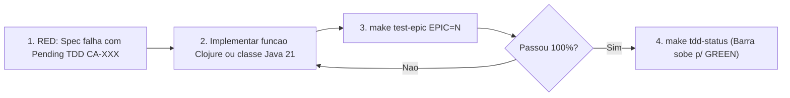

# Matriz de Rastreabilidade TDD e Especificação de Testes (`CA-001` a `CA-052`)

Este documento mapeia **cada Épico e cada Tarefa (`CA-001` a `CA-052`)** do backlog para sua respectiva especificação executável em `test/craft/agents/`, estabelecendo o fluxo **Red → Green → Refactor** do `craft-agents`.

---

## 1. Como Operar o Ciclo TDD no Repositório

### Comandos Rápidos
- **`make tdd-status`**: Compila o Java 21 (`--release 21`) e exibe o placar consolidado por Épico (`GREEN`, `RED` aguardando implementação e `FAIL` de regressão).
- **`make test-epic EPIC=N`** *(ou `0` a `7`)*: Roda detalhadamente todos os testes de um único Épico durante o desenvolvimento.
- **`make test`**: Executa a bateria completa de 50 especificações cobrindo `CA-001` a `CA-052` (667 asserções).

---

## 2. Matriz Completa: Backlog (`CA-XXX`) ↔ Testes Comportamentais

### Épico 0 — Fundação, Build e Contratos (`test/craft/agents/epic0_foundation_test.clj`)
| Task | Símbolo `deftest` | Comportamentos e Invariantes Verificados | Status Atual |
| :--- | :--- | :--- | :--- |
| **`CA-001`** | `ca-001-repository-and-java21-bytecode-test` | Estrutura de arquivos, manifesto e verificação binária do header `0xCAFEBABE` garantindo bytecode estrito Java 21 (`major == 65`). | ✅ **GREEN** |
| **`CA-002`** | `ca-002-java-dual-backend-api-contracts-test` | Operação isolada de `VoxelAccessor`, `CollisionType`, `PortalGroup`, `PathNodeStep` e `PathResult` sem classes Minecraft no classpath. | ✅ **GREEN** |
| **`CA-003`** | `ca-003-clojure-world-and-body-protocols-test` | Ciclo completo `spawn-agent! → apply-motor-controls! → transfer-container-items! → despawn-agent!` sobre `IWorldBackend` e `IAgentBody`. | ✅ **GREEN** |
| **`CA-004`** | `ca-004-malli-schemas-and-json-schema-export-test` | Validação *fail-closed* de `Coord3D`, `LeaseChannel`, `BTNode` recursivo, exportação JSON Schema p/ MCP e propriedade generativa (`test.check`). | ✅ **GREEN** |
| **`CA-005`** | `ca-005-non-blocking-event-bus-burst-test` | Rajada não-bloqueante de `10.000` eventos (`< 25ms`), isolamento de exceção de subscriber quebrado e `unsubscribe!` limpo. | ✅ **GREEN** |

---

### Épico 1 — Dual-Boot & Ponte Intermediary (`test/craft/agents/epic1_dual_boot_bridge_test.clj`)
| Task | Símbolo `deftest` | Comportamentos e Invariantes Verificados | Status Atual |
| :--- | :--- | :--- | :--- |
| **`CA-006`** | `ca-006-intermediary-and-mojmap-resolver-test` | Resolução híbrida Mojmap ↔ Intermediary (`class_*`) e cache idempotente de `MethodHandle`s. | ✅ **GREEN** |
| **`CA-007`** | `ca-007-zero-install-attach-idempotency-test` | Estado idempotente do agente JVM para conviver com o `craft-repl` sem duplicar hooks. | ✅ **GREEN** |
| **`CA-008`** | `ca-008-fabric-mod-manifest-and-entrypoint-test` | Validade do `fabric.mod.json` e carregamento da classe `FabricModInit` no classpath. | ✅ **GREEN** |
| **`CA-009`** | `ca-009-deterministic-server-thread-executor-and-tick-telemetry-test` | Execução FIFO na `ServerThread` e telemetria `:tick-duration-us < 1000us`. | ✅ **GREEN** |
| **`CA-010`** | `ca-010-modded-registry-inspector-never-unknown-test` | Resolução de IDs reais `naturalist:capybara`, `jeg:assault_rifle` e `another_furniture:*` (fim do `'unknown'`). | ✅ **GREEN** |
| **`CA-011`** | `ca-011-native-chat-and-damage-hooks-test` | Captura de sinais nativos de chat e dano convertidos em eventos tipados. | ✅ **GREEN** |
| **`CA-012`** | `ca-012-five-cycle-hot-reload-lifecycle-test` | 5 ciclos consecutivos `start! → spawn → stop!` com zero bots fantasmas residuais. | ✅ **GREEN** |

---

### Épico 2 — `ServerPlayerEntity` In-Memory (`test/craft/agents/epic2_synthetic_player_test.clj`)
| Task | Símbolo `deftest` | Comportamentos e Invariantes Verificados | Status Atual |
| :--- | :--- | :--- | :--- |
| **`CA-013`** | `ca-013-silent-embedded-channel-zero-bytebuf-leak-test` | Descarte imediato de 500 pacotes de saída em memória sem serialização e sem vazamento de `ByteBuf`. | ✅ **GREEN** |
| **`CA-014`** | `ca-014-deterministic-offline-uuid-and-synthetic-spawn-test` | Geração determinística de UUID offline por nome de agente (preservando inventário entre sessões). | ✅ **GREEN** |
| **`CA-015`** | `ca-015-declarative-skin-profile-application-test` | Injeção declarativa de textura e assinatura de skin no perfil do jogador sintético. | ✅ **GREEN** |
| **`CA-016`** | `ca-016-server-side-20hz-motor-physics-test` | Gravidade real, limpeza explícita de `sneaking` e locomoção 20 Hz sem teleporte artificial. | ✅ **GREEN** |
| **`CA-017`** | `ca-017-double-gate-block-interaction-test` | Abertura e fechamento sincronizado dos dois níveis (`y=65` e `y=66`) de um portão duplo. | ✅ **GREEN** |
| **`CA-018`** | `ca-018-naturalist-and-vanilla-animal-feeding-test` | Alimentação de `naturalist:capybara` consumindo item e ativando estado `InLove`. | ✅ **GREEN** |
| **`CA-019`** | `ca-019-jeg-modded-ranged-and-melee-combat-test` | Disparo com `jeg:assault_rifle` consumindo munição e causando dano a `Ravager` sem erro de rede. | ✅ **GREEN** |
| **`CA-020`** | `ca-020-atomic-chest-transfer-item-conservation-property-test` | Teste generativo (`test.check`) provando lei de conservação estrita da soma de itens entre bot e baú. | ✅ **GREEN** |

---

### Épico 3 — `PathSolver3D` e Portais Semânticos (`test/craft/agents/epic3_navigation_3d_test.clj`)
| Task | Símbolo `deftest` | Comportamentos e Invariantes Verificados | Status Atual |
| :--- | :--- | :--- | :--- |
| **`CA-021`** | `ca-021-packed-pos-heap-and-longset-generative-test` | `200` casos generativos em todo o domínio `[-30M..+30M]` para `PackedPos`, ordem monotônica de `PrimitiveMinHeap` (`decrease-key`) e `LongHashSet`. | ✅ **GREEN** |
| **`CA-022`** | `ca-022-off-thread-chunk-snapshot-concurrency-test` | Leitura concorrente por 8 *Worker Threads* sobre `ChunkSnapshotVoxelAccessor` fora da `ServerThread`. | ✅ **GREEN** |
| **`CA-023`** | `ca-023-double-stacked-gate-portal-detector-test` | Reconhecimento de portão duplo empilhado (`y=65` + `y=66`) como `PortalGroup` e rejeição de porta de ferro trancada. | ✅ **GREEN** |
| **`CA-024`** | `ca-024-pathsolver3d-mazes-lava-and-double-gates-test` | Cálculo de rota contornando lava mortal e emitindo passo `TRAVERSE_PORTAL` para entrar no cercado fechado. | ✅ **GREEN** |
| **`CA-025`** | `ca-025-string-pulling-and-async-pool-test` | Simplificação de nós colineares (*string-pulling*) e execução assíncrona fora da thread chamadora. | ✅ **GREEN** |
| **`CA-026`** | `ca-026-continuous-steering-without-teleport-cheat-test` | Vetores suaves de direção sem *cheat* de teleporte de `0.2` blocos e detecção de *stuck* `> 1500ms`. | ✅ **GREEN** |
| **`CA-027`** | `ca-027-transactional-portal-traversal-and-preemption-postcondition-test` | Produto escalar do cruzamento do plano normal **e prova de pós-condição**: combate interrompendo no meio da porta ainda fecha `y=65` e `y=66`! | ✅ **GREEN** |
| **`CA-028`** | `ca-028-semantic-region-enclosure-lookup-test` | Lookup espacial de cercados AABB sobre `agents/regions/sanctuary.edn`. | ✅ **GREEN** |

---

### Épico 4 — Behavior Trees, Leases e Hot-Reload (`test/craft/agents/epic4_behavior_leases_store_test.clj`)
| Task | Símbolo `deftest` | Comportamentos e Invariantes Verificados | Status Atual |
| :--- | :--- | :--- | :--- |
| **`CA-029`** | `ca-029-actuator-leases-exclusivity-and-preemption-cleanup-test` | Paralelismo entre `:legs` e `:gaze`, bloqueio de prioridade menor, `on-preempt` garantido e teste generativo (`test.check`) de invariância de posse única. | ✅ **GREEN** |
| **`CA-030`** | `ca-030-blackboard-ttl-and-bounded-history-test` | Expiração automática de diretivas por TTL e limite máximo do histórico circular. | ✅ **GREEN** |
| **`CA-031`** | `ca-031-behavior-tree-selector-sequence-parallel-and-trace-test` | Semântica funcional de `:selector`, `:sequence` e rastreamento `:active-path` para visualização ao vivo. | ✅ **GREEN** |
| **`CA-032`** | `ca-032-layer1-autonomous-survival-reflexes-without-llm-test` | Reflexo imediato `:escape-hazard` ao pisar em lava/fogo sem nenhuma dependência de LLM. | ✅ **GREEN** |
| **`CA-033`** | `ca-033-builtin-skills-semantic-error-codes-test` | Retorno estruturado `{:status :failure :reason :MISSING_ITEM}` quando falta alimento para cuidar do cercado. | ✅ **GREEN** |
| **`CA-034`** | `ca-034-hot-reload-edn-rejects-invalid-preserving-live-tree-test` | Hot-swap de EDN válido e proteção contra EDN inválido preservando a árvore anterior em execução. | ✅ **GREEN** |
| **`CA-035`** | `ca-035-atomic-snapshot-persistence-roundtrip-test` | Persistência e restauração atômica de memória episódica e skills aprendidas em disco. | ✅ **GREEN** |

---

### Épico 5 — Percepção, MCP, Skills Seguras e Studio (`test/craft/agents/epic5_cognition_mcp_studio_test.clj`)
| Task | Símbolo `deftest` | Comportamentos e Invariantes Verificados | Status Atual |
| :--- | :--- | :--- | :--- |
| **`CA-036`** | `ca-036-semantic-scene-digest-compactness-and-modded-ids-test` | Síntese compacta (`<= 600` palavras) com contagem real de `naturalist:capybara` e estado dos portais. | ✅ **GREEN** |
| **`CA-037`** | `ca-037-voyager-safe-skill-composer-blocks-cycles-and-unknown-ops-test` | Aprovação de sub-árvore segura e **bloqueio estático de ciclo recursivo (`A → B → A`)** e de ações fora do catálogo (`eval`). | ✅ **GREEN** |
| **`CA-038`** | `ca-038-mcp-jsonrpc-protocol-tools-and-resources-test` | Conformidade JSON-RPC 2.0 MCP para `initialize` e `tools/list` (`reply_and_gesture`, `set_directive`, `run_task_sequence`, `compose_and_save_skill`). | ✅ **GREEN** |
| **`CA-039`** | `ca-039-async-llm-never-freezes-20hz-body-loop-test` | Prova temporal: enquanto uma LLM lenta leva `250ms` pensando, o loop de `50ms` do corpo roda livremente sem congelar. | ✅ **GREEN** |
| **`CA-040` / `CA-041`** | `ca-040-and-041-agent-studio-telemetry-and-zero-node-ui-test` | Frame de telemetria WebSocket e garantia de frontend ES Modules puro sem `node_modules`. | ✅ **GREEN** |
| **`CA-042`** | `ca-042-admin-only-ingame-route-particles-test` | Envio de partículas da rota 3D restrito exclusivamente ao admin `Pace`. | ✅ **GREEN** |

---

### Épico 6 — Migração em Produção (`test/craft/agents/epic6_production_migration_test.clj`)
| Task | Símbolo `deftest` | Comportamentos e Invariantes Verificados | Status Atual |
| :--- | :--- | :--- | :--- |
| **`CA-043`** | `ca-043-sanctuary-region-profile-validation-test` | Validação dos 4 cercados reais do santuário em `agents/regions/sanctuary.edn`. | ✅ **GREEN** |
| **`CA-044`** | `ca-044-karlach-sanctuary-caretaker-e2e-acceptance-test` | Simulação E2E de 200 ticks: Karlach entra, alimenta capivara, sai e tranca os dois níveis do portão (`y=65` e `y=66`). | ✅ **GREEN** |
| **`CA-045`** | `ca-045-picard-command-patrol-and-social-gaze-acceptance-test` | Validação do perfil declarativo e rotina diplomática em `agents/picard.edn`. | ✅ **GREEN** |
| **`CA-046`** | `ca-046-antigravity-jeg-combat-and-escort-acceptance-test` | Simulação E2E: Antigravity escolta `Pace` e neutraliza um `Ravager` usando `jeg:assault_rifle`. | ✅ **GREEN** |
| **`CA-047` / `CA-048`** | `ca-047-and-048-twenty-five-agents-mspt-and-memory-budget-test` | Teste de carga com **25 agentes simultâneos** exigindo orçamento total de tick `< 15ms` (`15.000us`). | ✅ **GREEN** |

---

### Épico 7 — `v0.2` Headless Swarm TCP (`test/craft/agents/epic7_headless_swarm_v02_test.clj`)
| Task | Símbolo `deftest` | Comportamentos e Invariantes Verificados | Status Atual |
| :--- | :--- | :--- | :--- |
| **`CA-049`** | `ca-049-shared-swarm-world-single-chunk-cache-test` | Ingestão única de chunk em `SharedSwarmWorld` compartilhada entre múltiplos bots externos. | ✅ **GREEN** |
| **`CA-050`** | `ca-050-virtual-thread-tcp-swarm-backend-contract-test` | Inicialização do adaptador TCP Swarm sobre Virtual Threads. | ✅ **GREEN** |
| **`CA-051`** | `ca-051-tolerant-modded-packet-opaque-passthrough-test` | Decodificação tolerante preservando cauda opaca de bytes em pacotes modded desconhecidos sem perder alinhamento TCP. | ✅ **GREEN** |
| **`CA-052`** | `ca-052-external-python-sdk-mcp-wire-contract-test` | Contrato wire `resources/list` JSON-RPC para SDK Python/CLI externo. | ✅ **GREEN** |
