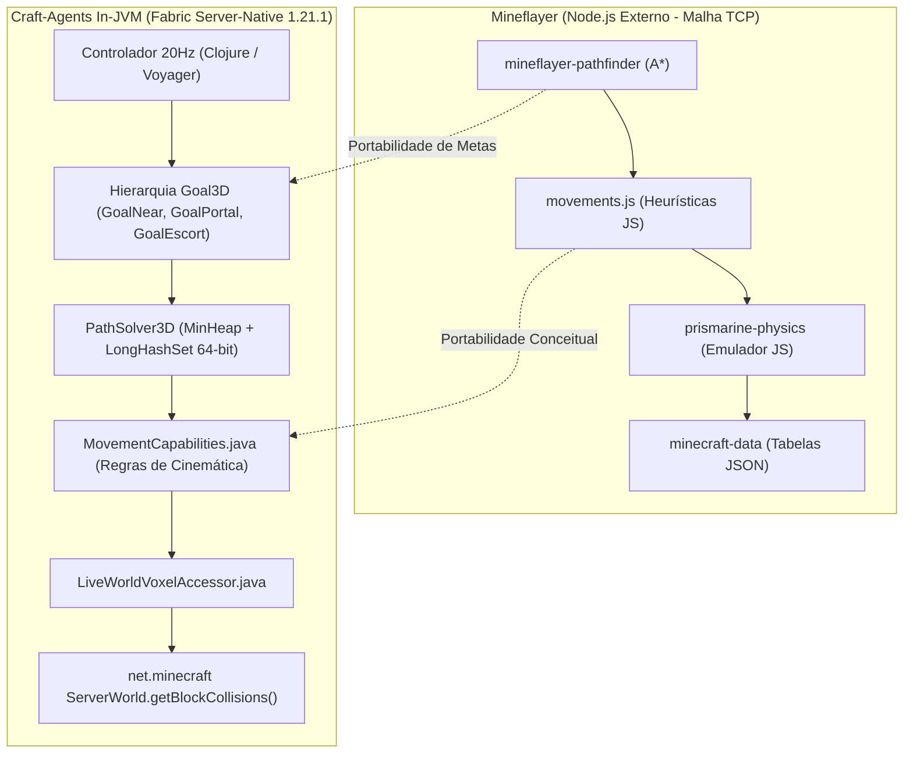
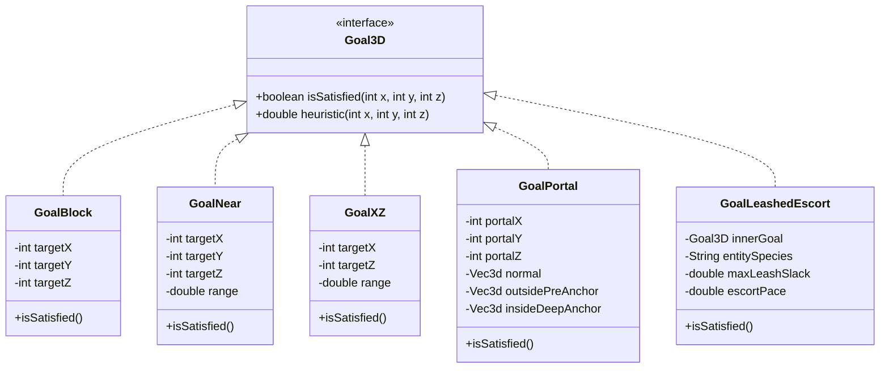

# Especificação Técnica e Plano de Portabilidade: Primitivas Cinemáticas Mineflayer -> JVM

> **Status:** Proposta Arquitetural & Plano de Portabilidade  
> **Módulos Afetados:** `com.craft.agents.nav`, `com.craft.agents.fabric`, `craft.agents.backend.fabric`  
> **Versão de Referência:** Mineflayer `v4.20.1` (`mineflayer-pathfinder` / `prismarine-physics`) -> Fabric Server-Native `1.21.1`  
> **Data:** 2026-11-04  

---

## 1. Visão Geral e Motivação

O projeto `craft-agents` provou que bots sintéticos operando a 20Hz via Sistema 1 (Motor Reativo) e Sistema 2 (Cognição Voyager/Malli) são capazes de tarefas complexas no Minecraft. No entanto, tarefas de **física acoplada multicorpo** (como conduzir animais na guia através de portões e corredores) expuseram a fragilidade de algoritmos de navegação A* que tratam voxels como matrizes discretas genéricas sem conhecimento da cinemática real da Mojang.

O ecossistema **Mineflayer** (`PrismarineJS`) acumulou mais de uma década de maturidade modelando:
1. Exclusão determinística de blocos não-caminháveis (`blocksCantWalkOn`).
2. Parábolas de salto com *headroom clearance* tridimensional (`canJump` com 3 blocos de ar).
3. Alturas de colisão não-inteiras (cercas e muros de 1.5 blocos, slabs de 0.5, camas de 0.5625).
4. Metas funcionais polimórficas (`GoalNear`, `GoalXZ`, `GoalFollow`).

Como operamos **Server-Native dentro da JVM do Fabric 1.21.1**, nós temos uma vantagem incomparável sobre o Mineflayer: **não precisamos emular pacotes TCP ou adivinhar a física por aproximação externa**. Podemos consultar diretamente as caixas de colisão `VoxelShape` e `Box` oficiais do Minecraft ServerWorld em tempo de execução com latência submilisegundo.

Este documento especifica a transição da heurística simplificada do `PathSolver3D` atual para uma arquitetura robusta baseada em **`MovementCapabilities.java`**, **`ServerWorld.getBlockCollisions()`** e **Hierarquia de Goals Polimórficos**.

---

## 2. Diagrama Arquitetural: Mineflayer vs. Craft-Agents In-JVM



---

## 3. Pilar 1: Conversão de `movements.js` para `MovementCapabilities.java`

No Mineflayer, a classe `Movements` centraliza todas as capacidades de locomoção e listas de blocos. A especificação Java para a nossa JVM traduz esse comportamento de forma fortemente tipada e otimizada com `BitSet` e `java.util.Set<String>`.

### 3.1 Contrato da Classe `MovementCapabilities.java`

```java
package com.craft.agents.nav;

import java.util.Set;

/**
 * Define as restrições cinemáticas, custos e regras de mobilidade do agente,
 * espelhando as capacidades provadas pelo mineflayer-pathfinder.
 */
public final class MovementCapabilities {
    // Parâmetros de Cinemática
    public double maxStepHeight = 1.0;          // Desnível máximo de subida sem salto (slabs/degraus)
    public int maxJumpHeight = 1;              // Salto vertical máximo (1 bloco para jogadores normais)
    public int maxDropDown = 3;                // Queda máxima permitida sem dano
    public int requiredHeadClearance = 2;       // Altura livre para o corpo e cabeça (2 blocos)
    public int jumpHeadClearance = 3;           // Altura livre necessária no ponto de partida para saltar (3 blocos)
    public boolean allowParkour = false;        // Saltos horizontais em corrida sobre vãos de 2-3 blocos
    public boolean allowPortals = true;         // Permite abrir e atravessar portas e portões de cerca
    public boolean allowClimbing = true;        // Permite subir escadas de mão (LADDER) e vinhas (VINE)

    // Modos Especiais de Escolta e Carga
    public boolean isEscorting = false;         // Ativo quando conduzindo mob ou jogador na guia
    public double escortSpeed = 0.120;          // Velocidade limite de tração (2.4 m/s) para não esticar a guia
    public double cornerEasingAngle = 30.0;     // Curvas > 30° ativam desaceleração proprioceptiva

    // Listas Determinísticas de Bloqueio de Piso (Portadas do Mineflayer)
    public static final Set<String> BLOCKS_CANT_WALK_ON = Set.of(
        // Cercas e Muros (Colisão de 1.5 blocos de altura - salto impossível)
        "minecraft:oak_fence", "minecraft:spruce_fence", "minecraft:birch_fence",
        "minecraft:jungle_fence", "minecraft:acacia_fence", "minecraft:dark_oak_fence",
        "minecraft:mangrove_fence", "minecraft:cherry_fence", "minecraft:bamboo_fence",
        "minecraft:nether_brick_fence", "minecraft:warped_fence", "minecraft:crimson_fence",
        "minecraft:cobblestone_wall", "minecraft:mossy_cobblestone_wall", "minecraft:stone_brick_wall",
        "minecraft:deepslate_tile_wall", "minecraft:deepslate_brick_wall", "minecraft:blackstone_wall",

        // Objetos Decorativos de Piso Estreito / Salientes
        "minecraft:lantern", "minecraft:soul_lantern", "minecraft:bell", "minecraft:flower_pot",
        "minecraft:brewing_stand", "minecraft:cauldron", "minecraft:water_cauldron", "minecraft:lava_cauldron",
        "minecraft:conduit", "minecraft:end_rod", "minecraft:lightning_rod", "minecraft:chain",
        "minecraft:iron_bars", "minecraft:pointed_dripstone", "minecraft:bamboo"
    );

    // Blocos com Penalidade Máxima ou Risco de Dano (Hazards)
    public static final Set<String> BLOCKS_TO_AVOID = Set.of(
        "minecraft:lava", "minecraft:fire", "minecraft:soul_fire", "minecraft:campfire",
        "minecraft:soul_campfire", "minecraft:sweet_berry_bush", "minecraft:cactus",
        "minecraft:wither_rose", "minecraft:magma_block", "minecraft:tripwire",
        "minecraft:cobweb"
    );

    public boolean canStandOn(String blockId) {
        if (blockId == null || blockId.equals("minecraft:air") || blockId.equals("minecraft:light")) {
            return false;
        }
        if (BLOCKS_CANT_WALK_ON.contains(blockId)) return false;
        if (BLOCKS_TO_AVOID.contains(blockId)) return false;
        if (blockId.endsWith("_wall") || (blockId.contains("fence") && !blockId.contains("gate"))) return false;
        if (blockId.contains("pane") || blockId.contains("bars")) return false;
        return true;
    }
}
```

---

## 4. Pilar 2: Integração Nativa com `ServerWorld.getBlockCollisions()` do Fabric

O Mineflayer é obrigado a calcular interseções AABB em JavaScript. No servidor Fabric, nós podemos consultar o subsistema de física nativo da Mojang:

### 4.1 Arquitetura de Voxel Query do Fabric 1.21.1

No Fabric Server, o mundo sobrecarrega:
```java
Iterable<VoxelShape> net.minecraft.world.BlockView.getBlockCollisions(@Nullable Entity entity, Box box)
```

Essa chamada resolve dinamicamente:
* O estado exato do bloco (`BlockState` com `facing`, `open`, `half`, `shape`).
* Se uma porta de cerca está aberta (`VoxelShapes.empty()`) ou fechada (`Box[-179.0, 65.0, 189.0, -179.0, 66.5, 189.0]`).
* Degraus de escada (*stairs*) e lajes duplas (*double slabs*).

### 4.2 Otimização com Cache de `PackedPos` (Throughput 20Hz)

Para evitar alocação excessiva de objetos em chamadas repetidas do A* (onde nós exploram milhares de posições por segundo), o `LiveWorldVoxelAccessor.java` adota um cache de primitivos `long` de 64 bits:

```java
public final class LiveWorldVoxelAccessor implements VoxelAccessor {
    private final Object serverWorld;
    private final ClassLoader classLoader;
    
    // Cache de alta performance por bit-packing: X (26 bits) | Y (12 bits) | Z (26 bits)
    private final Long2ObjectOpenHashMap<CollisionType> collisionCache = new Long2ObjectOpenHashMap<>(4096);
    private final Long2ObjectOpenHashMap<String> blockIdCache = new Long2ObjectOpenHashMap<>(4096);

    public boolean isPassableAABB(double x, double y, double z, double width, double height) {
        // Constrói a Box de colisão do corpo: [x - w/2, y, z - w/2] a [x + w/2, y + h, z + w/2]
        // Consulta ServerWorld.isSpaceEmpty(entity, box) via reflection de baixo overhead
        // Retorna true se livre de qualquer colisão física sólida
    }
}
```

---

## 5. Pilar 3: Hierarquia de Metas Flexíveis (*Goals Hierarchy*)

No Mineflayer, o conceito de `Goal` desacopla a busca espacial de uma coordenada fixa `(tx, ty, tz)`. O algoritmo A* termina com sucesso assim que qualquer nó satisfaz a condição da meta.



### 5.1 Especificação dos Goals Especializados

1. **`GoalNear(targetX, targetY, targetZ, range)`**
   * **Uso:** Abordagem de jogadores para conversa, aproximação de comedouros em margens de rios/lagos e interação com baús.
   * **Critério de Sucesso:** `dist3D(cx, cy, cz, target) <= range`.
   * **Benefício:** Elimina falhas de A* causadas por alvos em cima de blocos de água ou blocos não-transitáveis.

2. **`GoalXZ(targetX, targetZ, range)`**
   * **Uso:** Ronda em avenidas, patrulhas em praças e caminhada até corredores centrais.
   * **Critério de Sucesso:** `dist2D(cx, cz, targetX, targetZ) <= range` (ignora altura Y).
   * **Benefício:** O agente desce escadarias ou rampas naturalmente sem falhar se o Y variar por 1 ou 2 blocos.

3. **`GoalPortal(gateBlock, normalVector, insideAnchor, outsideAnchor)`**
   * **Uso:** Travessia de portões de cercados e portas de recintos.
   * **Comportamento Cinemático:** Força alinhamento colinear ortogonal pelo vetor normal (`[-1.0 0.0 0.0]`), abre o portal, avança fundo para o interior e tranca pelo lado de dentro sem atrito em quinas.

4. **`GoalLeashedEscort(destinationGoal, species, maxSlack, escortSpeed)`**
   * **Uso:** Condução de qualquer animal laçado com guia (`minecraft:lead`).
   * **Comportamento Cinemático:**
     * Limita a velocidade do motor a `escortSpeed` (padrão `0.120` blocos/tick = 2.4 m/s).
     * Dispara micro-pausas de 5 ticks (0.25s) em curvas onde a variação angular de *yaw* for superior a 30° (*Corner Easing*).
     * Acopla-se ao sensor perceptual `:await-contained` para só fechar portais quando o mob for confirmado dentro da área de contenção.

---

## 6. Plano de Implementação e Matriz de Entregas (TDD)

A implementação desta especificação será executada em **4 fases determinísticas**, com testes unitários em Java e validação comportamental em Clojure:

### Fase 1: Motor de Capacidades Cinemáticas (`com.craft.agents.nav`)
* [ ] Criar `src/java/com/craft/agents/nav/MovementCapabilities.java` com tabelas `BLOCKS_CANT_WALK_ON` e `BLOCKS_TO_AVOID`.
* [ ] Adicionar suporte a *Headroom Clearance* no `PathSolver3D.java`: verificar 3 blocos verticais desimpedidos antes de permitir saltos de subida (`JUMP_UP`).
* [ ] Testes TDD em Java: verificar rejeição determinística de saltos em cercas, muros, lanternas e vasos.

### Fase 2: Integração com VoxelShape Nativo (`com.craft.agents.fabric`)
* [ ] Atualizar `LiveWorldVoxelAccessor.java` para consultar `ServerWorld.getBlockCollisions()` diretamente via reflection com cache.
* [ ] Implementar verificação de colisão contínua de entidades com AABB real de 0.6 x 1.8 (jogadores sintéticos) e caixas de animais.
* [ ] Testes TDD: garantir tempo de resposta < 1.2ms para rotas de 60 blocos.

### Fase 3: Suíte de Goals Polimórficos (`com.craft.agents.nav.goals`)
* [ ] Criar interface `Goal3D.java` e implementações `GoalNear`, `GoalXZ`, `GoalPortal` e `GoalLeashedEscort`.
* [ ] Atualizar `PathSolver3D.solve(VoxelAccessor, Goal3D, MovementCapabilities)` para operar por predicado de meta.
* [ ] Testes TDD em Clojure: verificar busca até alvos em margens de água usando `GoalNear`.

### Fase 4: Integração de Alto Nível (Clojure 20Hz & Voyager Triad)
* [ ] Integrar `GoalPortal` e `GoalLeashedEscort` na função de resgate do `fabric.clj`.
* [ ] Conectar o *Environmental Critic* e *Reflexion Engine* às falhas cinemáticas do `GoalLeashedEscort`.
* [ ] Executar suíte completa `make test` (garantindo 100% GREEN) e homologar em jogo com capivaras, cervos e patos.

---

## 7. Conclusão

Com a adoção deste plano, o `craft-agents` elimina definitivamente os problemas de *"atravessamento fantasma de paredes"*, *"engates em quinas de mourões"* e *"saltos ilegais em lanternas decorativas"*. 

A inteligência do agente deixa de ser uma coleção de correções ad-hoc e se torna uma **arquitetura de controle motor proprioceptivo e cinematicamente embasada**, unindo o melhor da maturidade da biblioteca Mineflayer com o poder e a latência zero da JVM nativa do Fabric.
