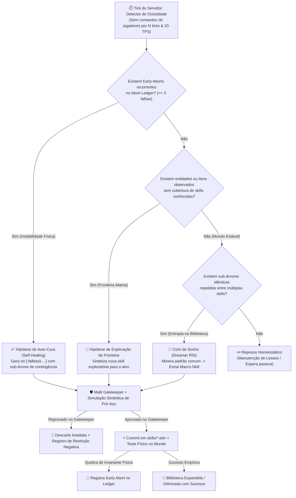

# 09 — Backlog de Engenharia: Curriculum Agent & Recursive Self-Improvement (RSI)
*Data: Novembro de 2026*  
*Versão: 1.0 (Fabric 1.21.1 / Clojure 1.12 / Java 21)*  
*Status: Aprovado para Implementação TDD*  
*Base Existente: 75 Suítes / 1005 Asserções TDD GREEN*

---

## 1. Visão Geral e Objetivo

O objetivo deste backlog é conduzir o **Craft Agents** do seu estágio atual (**Síntese Reativa sob Demanda**) para a **Autonomia Completa em Malha Fechada (24/7)**, habilitando **Recursive Self-Improvement (RSI) seguro e determinístico**.

Ao contrário de abordagens baseadas em código imperativo solto (`eval`) que sofrem de entropia e quebras em cascata, o Craft Agents ancora a auto-melhoria sobre três pilares formais:
1. **Homoiconicidade e Code-as-Data:** Comportamentos são árvores AST puras em EDN (`[:sequence ...]`, `[:selector ...]`, `[:action ...]`), permitindo inspeção, mutação e compressão matemática direta.
2. **Malli Gatekeeper Fail-Closed:** Validação estática rigorosa de schemas, anti-ciclos e leases antes de qualquer commit em `skills/*.edn`.
3. **Ground Truth como Verificador Físico:** O tick de 50ms (20Hz) da JVM e o `Environmental Critic` operam como oráculo empírico contínuo.

---

## 2. A Árvore de Decisão e Recursão da Curiosidade (RSI Loop)

A tomada de decisão autônoma do agente é governada pelo seguinte fluxo recursivo de prioridades durante os períodos de ociosidade do servidor:



---

## 3. Backlog Detalhado por Épicos e Tarefas

### ÉPICO 1: Ledger de Memória Negativa (Falsificação Empírica)

#### Tarefa 1.1 — Registro Estruturado de Early Aborts (`craft.agents.cognition.ledger`)
* **O Quê:** Implementar o namespace `craft.agents.cognition.ledger` com funções puras de registro e persistência em `memory/abort-ledger.edn`. Cada entrada armazena:
  - `:skill-id`: ID da habilidade em execução.
  - `:failed-action`: Ação primitiva onde ocorreu a quebra.
  - `:failed-path`: Caminho posicional exato do nó dentro da AST (`[:sequence 2 :action]`).
  - `:violated-fact`: Invariante violada (ex: `:leash-broken`, `:path-blocked`, `:missing-item`).
  - `:world-context`: Snapshot do estado físico no tick exato do abort.
* **Por Quê:** Sem memória explícita do que deu errado, um agente autônomo entra em alucinação cíclica, repetindo tentativas inviáveis. O erro físico precisa atuar como restrição formal para sínteses futuras.
* **Onde Acopla:** Invocado pelo `Environmental Critic` (`src/clj/craft/agents/cognition/critic.clj`) no instante de qualquer abortamento de execução.

#### Tarefa 1.2 — Injeção de Restrições Negativas no Skill-RAG e Gatekeeper
* **O Quê:** Atualizar `retrieve-relevant-skills` em `src/clj/craft/agents/skills/composer.clj` para carregar o histórico de falhas da skill e injetar restrições negativas no prompt do Sistema 2.
* **Por Quê:** Evita que o LLM sintetize variações da mesma árvore rejeitada pelo mundo físico.
* **Onde Acopla:** `src/clj/craft/agents/skills/composer.clj`.

---

### ÉPICO 2: Scanner de Fronteira e Motor de Curiosidade

#### Tarefa 2.1 — Detector de Ociosidade do Servidor (`craft.agents.rsi.idle`)
* **O Quê:** Monitorar a atividade do servidor: contagem de ticks sem comandos de jogadores, estabilidade de TPS (alvo = 20 TPS) e ausência de hostis imediatos.
* **Por Quê:** Garante que o agente só dedique recursos cognitivos (Sistema 2 / chamadas de síntese) quando não houver sobrecarga no motor nem perigo iminente.
* **Onde Acopla:** Acoplado ao loop de ticks em `src/clj/craft/agents/cognition.clj`.

#### Tarefa 2.2 — Cálculo de Diferencial de Fronteira (`frontier-delta`)
* **O Quê:** Função pura que recebe `SceneDigest` (visão 3D, inventário, entidades) e a biblioteca de skills (`skills/*.edn`), calculando:
  $$\Delta_{\text{fronteira}} = \text{Entidades/Blocos Observados} \setminus \text{Domínio Coberto por Skills}$$
* **Por Quê:** Transforma curiosidade em uma operação determinística de conjuntos sobre dados. O agente passa a ter um "porquê" claro para formular novos objetivos.
* **Onde Acopla:** `src/clj/craft/agents/rsi/curriculum.clj`.

#### Tarefa 2.3 — Gerador de Hipóteses de Curiosidade (`generate-curiosity-hypothesis`)
* **O Quê:** Motor de decisão que avalia o `abort-ledger`, a fronteira observável e a entropia da biblioteca, gerando uma diretiva formal para o Sistema 2:
  1. *Prioridade Alta:* Fallback de Auto-Cura para skills com $\ge 3$ falhas recorrentes.
  2. *Prioridade Média:* Exploração de itens ou blocos novos observados no Ground Truth.
  3. *Prioridade Baixa:* Consolidação e refatoração da biblioteca (Fase de Sonho).
* **Por Quê:** Garante direcionamento semântico rígido sem perguntas abertas dispersas para o LLM.
* **Onde Acopla:** `src/clj/craft/agents/rsi/curriculum.clj`.

---

### ÉPICO 3: Mutador de Árvore e Simulador Simbólico de Pré-Voo

#### Tarefa 3.1 — Nó Composto `:fallback` e Transformação de Auto-Cura (`wrap-fallback`)
* **O Quê:** Implementar a transformação funcional de AST que localiza o nó problemático indicado pelo Ledger e o substitui por uma estrutura de contingência:
  ```clojure
  ;; Antes:
  [:action :attach-lead {:species "naturalist:duck"}]
  
  ;; Depois (com Fallback):
  [:fallback
   [:action :attach-lead {:species "naturalist:duck"}]
   [:sequence
    [:action :equip-bait {:item "minecraft:apple"}]
    [:action :attach-lead {:species "naturalist:duck"}]]]
  ```
* **Por Quê:** Transforma falhas físicas em resiliência procedural cumulativa.
* **Onde Acopla:** `src/clj/craft/agents/skills/composer.clj`.

#### Tarefa 3.2 — Verificação Estática de Conflito de Leases Simbólicas
* **O Quê:** Analisar ramos paralelos (`:parallel`) e sequências para garantir que dois nós simultâneos não requisitem o mesmo canal de lease (`:legs`, `:hands`, `:gaze`).
* **Por Quê:** Evita condições de corrida em tempo de execução nos atuadores motores do agente.
* **Onde Acopla:** Expansão do validador em `src/clj/craft/agents/schemas.clj`.

---

### ÉPICO 4: O "Dreamer" — Mineração Homoicônica e Compressão de ASTs (RSI Puro)

#### Tarefa 4.1 — Minerador de Padrões e Sub-Árvores Comuns (`find-repeated-sequences`)
* **O Quê:** Algoritmo baseado em `clojure.walk` que varre todas as árvores em `skills/*.edn`, extrai subsequências válidas de Behavior Tree e ranqueia as que possuem maior economia de nós:
  $$\text{Score} = \text{Frequência} \times \text{Peso do Nó}$$
* **Por Quê:** Descobre primitivas de ordem superior emergentes que foram repetidamente úteis em diferentes tarefas.
* **Onde Acopla:** `src/clj/craft/agents/rsi/curriculum.clj`.

#### Tarefa 4.2 — Refatoração e Substituição de Macros na Biblioteca (`dream-compress-library!`)
* **O Quê:** Extrai a sub-árvore repetida como uma nova macro-skill (`:macro-<hash>`), submete ao Malli Gatekeeper e reescreve as skills originais referenciando a nova abstração.
* **Por Quê:** Reduz o tamanho médio das árvores, desacelera o crescimento do espaço de busca do Semantic Router e consolida o aprendizado cumulativo semântico.
* **Onde Acopla:** `src/clj/craft/agents/rsi/curriculum.clj` e `src/clj/craft/agents/skills/composer.clj`.

#### Tarefa 4.3 — Suíte de Regressão TDD para Ciclos de Sonho
* **O Quê:** Criar `test/craft/agents/epic8_rsi_curriculum_test.clj` cobrindo:
  - Registro e consulta no Abort Ledger.
  - Geração correta de hipóteses de curiosidade nas 3 prioridades.
  - Detecção e extração de sub-árvores idênticas pelo Dreamer.
  - Verificação de não-regressão pós-compressão das skills existentes.
* **Por Quê:** Manter a meta inegociável de 100% de asserções TDD GREEN.
* **Onde Acopla:** `test/craft/agents/epic8_rsi_curriculum_test.clj`.

---

## 4. Estratégia de Rollout

| Fase | Entregáveis | Critério de Sucesso |
|---|---|---|
| **Fase 1: Memória Negativa** | `ledger.clj` + Acoplamento com `critic.clj` | Aborts reais persistidos e recuperados no RAG |
| **Fase 2: Motor de Curiosidade** | `curriculum.clj` + `idle.clj` | Hipóteses geradas deterministamente sem comandos de jogadores |
| **Fase 3: Auto-Cura Fallback** | `wrap-fallback` + Validação Malli | Skills com abort aprendem rota alternativa |
| **Fase 4: RSI Dreamer** | `find-repeated-sequences` + `dream-compress-library!` | Sub-árvores comprimidas e suíte TDD 100% GREEN |
