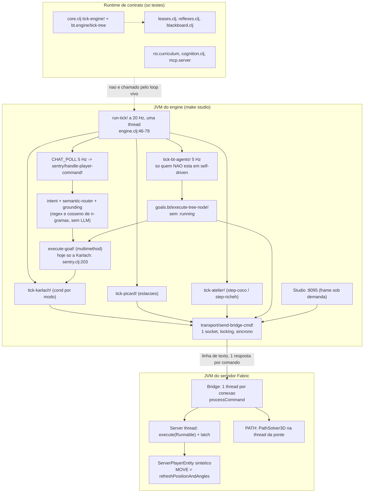
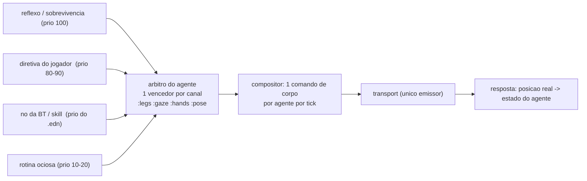

# arch-review-01 — Sugestões arquiteturais do craft-agents à luz do objetivo "Voyager na JVM"

*Data: 2026-11-14 · Tarefa CA-097 · Commit analisado: `abbb2cd` (branch `feat/CA-097`) · Modo análise: nenhum código foi alterado.*

**Como ler:** "Fato" é o que li no arquivo citado (`arquivo:linha`). "Inferência" é conclusão minha que não foi medida nem exercitada em servidor vivo. Medições feitas nesta tarefa: `make test` (349 test vars, 3244 asserções, 0 falhas, 0 erros) e `clj-kondo --lint src` (0 erros, 46 warnings). Nada foi medido ao vivo.

**Limites da leitura:** li por inteiro os docs pedidos (do doc 05, da linha 168 em diante), o engine, os ticks, metas, BT, cognição, RSI, NPC Core, Studio, MCP, `leases.clj`, `core.clj` e os trechos `SPAWN`/`MOVE`/`PLAYERS`/`PATH`/`GROUND` da ponte Java. Li só o cabeçalho (`ns` e primeiras linhas) de `mining.clj`, `atelier/{aim,held,registry}.clj`, `goals/{work,furniture}.clj`, `sanctuary.clj`, `locomotion.clj`, `nav*.clj` e `rsi/bench.clj`. Não li `PathSolver3D.java` nem os testes. O diff do commit `8678fc8` não foi inspecionado; o estado que ele deixou está confirmado em `bt_tick.clj:14-16`.

---

## 1. Resumo executivo

O craft-agents tem hoje um **corpo server-native que funciona** e um **conjunto de peças do Voyager escritas e testadas, mas desligadas do loop vivo**. O que roda em produção é um motor de NPCs roteirizados: a rotina de cada personagem é código Clojure com o nome dele, as `:bt/root` dos `.edn` não conduzem nenhum agente vivo, não existe nenhuma chamada a LLM, e o currículo automático nunca é invocado. Existem dois runtimes paralelos (o "de contrato", com leases, reflexos e blackboard, usado só por testes; e o vivo, em `backend/fabric`), e o segundo não usa o primeiro.

As cinco recomendações mais importantes:

1. **Um único dono do corpo (SUG-01):** todo `MOVE` passa por um árbitro por agente com leases obrigatórios; um teste estrutural proíbe o literal `"MOVE|` fora dele.
2. **Um único interpretador de BT com `:running` e um único registro de ações (SUG-03, SUG-04):** hoje há dois interpretadores e sete lugares onde uma ação é "registrada".
3. **Rotina como dado (SUG-06, SUG-07):** migrar Coco e Richeh para o NPC Core e fazer a `:bt/root` ser o que conduz todo agente, incluindo Karlach e Picard.
4. **Percepção por tick e ponte em lote (SUG-02, SUG-09):** um snapshot de mundo por tick e um op por tick para N agentes; sem isso o loop único não chega a dezenas.
5. **Fechar a malha Voyager de verdade, com orçamento (SUG-11 a SUG-14):** crítico genérico por meta, ledger lido, currículo ligado ao tick ocioso, LLM só via small-router com teto por agente.

---

## 2. Objetivo e conceitos

**A tese, em palavras próprias.** O Voyager (2023) mostrou que um LLM consegue aprender Minecraft sozinho com três mecanismos: um currículo que propõe a próxima meta, um laço de tentativa e correção guiado pelo que o mundo devolve, e uma biblioteca de habilidades reutilizáveis (`docs/05`:302-305). O craft-agents quer manter os três e trocar as duas partes frágeis: o corpo (um cliente Node/Mineflayer externo) e a forma da habilidade (JavaScript executado por `eval`). A aposta (`README.md`:11-13, `docs/08`:10-22) é que a autonomia vem de separar tempos: reflexo e rotina rodam localmente a 20 Hz sem LLM, e a cognição cara só acorda por gatilho.

**Promessas registradas nos docs:**

- Corpo `ServerPlayerEntity` dentro da JVM do servidor, "sem latência TCP", `< 500 KB/bot` (`README.md`:57).
- Habilidades como BT em EDN, validadas por Malli, sem `eval` (`docs/08`:18-20), com tipos e limites de parâmetros e timeouts obrigatórios (`docs/03`:182-184, `docs/05`:190-193).
- LLM chamada só por gatilho, com quatro ferramentas MCP, entre elas `compose_and_save_skill` (`docs/03`:174-185).
- Leases `:legs/:hands/:gaze` com posse exclusiva (`docs/03`:89-94, `docs/05`:207-209).
- Currículo e curiosidade em malha fechada, ledger de memória negativa, auto-cura e Dreamer (`docs/09`).
- "Trinta ou cinquenta agentes estilo Voyager vivendo no mesmo mundo multiplayer" (`docs/05`:168; reforçado em 247).

**Conceitos centrais:**

| Conceito | O que significa aqui |
| :--- | :--- |
| Sistema 0/1 | Reflexo e rotina a 20 Hz, sem tokens: locomoção, combate, patrulha, olhar. |
| Sistema 2 | Cognição por gatilho: interpretar chat, sintetizar skill, criticar resultado, propor meta. |
| BT-como-dado | A rotina e as skills são vetores EDN (`[:selector ...]`); o motor interpreta, a IA só propõe dados. |
| Gatekeeper | Validação fail-closed antes de gravar uma skill: forma, ações conhecidas, ciclos, conflito de lease. |
| Skill library | `skills/*.edn` (árvore) + `agents/routes/*.edn` (âncoras do roteador semântico). |
| Server-native | O corpo é uma entidade do próprio servidor, sem cliente de rede. |

---

## 3. Mapa da arquitetura atual

**Fato central:** o "cérebro" não roda dentro do servidor. `make studio` sobe uma JVM própria (`Makefile`:31-33, `studio/server.clj`:210-224) que fala com a JVM do Minecraft por um socket de texto em `127.0.0.1:25595` (`transport.clj`:27-46; lado Java em `SyntheticPlayerFactory.java`:144-194). O corpo é server-native; o loop de 20 Hz é um `Thread/sleep` do lado de fora (`engine.clj`:66-78), não o tick do servidor.



**Fluxo de um tick** (`engine.clj`:46-64): chat a cada 4 ticks; manutenção a cada 100 e 200 ticks; depois, em sequência e na mesma thread, `tick-picard!`, `tick-atelier!`, `tick-bt-agents!`, `tick-karlach!`. Cada um formata strings `MOVE|Nome|x|y|z|yaw|pitch|sprint|sneak` e as envia direto.

**Dois runtimes.** `core.clj` (`tick-engine!`, linhas 99-123) usa `bt.engine/tick-tree` (com `:running`, `bt/engine.clj`:20,34,42), `leases`, `reflexes` e `blackboard` sobre `IWorldBackend`. O `-main` de produção chama `fabric/start-live-karlach-loop!` (`studio/server.clj`:220) e nenhum dos arquivos de `backend/fabric` que li requer `leases`, `reflexes`, `blackboard`, `perception` ou `bt.engine`. O `create-fabric-backend` devolve um backend vazio (`fabric.clj`:29-38).

---

## 4. Aderência à tese

Status: **rodando** (no loop de produção), **sem uso** (implementado e testado, mas nenhum chamador no caminho vivo que li), **stub** (existe a assinatura, não o comportamento), **só doc**.

| # | Promessa | Evidência | Status |
| :-- | :--- | :--- | :--- |
| 1 | Corpo `ServerPlayerEntity` + `EmbeddedChannel` | `SyntheticPlayerFactory.java`:303-356 | rodando |
| 2 | Execução in-process, "sem latência TCP" | Engine em JVM separada: `Makefile`:31-33; socket: `transport.clj`:27-46 | parcial: corpo dentro, cérebro fora |
| 3 | Física real a 20 Hz | `MOVE` chama `method_5808` (teleporte): Java 451-455; `STEP` não existe (`docs/12`:24-26) | ausente |
| 4 | Rotina dos agentes em BT declarativa | `:bt/root` nos 5 `.edn`; `self-driven` exclui 4 (`bt_tick.clj`:14-16,31-32); o 5º não nasce no boot (`antigravity.edn`:5). Rotinas reais: `karlach_tick.clj`:139-152, `picard_tick.clj`:95-101, `atelier/behavior.clj`:61,143 | sem uso (ver 4.1) |
| 5 | Skill aprendida por chat, gravada em `skills/` | `goals/skills.clj`:55-77; `composer.clj`:451-486; 7 arquivos em `skills/` | rodando, só Karlach (`sentry.clj`:203-205) |
| 6 | Síntese por LLM (`compose_and_save_skill`) | Síntese é tabela de regex: `composer.clj`:295-391. `mcp/server.clj`:52-55 responde texto fixo; o servidor MCP não é iniciado em `studio/server.clj`:210-224 | stub |
| 7 | Gatekeeper Malli fail-closed | `composer.clj`:65-107; `schemas.clj`:48-78,139-166 | rodando, com lacunas (ver 4.2) |
| 8 | Execução da skill aprendida | `goals/skills.clj`:86-99 → `goals/bt.clj`:158-210 | rodando, semântica fraca (ver 4.3) |
| 9 | Skill-RAG few-shot | `composer.clj`:113-151; nenhum chamador nos arquivos vivos lidos | sem uso |
| 10 | Roteador semântico `< 1 ms` | `semantic_router.clj`:31-66; `intent.clj`:212-239; `sentry.clj`:193-202 | rodando (n-gramas + regex; latência não medida aqui) |
| 11 | Crítico de ambiente | Só contenção de animal: `patrol_ops.clj`:97-119. Demais tipos (`critic.clj`:168-265) sem chamador | rodando em 1 caso |
| 12 | Prompting iterativo (reflexão → nova tentativa) | Hipótese é texto fixo (`critic.clj`:145-146); "Tentativa 2" é lista de passos escrita à mão (`patrol_ops.clj`:149-176) | roteirizado, não sintetizado |
| 13 | Early abort + ledger de memória negativa | Escrita: `patrol.clj`:253-267 → `ledger.clj`:44-53. Só dispara se o passo tiver `:invariants` (`patrol.clj`:273-281); não achei produtor que as passe (`rescue.clj`:102-104, `navigation.clj`:62). Leitura do ledger: nenhuma no loop | sem uso (inferência: caminho inalcançável hoje) |
| 14 | Currículo automático / curiosidade | `rsi/curriculum.clj`:284-336; `run-tick!` não o chama (`engine.clj`:46-64). `rsi.idle` do doc 09 não existe | sem uso |
| 15 | Auto-cura `:fallback` e Dreamer | `curriculum.clj`:141-242; fallback fixo com maçã (311-313) | sem uso |
| 16 | LLM assíncrona por gatilho | `cognition.clj`:5-17 recebe `llm-client-fn` injetada; nenhum chamador; nenhum namespace requer cliente HTTP para LLM | só esqueleto |
| 17 | Semantic Scene Digest | `perception.clj`:6-35 sobre `IWorldBackend`; `hostiles []` e `tod 6000` fixos (21,30) | stub |
| 18 | Leases `:legs/:hands/:gaze` | `leases.clj` completo; usado por `core.clj`:7, `reflexes.clj`, `nav_portals.clj`. No vivo, `:leases` é um mapa literal para o Studio (`karlach_tick.clj`:68, `patrol.clj`:144) | sem uso no vivo |
| 19 | Studio com broadcast contínuo | Frame só no `on-open` e em `/api/status` (`studio/server.clj`:123-126,175-181) | rodando, sob demanda |
| 20 | Hot-reload de `agents/*.edn` | `registry/reload!` existe (`registry.clj`:82-85); `/api/reload` recarrega código e rotas, não o registro (`studio/server.clj`:148-173). Dados lidos uma vez: `picard.clj`:103, `sanctuary.clj`:8-11, `atelier/speech.clj`:15-17 | parcial |
| 21 | Dezenas de agentes, `< 500 KB/bot` | 5 perfis, 4 nascem no boot; memória não medida | só doc |
| 22 | Benchmark de promoção de skills | `rsi/bench.clj`:6 usa `bt.engine`, não o interpretador vivo | sem uso; mede outro motor |

### 4.1 As `:bt/root` não conduzem ninguém

Fato: `tick-bt-agents!` só roda agentes fora de `self-driven` (`bt_tick.clj`:31-32). Sobra `:antigravity`, que tem `:agent/boot-spawn? false`. Inferência: em produção o tick genérico de BT só conduz um agente que não está no mundo; quando `:social-gaze` acha um jogador perto do spawn dele, o `MOVE|Antigravity|...` volta `ERR|NOT_FOUND` (Java 449).

Mesmo se rodasse, a árvore não faria o que declara:

- Os guards leem `[:perception ...]`, `[:active-directive]` e `[:leader ...]` do engine-ctx (`goals/bt.clj`:27-82). Não achei nenhum escritor dessas chaves no caminho vivo. `:hostile-nearby?` e `:has-active-directive?` são sempre falsos.
- Guard desconhecido devolve `true` (`goals/bt.clj`:86) e `:in-quiet-corner?` é `true` fixo (84): fail-open.
- `[:cooldown {...} filho]` cai no `default` e devolve `:success` sem rodar o filho (`goals/bt.clj`:210). `karlach.edn`:80 usa esse nó.
- `:patrol-waypoints`, `:run-blackboard-directive`, `:engage-hostiles`, `:escort-player`, `:care-for-enclosure` não têm implementação: viram `:UNKNOWN_ACTION` (`bt_actions.clj`:101-106).

### 4.2 Lacunas do gatekeeper

- **Não é schema Malli.** `BTNode` é `[:fn valid-bt-node?]` (`schemas.clj`:77-78), um predicado escrito à mão. Parâmetros só precisam ser `map?` (63-64): a promessa de "tipos e limites" não está implementada.
- **Catálogo de nomes, não de executáveis.** `default-known-actions` (`composer.clj`:35-43) lista `:equip-bait`, `:open-gate`, `:lure-inside`, `:move-to`, `:traverse-portal` e outras que não têm `defmethod` em `skills/actions.clj` nem ramo em `goals/bt.clj`:129-154. `skills/rescue-animal.edn` passa no gatekeeper e não é executável; o resgate real são micro-passos em `rescue.clj`:105-143.
- **Registro novo a cada aula.** `:teach-skill` cria um átomo com `:composite-skills {}` (`goals/skills.clj`:59-60). Uma skill aprendida não pode citar outra (seria `:UNKNOWN_ACTION`), embora o interpretador saiba expandi-la (`goals/bt.clj`:117-127). A composição hierárquica do Voyager fica impossível pelo chat.
- **Timeout gravado e não aplicado.** `:skill/timeout-ms` é escrito (`composer.clj`:476); `execute-tree-node!` não o lê.

### 4.3 Semântica da execução

`execute-tree-node!` é síncrono e só conhece `:success`/`:failure` (`goals/bt.clj`:170-210). Uma ação-meta devolve `:success` assim que muda o modo (`goal-action`, 88-92). Em `[:sequence [:action :social-dance] [:action :sit-furniture]]` as duas metas disparam no mesmo tick. Além disso, cada nó `:action` faz `slurp` de `skills/<id>.edn` para ver se é macro (117-119): leitura de disco por ação, por execução.

---

## 5. Escalabilidade (5 → dezenas)

### Achados

**E1. Um loop, uma thread, um socket, tudo síncrono.** Os ticks rodam em sequência (`engine.clj`:61-64). Todo comando passa por `raw-send-bridge-cmd!`, que segura um `locking` até ler a resposta (`transport.clj`:51-77). Studio, thread de itens e chat usam o mesmo socket.

**E2. Custo por tick hoje.** Contagem a partir do código, com 4 agentes vivos em rotina:

| Origem | Comandos | Evidência |
| :--- | :--- | :--- |
| Picard andando | 1 `MOVE`/tick | `picard_tick.clj`:84 |
| Ateliê | 1 `PLAYERS` + 1 a 2 `MOVE`/tick | `atelier_tick.clj`:30; `behavior.clj`:115,183-203 |
| Karlach em patrulha | 1 `MOVE`/tick; `PLAYERS` a cada 20; `SANCTUARY` a cada 2,5 s | `patrol.clj`:139,306; `sentry.clj`:103-105 |
| Karlach em follow | 1 `PLAYERS` + 1 `MOVE`/tick; `TARGET_HOSTILE` a cada 4; 2 `IS_SITTING` a cada 10; `PATH` no replanejamento | `follow.clj`:301,167-168,110-119,248 |
| BT genérica | 1 `PLAYERS` a cada 4 ticks por `:social-gaze` | `bt_actions.clj`:143 |
| Chat | 1 `CHAT_POLL` a cada 4 ticks | `engine.clj`:49-50 |
| Thread de itens (4 Hz) | 1 `PLAYERS` + 1 `HELD_ITEM` por nome online, **NPCs incluídos** | `engine/chat.clj`:93-100,112 |
| Fome | 1 `HEALTH_STATUS` por agente a cada 100 ticks | `engine.clj`:59-60; `actions.clj`:350-366 |

Ordem de grandeza: ~4 a 6 idas e voltas por tick, perto de 100 a 150 por segundo para 4 agentes. Cresce linearmente: cada agente novo custa pelo menos 1 `MOVE` por tick, mais as consultas que o tick dele repetir.

**E3. `PLAYERS` é consultado por quem precisa, sem cache do tick.** Chamadores: `atelier_tick.clj`:30, `picard_tick.clj`:44, `follow.clj`:301, `patrol.clj`:205 e 306, `bt_actions.clj`:128 e 143, `companion.clj`:22,42,71,104, `engine/chat.clj`:93, `studio/server.clj`:65.

**E4. Cada `MOVE` espera a thread do servidor.** `MOVE`, `SWING`, `CMD` e `EQUIP_ITEM` usam `runOnServerThread`, que enfileira e bloqueia num `CountDownLatch` de até 1500 ms (Java 263-274, 451). O corpo do `MOVE` faz cerca de vinte buscas de método por reflexão, sem cache (447-591). `PLAYERS` lê a lista fora da thread do servidor (662-686); a latência de 0,15 a 0,46 ms medida no doc 11 (M6) é desse op e não vale para `MOVE`.

**E5. `PATH` trava todos.** O A* roda na thread da ponte com orçamento de 3000 nós (Java 843-875), com um `LiveWorldVoxelAccessor` novo por chamada, que resolve cada bloco por `Class.forName` + `getMethod` (`LiveWorldVoxelAccessor.java`:26-50) e guarda em `HashMap<Long,...>` (17-19). Como o cliente tem um socket só, enquanto um agente planeja nenhum outro recebe `MOVE`. Inferência: o mundo é lido fora da thread do servidor, sem snapshot; a segurança disso não foi verificada.

**E6. O loop degrada em silêncio.** `(Thread/sleep (max 5 (- 50 elapsed)))` (`engine.clj`:77): tick acima de 45 ms derruba a taxa sem aviso. As velocidades são em blocos por tick (`patrol.clj`:65-67, `follow.clj`:209), então menos Hz significa agentes mais lentos. Não há métrica de duração de tick publicada no caminho vivo.

**E7. Estado global com formato de quatro personagens.**
- `make-agents-map` monta `{:karlach :picard :coco :richeh}` fixo e substitui `:agents` inteiro (`karlach_tick.clj`:39-43,66-69), apagando a entrada que outros agentes publicam por `update` (`follow.clj`:129).
- `:leases` é um mapa único no ctx, não por agente (`karlach_tick.clj`:68).
- `:cooldowns` é indexado só pela chave do guard (`bt_actions.clj`:63-69): dois agentes com a mesma `:key` dividem o cooldown.
- `:events` guarda 40 eventos para todos (`telemetry.clj`:36).
- `env` e `handle-player-command!` têm um parâmetro por personagem (`engine.clj`:85-90; `sentry.clj`:174).
- Átomos `defonce` de processo: `sentry.clj`:16,63-65 (um único relógio de varredura), `transport.clj`:7, `registry.clj`:80.

**E8. Studio custa N consultas por frame.** `build-telemetry-frame` faz `PLAYERS`, `WEATHER`, um `INSPECT_INVENTORY` por agente e relê `skills/` do disco (`studio/server.clj`:54-58,65-66,82,15-36), no mesmo socket do engine. O intervalo de polling do front não foi lido.

**E9. Custo de LLM hoje é zero** (nenhuma chamada). O risco é futuro: sem orçamento, N agentes com currículo multiplicam o gasto por N.

**E10. Memória não foi medida.** Inferência: o custo dominante por agente não é a entidade, e sim os chunks que ela mantém carregados. Cada `MOVE` atualiza o chunk manager para o jogador sintético (Java 580-584). Agentes espalhados carregam áreas separadas do mundo.

**E11. Caminhos e geografia fixos.** `/home/pace/dev/minecraft/craft-agents/target/classes/` na ponte (Java 773,854-855) e em `actions.clj`:46; caixas dos cercados em Java (711,732-735) e em Clojure (`sanctuary.clj`:19-22).

### Estimativa de teto (inferência)

Com o desenho atual, 50 agentes pedem 50 a 75 idas e voltas por tick. Para caber em 45 ms, cada uma teria de custar menos de 0,6 a 0,9 ms em média, incluindo a espera pela thread do servidor. Um `PATH` ou um `CMD` lento consome o tick inteiro. Minha estimativa é que o loop único aguenta **da ordem de 10 a 20 agentes ativos** antes de perder os 20 Hz, e menos se vários estiverem em follow. O primeiro passo é medir (SUG-02), não acreditar neste número.

### Riscos

- Queda de taxa invisível: os agentes ficam lentos e ninguém vê por quê.
- Um agente preso em `PATH` congela todos.
- Estado compartilhado por chave (`:cooldowns`, `:agents`) gera bugs que só aparecem com o segundo agente do mesmo tipo.

### Sugestões

- **Medir primeiro:** duração do tick, comandos por tick e por op, publicados no ctx e no Studio (SUG-02).
- **Snapshot de percepção por tick:** uma leitura (`PLAYERS` + hostis + vitais) no início do tick, passada como valor para todos os ticks e guards. Elimina E3 e dá aos guards a `[:perception]` que hoje ninguém escreve (SUG-02).
- **Op em lote:** `TICK|<n>` com todos os movimentos do tick numa linha e uma resposta com o estado de todos. Uma ida e volta por tick, uma passagem pela thread do servidor (SUG-09).
- **`PATH` fora do socket de controle:** segunda conexão ou resposta assíncrona por id; resultado entra no estado do agente no tick seguinte (SUG-09).
- **Estado por agente de verdade:** `:cooldowns`, `:leases`, `:events` e cartões do Studio dentro de `[:agent-states id]`; Studio lê do registro (SUG-08).
- **Cache de reflexão na ponte:** `Method`/`Class` resolvidos uma vez. Fica para a sprint de física, que já mexe no Java (SUG-10).
- **Agendamento por agente:** nem todo agente precisa de 20 Hz. Agente sem jogador por perto pode ticar a 2 Hz (SUG-15).

---

## 6. Extensibilidade

### Quanto custa um agente novo hoje

| O que | Só `.edn`? | Evidência |
| :--- | :--- | :--- |
| Existir, validar, nascer com skin, efeitos e loadout | sim | `registry.clj`:27-48; `spawn.clj`:49-84 |
| Falar com cor, som e raio próprios | sim | `speech.clj`:24-46 |
| Ser reconhecido pelo nome no chat | sim | `addressing.clj`:39-52 |
| Não morrer de fome | sim | `actions.clj`:350-366 |
| Aparecer no Studio | parcial: entra em `studio-snapshot`, mas o cartão rico é fixo | `studio/server.clj`:44-53; `karlach_tick.clj`:39-43 |
| **Obedecer** a um comando de chat | **não**: só a Karlach executa a meta | `sentry.clj`:203-205 |
| Seguir um jogador | código existe, sem gatilho: nada grava `:mode :follow` para outro agente pelo chat | `karlach_tick.clj`:102-111 |
| Planejar rota no mundo dele | não: quem chama não repassa `agent=` | `navigation.clj`:46-55 |
| Ter rotina (andar, parar, olhar, trabalhar) | não: exige um `tick-<nome>!` em Clojure | `picard_tick.clj`, `atelier/behavior.clj` |
| Reagir a hostil | não: guard lê percepção que ninguém escreve | `goals/bt.clj`:72-74 |
| Falar com a própria personalidade ao cumprir metas | não: as falas das metas são da Karlach | `grounding.clj`:71,116,129,136,143 |
| Novo op do corpo | Java, só corpo de método por causa do hot-swap | `docs/13`:47 |

Resumo: **identidade é dado, comportamento é código**. Um sexto agente nasce, fala e come pelo `.edn`, e fica parado.

### Achados

**X1. Sete lugares para "registrar" uma ação**, que não concordam entre si:

1. `defmulti bt-action` (`bt_actions.clj`:75).
2. `defmulti skills.actions/execute-action` (`skills/actions.clj`:11).
3. O `case` de metas em `goals/bt.clj`:129-154.
4. `composer/default-known-actions` (`composer.clj`:35-43).
5. `schemas/action->lease-channel` (`schemas.clj`:84-115).
6. `:primitives` da gramática (`composer.clj`:165-167).
7. A tabela de regex `step->action-node` (`composer.clj`:295-391).

Exemplo de divergência: `:face-entity` tem duas implementações (`bt_actions.clj`:123 por `MOVE`; `skills/actions.clj`:175-183 por `tp ... facing`, que a convenção do doc 13 proíbe).

**X2. Guards não são extensíveis.** `eval-condition` e `guard-holds?` são `case` fechados (`goals/bt.clj`:25-86; `bt_actions.clj`:28-52).

**X3. Uma meta nova toca quatro arquivos:** padrão em `intent.clj`, ramo do `case` em `grounding.clj`, `defmethod execute-goal!`, e âncoras do roteador. `execute-goal!` em si é um bom ponto de extensão (`dispatch.clj`:43-46).

**X4. `:agent/capabilities` cobre só três metas de papel** (`dispatch.clj`:19-23). Não descreve o que o corpo sabe fazer. `:bodyguard` equipa machado de netherite e escudo em qualquer agente (`companion.clj`:83-84), inclusive nos de política `:flee`.

**X5. Dois schemas de agente.** `registry/AgentSpec` (`registry.clj`:27-48) e `schemas/AgentProfile` (`schemas.clj`:168-177, que exige `:bt/root`). `:bt/root` no registro é só `vector?` (39): uma árvore inválida passa no boot.

**X6. Nomes de personagem como padrão escondido.** `"pace"` como líder padrão (`follow.clj`:302, `picard_tick.clj`:46, `behavior.clj`:70,152, `companion.clj`:23,43,72); `"Karlach"` em `patrol.clj`:124,139 e `patrol_ops.clj`:20,35,39 (e `mining.clj` importa `karlach-say!`); `"Richeh"`/`"Coco"` nas ações do ateliê (`skills/actions.clj`:121-178).

**X7. Skills sem dono nem estado.** A lista de skills de um agente vive só em memória (`goals/skills.clj`:75) e some no restart. O arquivo não diz quem pode usar, quantas vezes rodou ou se já foi verificado.

### Caminho para skills aprendidas entrarem na BT de qualquer agente

A peça que falta é pequena, porque a expansão de macro já existe (`goals/bt.clj`:117-127):

1. **Registro único de ações** (SUG-04): um mapa `action-id → {:run fn :channels #{...} :params schema-malli :doc str}`. O gatekeeper, a gramática para o LLM e o interpretador leem dele. "Ação conhecida" passa a significar "ação executável".
2. **Skill library carregada em memória no boot** (índice por id, recarga por evento), no lugar do `slurp` por nó.
3. **Metadado de skill:** `:skill/owner`, `:skill/scope (:private | :shared)`, `:skill/requires #{capability}`, `:skill/stats {:runs :successes :aborts}`, `:skill/verified?`.
4. **Nó `[:skill :id]` explícito** na BT, distinto de `[:action ...]`, para a validação saber o que expandir.
5. **Capacidades do corpo:** uma skill só entra na árvore de um agente cujo `:agent/capabilities` cobre o `:skill/requires`.

### Riscos

- Unificar registros mexe em testes travados de CA-047/048 e CA-085. Fazer por fachada, mantendo os nomes antigos.
- Tipar parâmetros com Malli vai reprovar skills já gravadas (`rescue-animal.edn`). Precisa de migração explícita.

---

## 7. Individualidade

### Achados

**I1. Traços declarados e ignorados.** `:personality :curious-optimistic`, `:companion-id`, `:preferred-stance` existem (`coco.edn`:11-14, `richeh.edn`:11-14). O código só lê `:preferred-blocks` (`bt_actions.clj`:61) e `:flee-target` (`combat.clj`:96-100). `:agent/traits` é `:map` livre (`registry.clj`:38).

**I2. A voz das metas é a da Karlach.** "motor infernal" e "soldado" estão em `grounding.clj`:71,116,129,136,143, em `goals/skills.clj`:53,77 e na recusa de `dispatch.clj`:53. Se a Coco executasse `:follow-player` hoje, falaria como a Karlach.

**I3. Diálogos são dado, a escolha é código por personagem.** `rand-nth` sobre `:agent/dialogues` em `atelier/chat.clj`:98-109 e `behavior.clj`:231-233, com um ramo `cond` por bruxa e casamento por substring (`atelier/chat.clj`:28-29: qualquer mensagem com "coco" vai para o ateliê).

**I4. A relação da dupla é código.** `check-duo-synchrony!` conhece Coco e Richeh pelo nome (`behavior.clj`:210-234).

**I5. Não há memória.** `store/save-agent-snapshot-atomic!` existe (`store.clj`:21-34) sem chamador vivo; `state/` só tem `.gitkeep`. O histórico do blackboard é do runtime de contrato.

**I6. Rotina é coordenada fixa em código** (`behavior.clj`:12-17) ou tabela dentro de `:agent/dialogues :stations` (`picard.edn`:15-46), lida por `picard.clj`:97-103.

### Modelo proposto: três camadas de dado

**(a) No `.edn` do agente (autoria humana, versionado):**

```clojure
{:agent/id :coco
 :agent/persona   {:temperament {:curiosity 0.9 :caution 0.7 :sociability 0.8 :tempo 0.6}
                   :speech {:register :entusiasmada :address "você" :emoji-rate 0.4}
                   :prompt "Aprendiz de ateliê, otimista, desenha tudo que vê."}
 :agent/voice     {...}                       ; já existe
 :agent/lines     {:ack/follow ["Tô indo, {speaker}!"]
                   :refuse/capability ["Isso eu ainda não sei fazer..."]
                   :idle/near {:richeh [...]}}
 :agent/relations {:richeh {:bond :duo :affinity 0.9 :role :protegida}
                   :karlach {:bond :protetora :affinity 0.6}}
 :agent/routine   [{:when :day   :do [:skill :estudar-castelo]}
                   {:when :rain  :do [:skill :abrigar]}
                   {:when :night :do [:skill :recolher]}]
 :agent/places    {:home [-30 66 190] :waypoints [[...]]}
 :agent/capabilities #{:walk :emote :cast/ink-glyph}
 :bt/root [...]}
```

**(b) Comportamento compartilhado (código, igual para todos):** o interpretador, as ações genéricas, a seleção de fala (`(line ctx :ack/follow {:speaker s})` busca em `:agent/lines`, com fallback neutro), o motor de relações (um guard `:relation-nearby? {:bond :duo}` no lugar de `check-duo-synchrony!`) e a modulação por temperamento.

**(c) Aprendido (dado gerado, por agente, em `state/<id>/`):** skills privadas, memória episódica (JSONL com teto), afinidades que mudam com interações, estatísticas de skill e o recorte do ledger.

**Regra de separação:** nenhum namespace fora de `agents/` cita nome de personagem. É verificável por teste estrutural, no molde de `npc_docs_test.clj`.

### Como garantir diferença reconhecível com o mesmo núcleo

1. **Temperamento como parâmetro das ações genéricas.** `:social-gaze` usa raio proporcional a `:sociability` (a `.edn` já faz isso à mão: raio 10 da Coco, 5 da Richeh). `:evade` dispara a distância proporcional a `:caution`. Pausas e velocidade de caminhada escalam com `:tempo`. A mesma árvore produz ritmos diferentes.
2. **Falas próprias para as mesmas metas**, via `:agent/lines`.
3. **Rotina e lugares próprios** em dado.
4. **Aleatoriedade com semente por agente**, para o comportamento ser reprodutível em teste e diferente entre agentes.
5. **Teste de distinção:** rodar dois perfis no mesmo mundo fixo por N ticks, com ponte stubada, e exigir que a sequência de comandos difira em métricas declaradas (distância média ao aliado, número de falas, raio de olhar). É um teste de unidade, sem servidor.
6. **Quando o LLM entrar:** `:agent/persona :prompt` e as últimas memórias compõem o contexto da fala livre. O LLM só escolhe texto e diretiva; o corpo continua no Sistema 1.

### Riscos

- Temperamento numérico demais vira ruído. Começar com 3 ou 4 eixos que mudam algo visível.
- Memória por agente cresce sem limite. Definir teto e compactação desde o início.

---

## 8. Controle único do corpo

### Achados

**C1. `MOVE` é formatado e enviado direto em pelo menos dez namespaces:** `karlach_tick.clj`:56; `follow.clj`:71,78,144,155,183,212,218,227; `patrol.clj`:124,139,216; `patrol_ops.clj`:39; `picard_tick.clj`:53,57,72,84; `atelier/behavior.clj`:81-250 (14 ocorrências); `bt_actions.clj`:117; `companion.clj`:114; `actions.clj`:22; `sentry.clj`:285. Inferência: `mining.clj` também (importa `send-bridge-cmd!`, `uformat` e `compute-yaw`; não li o corpo).

**C2. Um op carrega três atuadores.** `MOVE` leva posição, yaw/pitch e sprint/sneak (Java 437-445). Para virar a cabeça é preciso reenviar a posição, e quem olha reenvia a **sua cópia** dela: `face-toward!` usa `self-pos` do ctx (`bt_actions.clj`:111-119). Dois controladores com cópias diferentes brigam pelo yaw e também puxam o corpo de volta. Esse é o mecanismo do bug da Coco.

**C3. O conserto foi exclusão, não arbitragem.** `:coco` entrou em `self-driven` (`bt_tick.clj`:14-16), o que desliga a BT inteira dela. O mesmo vale para os outros três.

**C4. Os leases do caminho vivo são rótulos.** Mapas literais gravados para o Studio (`karlach_tick.clj`:68,88; `patrol.clj`:144,159-161; `follow.clj`:148,195). Ninguém consulta antes de mover.

**C5. O gerenciador real existe e está certo no essencial.** `acquire-leases!` tem prioridade, preempção e `on-preempt` (`leases.clj`:16-48), mas não tem TTL nos canais (só os recursos compartilhados têm, 74-105) e não é instanciado por agente no caminho vivo.

**C6. Colisões de escrita fora do tick.** `handle-player-command!` roda em threads diferentes (loop, tailer de log, Studio) e escreve estado e `MOVE` direto (`sentry.clj`:284-285), concorrendo com o tick.

### Arquitetura proposta: `craft.agents.npc.body`



1. **Intenção em vez de comando.** Controladores chamam `(body/request! ctx agent-id {:channel :gaze :owner :social-gaze :priority 15 :ttl-ticks 4 :intent {:look-at [x y z]}})`. Ninguém formata string de ponte.
2. **Um árbitro por agente**, no `agent-atom`, reusando `leases/create-lease-manager`. Por canal vence a maior prioridade; empate fica com o dono atual. Lease expira por TTL: dono que parou de pedir perde o canal sozinho.
3. **Quatro canais:** `:legs` (deslocamento), `:gaze` (yaw/pitch), `:hands` (uso, golpe, item), `:pose` (agachar, sentar, planar). `:pose` separado evita o caso "andar agachada para sempre".
4. **Composição única.** No fim do tick, `body/flush!` monta um comando por agente: a posição vem do vencedor de `:legs` (ou fica onde está), o yaw vem do vencedor de `:gaze` (ou da direção do movimento). Olhar nunca reenvia posição velha.
5. **Posição autoritativa.** O compositor usa a posição devolvida pela ponte, não cópias locais. Com `STEP`, `:legs` vira intenção (direção, pulo, sprint) e a troca acontece só dentro de `npc.body`.
6. **Tornar o erro impossível, em três camadas:**
   - *Estrutural:* teste que lê `src/clj` e falha se o literal `"MOVE|` (e depois `"STEP|`) aparecer fora de `npc/body.clj`. Mesmo molde do invariante de 400 linhas.
   - *Em runtime:* `body/flush!` registra evento se dois donos pediram o mesmo canal com a mesma prioridade, e conta as preempções no Studio.
   - *Na ponte (sprint de física):* o op do corpo recebe o número do tick do engine; a ponte rejeita um segundo comando para o mesmo agente no mesmo tick.
7. **Comandos de chat viram pedidos.** `handle-player-command!` grava diretiva no estado do agente; o tick seguinte a transforma em pedido de lease.
8. **`self-driven` deixa de existir.** Um tick dedicado que ainda não foi migrado vira só mais um dono (`:owner :atelier-routine :priority 20`), e a BT volta a rodar ao lado dele.

### Prioridades sugeridas

| Faixa | Dono | Exemplos |
| :--- | :--- | :--- |
| 100 | Reflexo | fuga de lava, autodefesa, queda |
| 90 | Segurança de cena | assento, travessia de portal em curso (não interromper no meio) |
| 80 | Diretiva de jogador | "me segue", "senta" |
| 40-60 | Skill/BT ativa | resgate, escolta, estudo |
| 10-20 | Rotina e vida social | patrulha, olhar para quem passa |

Os `.edn` já carregam `:priority` nas ações (`karlach.edn`:75-88, `coco.edn`:46-69), hoje ignorado.

### Riscos

- Migração grande (dez namespaces). Fazer em duas etapas: primeiro `body/move!` como passagem obrigatória que só registra o dono (comportamento idêntico, testes de caracterização verdes); depois ligar a arbitragem.
- Testes travados comparam strings `MOVE|...` byte a byte. O compositor tem de produzir a mesma string quando há um dono só.

---

## 9. Sugestões priorizadas

Esforço: P (≤ 1 tarefa de sprint), M (2 a 4), G (5 ou mais). Todas seguem o protocolo do repo: teste antes, testes travados, LLM só via small-router em `http://localhost:8081`.

| ID | Sugestão | Impacto | Esforço | Risco | Depende de |
| :--- | :--- | :--- | :--- | :--- | :--- |
| SUG-01 | `npc.body`: árbitro por agente, leases com TTL, compositor único, teste estrutural que proíbe `"MOVE|` fora dele | Elimina a classe do bug da Coco; ponto único para o `STEP` | G | médio (strings travadas em testes) | — |
| SUG-02 | Snapshot de percepção por tick (`PLAYERS`, hostis, vitais) + métricas de tick e de comandos no ctx | Remove consultas repetidas; dá `[:perception]` aos guards; torna a escala mensurável | M | baixo | — |
| SUG-03 | Um interpretador de BT com `:running`, memória de nó e `:cooldown`/`:repeat`/timeout reais; aposentar a duplicata | Sequências com duração; skills que funcionam; bench mede o motor certo | G | médio | SUG-02 |
| SUG-04 | Registro único de ações `{:run :channels :params :doc}`; gatekeeper, gramática e interpretador leem dele; guards como multimethod, desconhecido = falha | "Ação conhecida" = "executável"; uma ação nova num lugar só | M | médio (fachadas para nomes antigos) | — |
| SUG-05 | Roteamento de metas para o agente endereçado: `sentry` chama `execute-goal!` com o contexto de quem foi chamado | Qualquer agente obedece ao chat; conclui a pendência da CA-091 | P | baixo | — |
| SUG-06 | Migrar Coco e Richeh para o NPC Core (seção 10, sprint 2) | Fim do controlador paralelo; valida o núcleo com dois perfis | G | médio | SUG-01, 03, 04 |
| SUG-07 | Karlach e Picard conduzidos pela `:bt/root`; `tick-<nome>!` vira ações e skills | Cumpre "BT-como-dado" para todos; sexto agente só com `.edn` | G | alto (comportamento em produção) | SUG-06 |
| SUG-08 | Estado por agente: `:cooldowns`, `:leases`, `:events`, cartão do Studio em `[:agent-states id]`; `env` sem chaves por personagem | Remove bugs do segundo agente do mesmo tipo | M | baixo | SUG-02 |
| SUG-09 | Ponte: op em lote por tick e `PATH` em conexão separada (ou assíncrono por id) | Uma ida e volta por tick; A* deixa de congelar os outros | M | médio (Java, hot-swap) | SUG-01 |
| SUG-10 | Paridade de física CA-068…079: `STEP` atrás do `npc.body`, cache de reflexão, rota parcial, blocos parciais | Corpo real; fim de "enterrada" e de knockback acumulado | G | alto (servidor vivo) | SUG-01, 09 |
| SUG-11 | Modelo de individualidade em dado: `:agent/persona`, `:lines`, `:relations`, `:routine`, `:places`; teste "nenhum nome de personagem em `src/`" | Personagens distintos sem código próprio | M | baixo | SUG-04, 05 |
| SUG-12 | Gatekeeper de verdade: schema Malli por ação (tipos e limites), timeout aplicado, biblioteca em memória, composição entre skills, metadado de dono/escopo/estatística | Cumpre a promessa central da tese | M | médio (skills antigas reprovam) | SUG-04 |
| SUG-13 | Crítico genérico: toda skill declara `:skill/success` (um tipo de `evaluate-goal-achievement`) e `:invariants`; resultado vai para estatística e ledger; ledger lido na síntese | Auto-verificação para qualquer skill, não só resgate | M | médio | SUG-03, 12 |
| SUG-14 | Cliente LLM único via small-router, assíncrono, com orçamento por agente e por hora, cache e fallback determinístico; `compose_and_save_skill` real atrás do gatekeeper | Sistema 2 existe; custo limitado | M | médio (custo, latência) | SUG-12 |
| SUG-15 | Currículo ligado ao tick ocioso: um agente por vez, hipótese → síntese → gatekeeper → execução → crítico → promoção; agendamento por nível de atividade | Fecha a malha Voyager | G | alto | SUG-13, 14 |
| SUG-16 | Higiene: schema único de agente (`AgentSpec` valida `:bt/root`), `registry/reload!` em `/api/reload`, caminhos absolutos em configuração, contagens de teste dos docs | Menos surpresa no boot e no deploy | P | baixo | — |
| SUG-17 | Decidir o destino do runtime de contrato (`core.clj`, `reflexes`, `blackboard`, `perception`, `mcp.server`): promover a caminho vivo ou marcar como legado | Fim da ambiguidade sobre qual motor é "o" motor | P (decisão) + M | baixo | questão 1 da seção 11 |
| SUG-18 | Rever a fila `curiosity-queue`: um chat de jogador vira texto de tarefa para um agente que edita o repositório (`goals/skills.clj`:13-48) | Fecha uma superfície de injeção de prompt | P | baixo | questão 6 da seção 11 |

---

## 10. Roadmap de sprints

Cada tarefa segue o pipeline do `AGENTS.md`: worktree por tarefa, commit Red só com testes, testes travados no Green, `make test` e `repo-index verify` verdes. O que depende de servidor vivo vai para um arquivo de pendências, sem inventar resultado.

### Sprint 1 — `body-01`: um dono por atuador e um tick mensurável

**Objetivo:** tornar impossível dois controladores no mesmo atuador e saber quanto custa um tick.

**Escopo:** SUG-01 (em duas etapas: passagem obrigatória, depois arbitragem), SUG-02, SUG-05, SUG-08, SUG-16.

**Pronto quando:**
- Teste estrutural falha se `"MOVE|` aparecer em `src/clj` fora de `npc/body.clj`.
- Teste de unidade: dois donos pedem `:gaze` no mesmo tick com prioridades diferentes e sai exatamente um comando de corpo, com o yaw do vencedor e a posição de `:legs`.
- Teste: um lease sem renovação expira no TTL.
- Teste: `bt_tick/self-driven` está vazio e Coco roda a BT e o tick do ateliê no mesmo tick sem comando duplicado.
- Teste: no máximo um `PLAYERS` por tick com N agentes (ponte stubada contando comandos).
- Teste: "picard me segue" chama `execute-goal!` com o contexto do Picard.
- `:tick-ms` e `:cmds-per-tick` aparecem no frame do Studio.
- Todos os testes de caracterização existentes verdes sem edição.

### Sprint 2 — `atelier-core-01`: Coco e Richeh no NPC Core

**Objetivo:** apagar o controlador paralelo e provar que dois personagens distintos saem do mesmo núcleo.

**Escopo:** SUG-03, SUG-04, SUG-06, SUG-11.

**Plano de migração:**
1. **Caracterizar** `step-coco-tick!`, `step-richeh-tick!`, `check-duo-synchrony!` e `check-celestial-reaction!`: dado estado e leitura de mundo, quais comandos saem. Esses testes viram a régua.
2. **Ações genéricas no registro único:** `:patrol-waypoints` (anda por `:agent/places` com A*, devolve `:running`), `:emote` (parametriza `SWING` + partícula + som; cobre `:emote-sketch-notes`, `:crouch-and-inscribe`, `:approach-and-sketch` por dado), `:approach` (alvo: bloco, entidade ou aliado), `:tether-follow-ally`, `:ward-companion` (posiciona entre o hostil e o aliado), `:cast-spell` (liga os feitiços como capacidade `:cast/*`), `:say-line`.
3. **Guards genéricos:** `:relation-nearby?`, `:celestial-event?`, `:in-quiet-corner?` real, `:hostile-nearby?` sobre o snapshot da sprint 1.
4. **Follow e sobrevivência do núcleo:** "coco me segue" passa por `execute-goal! :follow-player` e `tick-follow!` (A*, watchdog, teleporte de recuperação), no lugar da linha reta de `behavior.clj`:69-86. Auto-defesa vira ramo de BT com `:cast-spell`.
5. **Dados:** `:agent/places`, `:agent/lines`, `:agent/relations` e temperamento nos dois `.edn`; `castle-waypoints` sai do código.
6. **Remover** `step-coco-tick!`, `step-richeh-tick!`, `tick-atelier!` e os ramos por nome de `atelier/chat.clj`. O que é de jogador (casting por item, grimório) fica em `atelier/`, porque não é comportamento de NPC.

**O que isso habilita:** Coco e Richeh ganham A*, watchdog, abrigo, política de combate, comandos por linguagem natural e skills aprendidas, sem código novo por personagem. Um terceiro morador do castelo passa a ser só `.edn`. O teste de distinção ganha dois perfis reais.

**Pronto quando:**
- `atelier/behavior.clj` não existe mais; nenhum arquivo de `src/` fora de `agents/` contém "Coco" ou "Richeh" (teste estrutural, com lista de exceções explícita para o que for de jogador).
- Toda ação citada em `agents/*.edn` existe no registro (teste que lê os `.edn`).
- Teste de sequência: `[:sequence [:action :approach ...] [:action :emote ...]]` leva mais de um tick e o segundo nó só roda depois do primeiro devolver `:success`.
- Teste de distinção: os dois perfis, no mesmo mundo fixo por 600 ticks, diferem nas métricas declaradas.
- Pendência registrada: verificação visual ao vivo no castelo.

### Sprint 3 — `physics-01`: paridade de física (CA-068…079)

**Objetivo:** trocar o teleporte por corpo com física, para todos os agentes de uma vez.

**Escopo:** SUG-10 e SUG-09. CA-068 (`STEP` com `Entity.move`), CA-069 (knockback), CA-070 (follow, patrulha e combate em `STEP`; `MOVE` só para cenas e assentos), CA-071 (`playerTick`, cooldown, fome), CA-072 (stubs mortos), CA-073 (rota parcial), CA-074/075 (blocos parciais, escadas), CA-076 (pitch), CA-077 (chat), CA-078 (setup do corpo), CA-079 (loader do `PATH`, já coberto pela CA-080 segundo `docs/12`:43). Mais: op em lote por tick, `PATH` fora do socket de controle, cache de reflexão.

**Pronto quando:**
- Em `world_fixture`, um agente sobre um degrau de 3 blocos nunca tem os pés dentro de bloco sólido em 400 ticks (teste de propriedade com `test.check`).
- `npc.body` emite `STEP` para `:legs` e nenhum controlador mudou de código (o teste estrutural da sprint 1 estende a proibição a `"STEP|`).
- Rota parcial: orçamento estourado devolve `PARTIAL` e o agente anda até o melhor nó.
- Com ponte stubada e 30 agentes, o engine envia uma linha de corpo por tick.
- Pendência ao vivo: repetir M2 a M5 do doc 11; 5 minutos de follow em terreno acidentado; TPS do servidor com 20 agentes.

### Sprint 4 — `voyager-loop-01`: fechar a malha em um agente

**Objetivo:** um agente aprende, verifica e guarda uma skill sem humano, com custo limitado.

**Escopo:** SUG-07, SUG-12, SUG-13, SUG-14, SUG-18.

**Pronto quando:**
- Skill com parâmetro fora do schema da ação é rejeitada com erro tipado; `rescue-animal.edn` migrada ou marcada `:verified? false`.
- Skill com `:skill/timeout-ms` estourado devolve `:failure` e grava no ledger.
- Toda execução de skill produz um veredito do crítico e atualiza `:skill/stats`.
- Com cliente LLM falso injetado, uma proposta inválida volta com o erro do gatekeeper e a segunda proposta é aceita; no máximo K tentativas.
- O cliente real só fala com `http://localhost:8081`; teste garante que orçamento esgotado cai no sintetizador determinístico, sem chamada.
- `:bt/root` de Karlach e Picard conduz a rotina; `karlach_tick.clj` e `picard_tick.clj` reduzidos a orquestração ou removidos.

### Sprint 5 — `swarm-01`: currículo aberto e biblioteca compartilhada

**Objetivo:** vários agentes com currículo, dividindo skills verificadas.

**Escopo:** SUG-15, agendamento por atividade, promoção de skill privada para compartilhada, decisão sobre SUG-17.

**Marcos:**
1. **Currículo em um agente:** `step-curriculum-cycle!` chamado no tick ocioso, com `server-idle?` alimentado por métricas reais.
2. **Skill privada → compartilhada:** promoção exige N execuções com sucesso do crítico e aprovação no `rsi.bench`, agora sobre o interpretador vivo.
3. **Currículo em vários:** um agente por vez em Sistema 2 (fila global), frontier calculada sobre a biblioteca compartilhada para não redescobrir o que outro já sabe.
4. **Recursos compartilhados:** `MultiagentArbiter` (`leases.clj`:65-133) para portões, baús e assentos.
5. **Carga:** 30 agentes sintéticos com rotina simples.

**Pronto quando:**
- Simulação determinística (mundo fixo, LLM falso com semente): em M ciclos a biblioteca cresce e nenhuma skill promovida tem taxa de sucesso abaixo do limiar.
- Dois agentes pedindo o mesmo portão: um espera, nenhum atravessa fechado.
- Teste de orçamento: com teto de X chamadas por hora, o total de chamadas de N agentes não passa de X.
- Pendência ao vivo: 30 agentes por 30 minutos com TPS ≥ 19 e `:tick-ms` p95 < 40.

### Riscos do caminho

| Risco | Onde aparece | Mitigação |
| :--- | :--- | :--- |
| Custo de LLM cresce com N | Sprints 4 e 5 | Orçamento no cliente; um agente por vez em Sistema 2; cache por (hipótese, biblioteca); fallback determinístico |
| Segurança | Skill proposta por LLM; chat virando tarefa de código | Gatekeeper com schema por ação; nenhuma ação que rode comando livre do servidor (hoje `:detect-and-attack-dangerous-mobs` emite `kill @e[...]`, `skills/actions.clj`:205); revisar a fila `curiosity-queue` |
| Determinismo | `rand-nth`, `System/currentTimeMillis` e threads fora do tick espalhados (`behavior.clj`:213,230; `sentry.clj`:101) | Relógio e semente injetados pelo tick; chat entra por fila consumida no tick |
| Testes dependem de servidor vivo | Física, spawn, chunks, TPS | Manter a fronteira testável (ponte stubada, `world_fixture`); roteiro manual curto por sprint; um teste de fumaça opcional (`make test-live`) fora do gate |
| Regressão em personagens em produção | Sprint 2 e SUG-07 | Caracterização antes; migração por etapas com o tick antigo como dono de lease de baixa prioridade |
| Skills antigas reprovadas pelo schema novo | Sprint 4 | Migração explícita e `:verified? false` em vez de apagar |

---

## 11. Questões em aberto (dependem do Patrick)

1. **Qual runtime é o oficial?** `core.clj` + `bt.engine` + `leases` (contrato, só testes) ou `backend/fabric` (vivo)? Minha recomendação: o vivo absorve `leases` e `bt.engine` (que já tem `:running`), e `core.clj` vira legado. Preciso da confirmação antes da SUG-03.
2. **O cérebro deve ir para dentro da JVM do servidor?** A tese diz "in-process"; hoje é um processo ao lado, com socket local. Ir para dentro elimina a ponte de texto e ganha o tick real, mas perde o isolamento de falha e complica o hot-reload. O op em lote (SUG-09) resolve a escala sem essa mudança. Recomendo adiar.
3. **Física antes ou depois do ateliê?** Propus árbitro → ateliê → física, porque o árbitro reduz o `STEP` a uma troca num lugar só. Se a Karlach enterrada for a dor maior hoje, as sprints 2 e 3 podem trocar de ordem sem retrabalho.
4. **Karlach e Picard viram BT (SUG-07) ou ficam com tick dedicado?** Converter é o que cumpre a tese, e é o maior risco de regressão em produção.
5. **Skill library: uma só ou por agente com promoção?** Propus privada por padrão e compartilhada após verificação. A alternativa (tudo compartilhado) é mais simples e deixa um agente estragar o repertório dos outros.
6. **A fila `target/curiosity-queue/` tem consumidor em produção?** Se tem, um chat de qualquer jogador vira instrução para um agente que edita o repositório. Quem pode disparar isso, e com qual modelo (`deepseek-v4-1-flash` está fixo em `goals/skills.clj`:42)?
7. **Qual o teto de gasto de LLM por hora e por agente**, e qual modelo o small-router deve usar para síntese e para fala?
8. **Quantos agentes é a meta real da próxima fase?** 10, 30 ou 50 mudam se o op em lote basta ou se o agendamento por atividade é obrigatório.
9. **Antigravity:** nasce em outro lugar ou é um perfil dormente? Hoje é o único agente que o tick genérico de BT conduz, e não nasce no boot.
10. **Os feitiços disparados pelo jogador (item na mão, grimório) ficam em `atelier/`** como sistema de jogo separado dos NPCs? Assumi que sim.
11. **Docs públicos:** `README.md`:90 cita "118 suítes / 1412 asserções" e `docs/08`:4 cita 1005; o medido hoje é 349 test vars e 3244 asserções. Atualizo os números e o status "rodando / sem uso" nos docs 08 e README numa tarefa própria?
